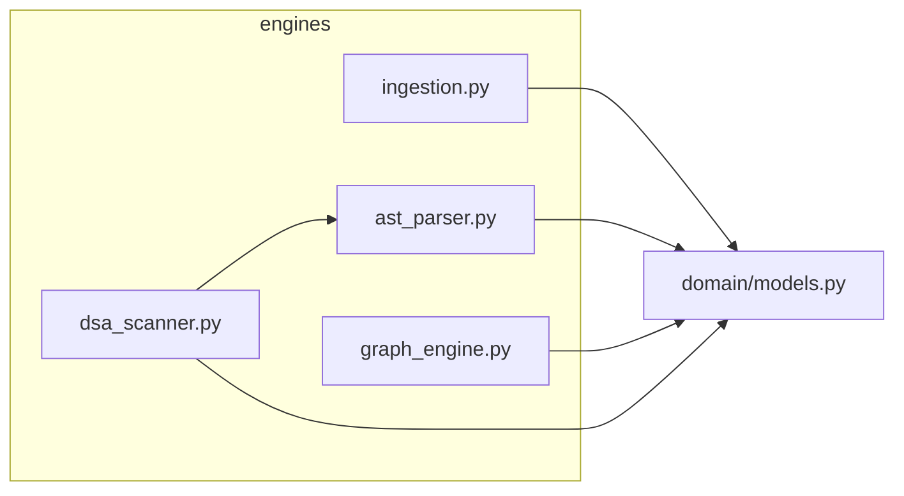
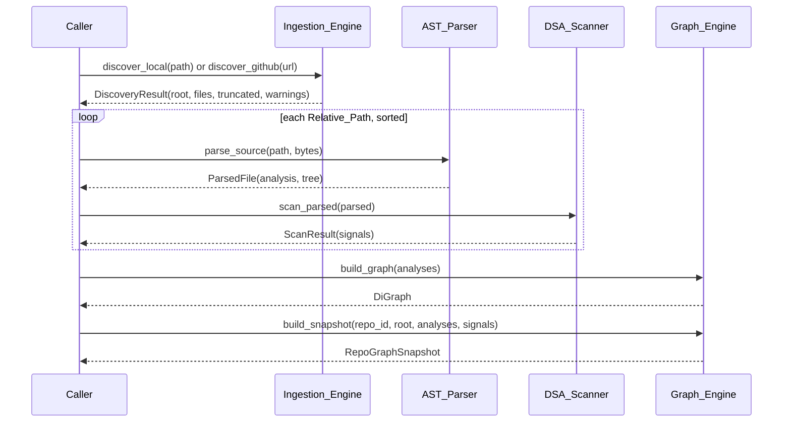

# Design Document

## Overview

Spec #01 adds the deterministic, offline, LLM-free static-analysis core of Stupid Code. It has five code units and one test configuration file:

| Unit | Path | Responsibility |
|---|---|---|
| Pytest_Config | `pytest.ini` | Root test discovery. |
| Domain_Models | `backend/domain/models.py` | Pure Pydantic v2 data contracts. |
| Ingestion_Engine | `backend/engines/ingestion.py` | Safe discovery of source files from a local directory or a public GitHub URL. |
| AST_Parser | `backend/engines/ast_parser.py` | Tree-sitter parsing, symbol/import/export/call extraction, normalized AST hash. |
| Graph_Engine | `backend/engines/graph_engine.py` | NetworkX graph, resolution, vital organs, cycles, blast radius, snapshot assembly. |
| DSA_Scanner | `backend/engines/dsa_scanner.py` | Structural DSA pattern detection with evidence. |

Everything is static. No analyzed file is executed, imported, or passed to a shell. Analyzed repositories are untrusted data.

### Research findings that shaped the design

Checked against the project's `.venv` (Python 3.14, networkx 3.7, tree-sitter 0.26, pytest 9.2):

1. **`tree-sitter-language-pack`** provides `get_parser(name)` for `python`, `typescript`, `javascript`, `tsx`, `java`. Parsing takes bytes. Node attributes used: `type`, `is_named`, `is_missing`, `has_error`, `start_byte`, `end_byte`, `start_point`, `children`, `child_by_field_name`. Anonymous tokens such as `async`, `=>`, and operators are children with `is_named == False`; the hash needs them.
2. **Decorator placement differs by grammar** (probed): Python wraps a definition in `decorated_definition` (field `definition`). TypeScript puts class decorators as `decorator` children of the enclosing `export_statement` (or of `class_declaration` if not exported) and method decorators as `decorator` siblings that precede the `method_definition` inside `class_body`. Java puts annotations (`marker_annotation`, `annotation`) inside a `modifiers` child.
3. **`nx.pagerank` fails in this environment.** networkx 3.7 requires NumPy/SciPy for it, and neither is installed or listed in `backend/pyproject.toml`. See Decision D1.
4. **Pytest ini precedence** was verified by running `pytest backend --collect-only` (see "pytest.ini consequences").

### Design decisions that go beyond the literal requirements

Each of these resolves a gap or a conflict. They are recorded so they can be confirmed or reversed.

| Id | Decision | Reason |
|---|---|---|
| D1 | PageRank is a small pure-Python power iteration inside `graph_engine.py` (alpha 0.85, tolerance 1e-10, at most 500 iterations, dangling mass spread uniformly). No SciPy dependency is added. | `nx.pagerank` needs SciPy, which is not a declared dependency. A fixed-order pure-Python loop is also bit-for-bit deterministic. Alternative: add `scipy>=1.11` to `pyproject.toml` and call `nx.pagerank`. |
| D2 | `SymbolNode.name` must equal the last dot-separated segment of `qualname` after removing one optional trailing `@<digits>` collision suffix. | Req 1.11 and Req 3.21 conflict: a deduplicated qualname `f@12` has last segment `f@12`, not `f`. |
| D3 | Relative_Path validation rejects `..` and `.` segments, as the glossary says. Req 1.12 names only `..`; the glossary is stricter. | The stricter rule satisfies both. |
| D4 | Ingestion, parser, and graph errors are exception classes defined in their own engine module, not in `domain`. Each ingestion error carries a `kind` enum member that identifies the cause. | Domain_Models must stay limited to the listed models. |
| D5 | Bare-name call resolution (Req 4.10, 4.11) matches any Symbol kind by `name`, and dotted callee text matches by exact Qualname. | This follows the requirement text literally. Java and JavaScript calls to sibling methods need it. |
| D6 | `from . import x` records `.` as the import. Resolution tries `<dir>/__init__.py`. Imported names are not recorded. | `FileAnalysis.imports` holds module specifiers only, so Req 4.11 matches by file, not by imported name. See "Call resolution". |
| D7 | `enum_declaration` and `record_declaration` in Java are emitted as kind `class`. | Their members need an enclosing Symbol for qualnames and exports. |
| D8 | Absolute Python imports and Java imports resolve by dotted suffix match against analyzed files (see "Import resolution"). | A repository analyzed from its root has `backend/engines/x.py`, but code imports `engines.x`. Ambiguous matches create no edge. |

## Architecture

Layering follows `.kiro/steering/architecture.md`. `domain` imports only the standard library and Pydantic. The three engines (`ingestion`, `ast_parser`, `graph_engine`, `dsa_scanner`) import `domain`, and `dsa_scanner` and `graph_engine` additionally import `ast_parser` types where stated. None import FastAPI, MCP, or frontend code. No file under `api`, `mcp_server`, `power`, `crew`, or `ui` is added or changed.



`graph_engine` consumes only `FileAnalysis` and `DSASignal` values from `domain`. It never touches Tree-sitter.

### Processing flow



The caller (a later delivery layer) reads file bytes from `DiscoveryResult.root / relative_path`. Spec #01 provides no orchestrator function. Tests perform this loop themselves. A read failure on one file is the caller's concern and does not occur in the engines because they take bytes.

### Determinism rules (apply to every engine)

- No randomness, clock, environment variable, or process id enters any output.
- Every list returned is explicitly sorted, or kept in source order where the requirement says so. Python `str` comparison (code-point order) is the only ordering used.
- Graph nodes and edges are inserted in sorted order, so `networkx` iteration order is a function of content only.

### pytest.ini consequences

`pytest.ini` content is exactly:

```ini
[pytest]
testpaths = backend/tests
pythonpath = .
```

Verified behavior:

- **`pytest` from the repository root.** The nearest ini file is the root `pytest.ini`. `backend/pyproject.toml` is ignored, so `asyncio_mode = "auto"`, `asyncio_default_fixture_loop_scope = "function"`, and `addopts = "-ra"` do not apply. `pythonpath = .` makes `backend.*` importable.
- **`pytest backend` from the repository root.** Pytest searches upward from the argument `backend`. It finds `backend/pyproject.toml` with a `[tool.pytest.ini_options]` table first, so that file wins. The rootdir becomes `backend`, and node ids lose the `backend/` prefix (confirmed: `tests/unit/test_health.py::...`). The same test files are collected, but the id strings differ from a root run.
- **Consequence for Req 1.3.** "The same set of test ids" holds only if ids are compared after resolving each id to an absolute file path plus the part after `::`. The verifying check does this normalization. If literal string equality is required, the root `pytest.ini` cannot give it without changing `backend/pyproject.toml`, which this spec does not do.
- **Consequence for async tests.** Spec #01 tests are all synchronous. Any future `async def` test run from the root runs without `asyncio_mode = "auto"` and would need `@pytest.mark.asyncio` or a root `pytest.ini` update. `-ra` is absent from root runs, so short summaries for skips and xfails are not printed there.

## Components and Interfaces

Signatures below are contracts, not code. Types are Python type names.

### Domain_Models (`backend/domain/models.py`)

Only `re`, `enum`, `typing`, and `pydantic` are imported. Every model uses `ConfigDict(frozen=True, extra="forbid")`. Scalar `int`, `str`, and `bool` fields use Pydantic strict scalar types so that `"5"` or `True` is not coerced (Req 1.30). Floats use `float` with `ge=0.0, le=1.0` where bounded, and booleans are rejected for them by a before-validator. The implementation must confirm that `model_validate_json(model_dump_json())` round-trips with these strict types.

Shared validated type `RelativePath` (an `Annotated[str, AfterValidator]`) applies D3 and Req 1.12: 1 to 4096 characters, no leading `/`, no `^[A-Za-z]:` prefix, no `\`, and no `.` or `..` segment when split on `/`.

Cross-field rules live in `model_validator(mode="after")` and field validators; see "Data Models".

### Ingestion_Engine (`backend/engines/ingestion.py`)

```text
discover_local(path: str, *, max_files: int = 500,
               max_total_bytes: int = 20_971_520) -> DiscoveryResult
discover_github(url: str, *, max_files: int = 500,
                max_total_bytes: int = 20_971_520,
                workspace: Path | None = None,
                git_runner: GitRunner = subprocess.run) -> DiscoveryResult
validate_github_url(url: str) -> GitHubRepoRef
build_clone_destination(ref: GitHubRepoRef, workspace: Path) -> Path
```

- `GitRunner` is any callable with the `subprocess.run` signature. Tests pass a recording double (Req 6.2). Production code passes `subprocess.run`.
- `workspace` defaults to `<project root>/data/repos`, where project root is found from `Path(__file__).resolve().parents[2]`. This is the Managed_Workspace.
- `validate_github_url` is a pure function and never touches the filesystem. `build_clone_destination` is separate and runs after it (Req 2.17).

Internal helpers (not public): `_walk(root)`, `_qualifies(entry)`, `_apply_limits(candidates, max_files, max_total_bytes)`, `_remove_inside(workspace, path)`.

### AST_Parser (`backend/engines/ast_parser.py`)

```text
parse_source(file_path: str, source: bytes) -> ParsedFile
parse_file(file_path: str, source: bytes) -> FileAnalysis      # parse_source(...).analysis
language_for_path(file_path: str) -> Language                  # raises UnsupportedLanguageError
compute_normalized_ast_hash(node: tree_sitter.Node) -> str
```

`ParsedFile` is a frozen dataclass in `ast_parser.py` (not a domain model, because it holds a Tree-sitter tree):

| Field | Type | Meaning |
|---|---|---|
| `analysis` | `FileAnalysis` | The domain result. |
| `source` | `bytes` | The UTF-8 bytes actually parsed (after replacement decoding, see below). |
| `root` | `tree_sitter.Node` | Tree root. |
| `symbol_nodes` | `dict[str, tree_sitter.Node]` | Symbol_Id to declaration node, used by the scanner. |

### Graph_Engine (`backend/engines/graph_engine.py`)

```text
build_graph(files: Sequence[FileAnalysis]) -> nx.DiGraph
compute_vital_organs(graph: nx.DiGraph, top_k: int = 10) -> list[str]
detect_cycles(graph: nx.DiGraph) -> list[list[str]]
trace_blast_radius(graph: nx.DiGraph, target_id: str, max_depth: int = 3) -> BlastRadius
build_snapshot(repo_id: str, root_path: str, files: Sequence[FileAnalysis],
               dsa_signals: Sequence[DSASignal]) -> RepoGraphSnapshot
```

`build_snapshot` calls `build_graph`, then reads its edges, `compute_vital_organs` with the default `top_k`, and `detect_cycles`.

### DSA_Scanner (`backend/engines/dsa_scanner.py`)

```text
scan_parsed(parsed: ParsedFile) -> ScanResult
scan_file(file_path: str, source: bytes) -> ScanResult      # unsupported extension -> skipped
scan_many(parsed_files: Sequence[ParsedFile]) -> ScanResult
```

`ScanResult` is a frozen dataclass: `signals: list[DSASignal]` (sorted) and `skipped: list[SkippedFile]`. `SkippedFile` has `file_path: str` and `reason: SkipReason` (`UNSUPPORTED_LANGUAGE`).

## Data Models

### Enums and aliases

| Name | Kind | Members (serialized value) |
|---|---|---|
| `Language` | `str, Enum` | `python`, `typescript`, `javascript`, `tsx`, `java` |
| `SymbolKind` | `str, Enum` | `function`, `method`, `class`, `interface`, `component` |
| `EdgeType` | `str, Enum` | `imports`, `calls` |
| `DSAChapter` | `Literal[...]` | `Hash Tables`, `Graphs & Trees`, `Recursion & Dynamic Programming`, `Sliding Window / Two Pointers`, `Heaps & Priority Queues`, `Sorting & Binary Search` |

Extension map: `.py` python, `.ts` typescript, `.js` javascript, `.tsx` tsx, `.java` java. Extensions are compared case-insensitively.

### Pydantic models

| Model | Fields (in declaration order, which fixes JSON key order) | Validation |
|---|---|---|
| `SymbolNode` | `id`, `name`, `qualname`, `kind`, `file_path` (RelativePath), `start_line`, `end_line`, `signature`, `ast_hash`, `decorators`, `is_async`, `raw_calls` | `id == file_path + "::" + qualname`. `start_line >= 1`. `end_line >= start_line`. `name` equals last `.` segment of `qualname` after stripping one trailing `@\d+` (D2). |
| `FileAnalysis` | `file_path` (RelativePath), `language`, `loc`, `ast_hash`, `imports`, `exports`, `symbols`, `parse_errors` | `loc >= 0`. Each symbol's `file_path` equals this `file_path`. Symbol ids unique. Lists are stored unchanged and in order. |
| `GraphEdge` | `source`, `target`, `edge_type` | Types only. |
| `BlastRadius` | `target_id`, `upstream_callers`, `downstream_callees`, `impact_score` | `0.0 <= impact_score <= 1.0`. |
| `DSASignal` | `symbol_id`, `file_path` (RelativePath), `start_line`, `end_line`, `chapter`, `pattern_name`, `confidence`, `evidence` | `start_line >= 1`, `end_line >= start_line`, `0.0 <= confidence <= 1.0`, `evidence` non-empty, every item has a non-whitespace character, `chapter` is a `DSAChapter` member. |
| `RepoGraphSnapshot` | `repo_id`, `root_path`, `files`, `edges`, `vital_organs`, `cycles`, `dsa_signals` | Types only. No field holds LLM output (Req 1.26). |

Serialization is `model_dump_json()` with no indent and no extra options, so key order follows declaration order and equal instances yield identical bytes. Enum members serialize as their string values.

`SymbolNode.ast_hash`, `FileAnalysis.ast_hash`, `signature`, `evidence` strings carry no further format validation. The parser guarantees a 64-character lowercase hex hash; the model does not enforce it.

### Engine-local types

```text
IngestionErrorKind (Enum): EMPTY_PATH, MALFORMED_PATH, NOT_FOUND, NOT_A_DIRECTORY, NOT_READABLE,
    INVALID_LIMIT, ROOT_FILESYSTEM_ERROR, URL_TOO_LONG, URL_BAD_SCHEME, URL_BAD_HOST,
    URL_FORBIDDEN_COMPONENT, URL_BAD_PATH, URL_BAD_OWNER, URL_BAD_REPO,
    DESTINATION_OUTSIDE_WORKSPACE, GIT_NOT_INSTALLED, GIT_FAILED, GIT_TIMEOUT, CLEANUP_FAILED
IngestionError(Exception): kind: IngestionErrorKind, message: str, detail: str | None
WarningKind (Enum): SYMLINK_ESCAPE, ENTRY_UNREADABLE
IngestionWarning (frozen dataclass): kind: WarningKind, path: str (Relative_Path), detail: str
GitHubRepoRef (frozen dataclass): owner: str, repo: str, clone_url: str
DiscoveryResult (frozen dataclass): root: Path, files: list[str], truncated: bool,
    warnings: list[IngestionWarning]

ParserError(Exception)
UnsupportedLanguageError(ParserError): extension: str
ParserInternalError(ParserError): message: str

GraphEngineError(Exception)
InvalidArgumentError(GraphEngineError)
MissingTargetError(GraphEngineError): target_id: str
InvalidInputError(GraphEngineError)
ConvergenceError(GraphEngineError)
```

The exception `kind` for URL rules maps one-to-one to the rules in Req 2.18 to 2.20, so a test can assert which rule fired. `URL_FORBIDDEN_COMPONENT` covers userinfo, port, query, fragment, extra path segments, encoded separators, whitespace, and control characters, and `detail` names which.

## Detailed Design

### Ingestion flow

**Local discovery (`discover_local`)**

1. Validate `max_files` and `max_total_bytes`: each must be an `int` (not `bool`) at least 1, else `INVALID_LIMIT`.
2. Reject `path` that is empty or only whitespace (`EMPTY_PATH`), contains a NUL character (`MALFORMED_PATH`), does not exist (`NOT_FOUND`), is not a directory (`NOT_A_DIRECTORY`), or fails `os.access(R_OK | X_OK)` (`NOT_READABLE`).
3. `Repo_Root = Path(os.path.realpath(path))`. A `scandir` failure on the root raises `ROOT_FILESYSTEM_ERROR`.
4. Walk iteratively (explicit stack, no recursion) with `os.scandir`. At each directory, entries are sorted by name. A set `visited_dirs` of real directory paths is seeded with `Repo_Root`.
5. For each entry, in this order:
   - A directory whose name is a Skipped_Directory is skipped at any depth.
   - A directory is entered only if its real path is inside `Repo_Root` and not in `visited_dirs`. A real path outside produces a `SYMLINK_ESCAPE` warning and is not entered. An already-visited real path is skipped silently.
   - A file with a non-supported extension is ignored.
   - A supported-extension file whose real path is outside `Repo_Root` produces a `SYMLINK_ESCAPE` warning and is excluded.
   - Size above 524288 bytes is skipped; exactly 524288 is kept.
   - A file whose first 8192 bytes contain `\x00` is skipped.
   - Any `OSError` while handling an entry below the root produces an `ENTRY_UNREADABLE` warning with the relative path and `errno` text, and the walk continues.
6. Qualifying entries are `(relative_posix_path, size)` pairs. They are sorted by path string, then limits are applied in order over the sorted list:
   - Stop at `max_files` entries. If more qualified, `truncated = True`.
   - Before adding a file, if `cumulative + size > max_total_bytes`, stop, drop it and all later files, and set `truncated = True`.
7. Warnings are sorted by `(path, kind.value)`. The result lists contain no duplicates because each path string is added once.

A repository with no qualifying files returns `files=[]`, `truncated=False`, no error (Req 2.29).

**GitHub discovery (`discover_github`)**

1. `validate_github_url(url)` runs first and may raise. It checks, in order: length at most 2048; no whitespace or control characters; scheme `https`; parsed host exactly `github.com` with no userinfo, port, query, or fragment; no `%` encoded separators (`%2f`, `%5c`, case-insensitive); path matches `/<owner>/<repo>` with an optional single trailing `/` and an optional `.git` suffix on `<repo>`; owner matches `[A-Za-z0-9_.-]{1,39}`; repo matches `[A-Za-z0-9_.-]{1,100}` after removing `.git`; neither equals `.` or `..`. The URL is parsed with `urllib.parse.urlsplit` only to inspect components; the clone URL is rebuilt from `owner` and `repo`, never reused from input.
2. `build_clone_destination` builds `workspace / owner / repo`, takes `os.path.realpath` of the result, and requires it to be inside `os.path.realpath(workspace)`. A failure raises `DESTINATION_OUTSIDE_WORKSPACE` before git runs.
3. If the destination exists, it is removed with `shutil.rmtree` only after the containment check in step 2 passes on the path being removed. A removal `OSError` raises `CLEANUP_FAILED`. The destination parent directory is created with `mkdir(parents=True, exist_ok=True)`.
4. The clone runs `git_runner(argv, ...)` once, with:
   - `argv = ["git", "-c", "core.hooksPath=" + os.devnull, "clone", "--depth", "30", "--single-branch", "--no-recurse-submodules", "--", clone_url, str(dest)]`
   - `shell=False`, `timeout=60`, `capture_output=True`, `stdin=subprocess.DEVNULL`, `check=False`
   - `env` copied from the process environment plus `GIT_TERMINAL_PROMPT=0`.
5. Outcomes: `FileNotFoundError` becomes `GIT_NOT_INSTALLED`. `subprocess.TimeoutExpired` becomes `GIT_TIMEOUT` (the standard `subprocess.run` kills the child before raising). A non-zero return code becomes `GIT_FAILED` with the first 500 characters of stderr in `detail`. In all three cases the partial destination is removed (using the same containment-checked removal) before the error is raised.
6. On success, `Repo_Root = dest` and the local walk steps 4 to 7 run on it. `git clone` is the only subprocess. No build, install, or repository script runs.

The total cost bound for a clone is the 60-second timeout; the 20 MB limit applies to discovered file sizes, not to the clone size.

### Tree-sitter static-analysis approach

#### Decoding and common mechanics

1. `language_for_path` lowercases the extension and maps it. An unknown extension raises `UnsupportedLanguageError` and nothing else happens.
2. `source.decode("utf-8", errors="replace")`, then `.encode("utf-8")`, gives the bytes that are parsed. Byte offsets from Tree-sitter therefore always align with the decoded text, and repeated parses of the same input are identical (Req 3.36).
3. One `Parser` per language is created lazily and cached in a module dict. Spec #01 is single-threaded, so no lock is used.
4. Any exception from grammar loading or parsing is wrapped in `ParserInternalError`. No partial `FileAnalysis` is returned (Req 3.35).
5. Tree traversal for hashing, symbol discovery, and error collection uses an explicit stack or `TreeCursor`, never recursion, so deeply nested files cannot hit the recursion limit.
6. `loc` counts lines from `re.split(r"\r\n|\n|\r", text)` that contain a non-whitespace character. Symbol and error line numbers are `node.start_point.row + 1` and `node.end_point.row + 1`, which Tree-sitter derives from `\n` only. A file that uses lone `\r` line breaks therefore reports symbol lines against `\n` rows. This is a known limitation, not handled further.
7. Parse errors: a pre-order walk reports each node with `type == "ERROR"` or `is_missing`. It does not descend into an `ERROR` node, so nested errors produce one entry. Entry text is `"line <n>: unexpected syntax"` for `ERROR` and `"line <n>: missing <type>"` for a missing node, with `n = min(max(row + 1, 1), line_count)` and `line_count = max(1, len(text.split("\n")))`. Entries are in source order.
8. A Symbol is kept only if `not declaration_node.has_error`. When the file has errors, the other Symbols are still emitted (Req 3.33).

#### Normalized AST hash algorithm

`compute_normalized_ast_hash(node)` returns `sha256(serialization).hexdigest()` (64 lowercase hex characters).

Serialization, built by an iterative pre-order traversal into a `bytearray`:

1. A node whose `type` is one of `comment`, `line_comment`, `block_comment` is skipped entirely, with its subtree.
2. For every other node with children, emit `(`, the grammar `type` encoded as UTF-8, then each remaining child serialization in order, then `)`.
3. For every other node without children (a leaf, including anonymous tokens such as `+`, `async`, `:`), emit `(`, the `type`, `:`, the decimal byte length of the token text, `:`, the exact token text bytes, then `)`.
4. A node with `is_missing` has `!` appended to its `type` in the output. An `ERROR` node is emitted as an ordinary node of type `ERROR`.

Why this satisfies the requirements:

- Whitespace and positions never enter the output (Req 3.11). Indentation matters only through the tree shape it produces, so Python indentation that changes block membership changes the hash (Req 3.13).
- The length prefix on leaf text and the explicit `(` and `)` make the serialization prefix-free, so two different tree shapes cannot collide by concatenation.
- Strings keep their exact text, so literal changes differ; only comment nodes are dropped. Python docstrings are `string` nodes and are kept.
- No random, clock, or process value is used (Req 3.14).
- An empty Python file hashes `(module)`; this is still a 64-hex string (Req 3.7).

File `ast_hash` is the hash of the root node. Symbol `ast_hash` is the hash of the Symbol's declaration node. For Python the declaration node is the `decorated_definition` when present (decorators are part of it), else the definition. For TypeScript and Java it is the `class_declaration`, `method_definition`, etc. node itself.

#### Per-language node types

Notation: `X.field` means `child_by_field_name("field")`.

**Python**

| Concept | Node types and rules |
|---|---|
| Function, method, class | `function_definition`, `class_definition`. Kind `method` if the nearest enclosing definition is a `class_definition`, else `function`. A `decorated_definition` wraps the definition via field `definition`. |
| Name / body | `name` field / `body` field. |
| Decorators | Each `decorator` child of `decorated_definition`, source text, in order. |
| Async | `function_definition` has a direct anonymous child of type `async`. |
| Calls | `call` node. `call.function` must be an `identifier` or an `attribute` chain whose leaves are all identifiers. Callee text is that node's text with whitespace runs collapsed. Other callees (calls on call results, subscripts, lambdas) are skipped. |
| Imports | `import_statement`: each `name` child, `dotted_name` text, or `aliased_import.name`. `import_from_statement`: `module_name` field text (`dotted_name`, or `relative_import` text such as `..pkg`). The imported names are not recorded (D6). |
| Exports | Module-level `assignment` (or `augmented_assignment`) whose left side is the identifier `__all__` and right side is a `list`. Each `string` child with a `string_content` child and no `interpolation` contributes its content. Anything else is ignored. |
| Signature | From the first non-decorator token of the declaration to the start of `body`, whitespace collapsed, trailing `:` removed. |
| Component | Not applicable. |

**TypeScript, JavaScript, TSX** (TS and TSX share node names; JavaScript has no type nodes)

| Concept | Node types and rules |
|---|---|
| Function | `function_declaration`, `generator_function_declaration`; and a `variable_declarator` whose `value` is `arrow_function` or `function_expression`, with the declarator `name` (identifier) as the Symbol name. For the declarator case the declaration node is the enclosing `lexical_declaration` or `variable_declaration`. |
| Method | `method_definition` inside `class_body`. |
| Class | `class_declaration`, `abstract_class_declaration`. |
| Interface | `interface_declaration` (TypeScript and TSX only). |
| Name / body | `name` field / `body` field. For an arrow function the signature runs to the end of the `=>` token. Without a body (abstract method) the signature is the whole node text without a trailing `;`. |
| Decorators | `decorator` children of the declaration node; for a class inside `export_statement`, the `decorator` fields of that `export_statement`; for a method, the consecutive `decorator` siblings immediately preceding it in `class_body`. Source text in source order. The Symbol line range starts at the first decorator. |
| Async | The declaration node (or the arrow/function expression for declarators) has a direct anonymous child of type `async`. |
| Calls | `call_expression`. `function` must be an `identifier`, `this`/`super` member, or a `member_expression` chain of identifiers (`this.a.b`, `obj.method`). Other callees are skipped. `new_expression` is not a call. |
| Imports | `import_statement.source` and `export_statement.source` (re-export `from`): the `string_fragment` text, without quotes. Dynamic `import()` and `require()` are not recorded. |
| Exports | `export_statement`: `declaration` field name(s) (function, class, interface name; each `variable_declarator` name for `export const`), `export_specifier` `alias` else `name`, `default` yields `default`, and `export * from` yields `*`. |
| Component | JavaScript and TSX only. A function or class Symbol whose name matches `^[A-Z]` and whose declaration node contains at least one descendant of type `jsx_element`, `jsx_self_closing_element`, or `jsx_fragment` gets kind `component` instead of `function` or `class`. Methods are never components. |

**Java**

| Concept | Node types and rules |
|---|---|
| Class | `class_declaration`, plus `enum_declaration` and `record_declaration` as kind `class` (D7). |
| Interface | `interface_declaration`. |
| Method | `method_declaration`, `constructor_declaration`, both kind `method`. A method without a body (abstract or interface method) takes the whole node text without `;` as its signature. |
| Annotations | The `marker_annotation` and `annotation` children of the node's `modifiers` child, source text in order. |
| Async | Always false. |
| Calls | `method_invocation`: text is `object.name` when an `object` field exists and is an identifier, `this`, `super`, or a `field_access` chain of identifiers; otherwise `name` alone when no `object` field exists; other callees skipped. `object_creation_expression` is not a call. Lambda bodies belong to the enclosing method. |
| Imports | `import_declaration`: text between `import` and `;` with `static ` removed, whitespace collapsed (for example `com.acme.Util`, `com.acme.*`). |
| Exports | Names of top-level class, interface, enum, and record declarations whose `modifiers` contains the token `public`. |

**Scope and qualnames (all languages).** A pre-order walk with a stack of enclosing Symbol names assigns `qualname = ".".join(enclosing + [name])`. A function nested in a function keeps the enclosing names, outermost first. A function whose nearest enclosing Symbol is a class is a `method` (Python, TypeScript). Symbols are appended in source order. Collision handling (Req 3.21) runs once after the walk: the first Symbol with a qualname is unchanged and each later one with the same qualname gets `@<start_line>` appended, which also becomes part of the prefix of its nested Symbols' qualnames because those are computed from the already-suffixed parent during a second ordered pass. `id` is `file_path + "::" + qualname`.

**`raw_calls`.** For each function or method, walk its body with an explicit stack, not descending into nested Symbol declaration nodes (nested functions, classes, methods), and collect callee texts in source order. Identical texts after the first are dropped.

**Imports and exports lists.** Collected into a `set`, then `sorted()` (Req 3.32).

### Graph construction

#### Edge-direction conventions

- `imports`: source is the importing file path, target is the imported file path (importer to imported).
- `calls`: source is the caller Symbol_Id, target is the callee Symbol_Id (caller to callee).
- Downstream means reachable by following edges forward. Upstream means reachable by following edges backward.

#### Node and edge construction

1. If two inputs share a `file_path`, raise `InvalidInputError` before building anything.
2. Sort inputs by `file_path`. Add each file node with attributes `node_type="file"`, `language`, `loc`. Then add each file's Symbol nodes in the order stored on the `FileAnalysis` with attributes `node_type="symbol"`, `kind`, `name`, `qualname`, `file_path`, `start_line`, `end_line`. Files are added first, then all Symbols, so every Symbol follows every file node in iteration order.
3. For each file in sorted order, resolve imports, add `imports` edges, then for each Symbol in order, resolve `raw_calls` and add `calls` edges. Edges are inserted in the order they are discovered; resolution never depends on input order beyond the sort above, so permuting the input yields an identical graph (Req 4.15).
4. Empty input yields a `DiGraph` with 0 nodes and 0 edges.

Because file ids and Symbol ids differ (`a/b.py` versus `a/b.py::f`), a file node and a Symbol node never collide, and `imports` and `calls` edges can never share a node pair.

#### Import resolution

Resolution is a pure function of the importing path, the specifier, and the set of analyzed file paths. A match yields at most one target; no match yields no edge, with no error (Req 4.8). A resolved target equal to the importing file produces no edge (Req 4.9). Duplicate resolutions to the same target produce one edge.

| Language | Rule |
|---|---|
| Python, relative (`.x`, `..a.b`, `.`) | Count leading dots `d`. Base directory is the importing file's directory, moved up `d - 1` levels. If the base goes above the root, no edge. Remainder is the dotted tail converted to `/`. Candidates in order: `<base>/<tail>.py`, `<base>/<tail>/__init__.py`. With an empty tail only `<base>/__init__.py`. First candidate in the file set wins. |
| Python, absolute (`a.b.c`) | `dotted = a/b/c`. Candidate files are those whose path, with the `.py` extension or trailing `/__init__.py` removed, equals `dotted` or ends with `/` + `dotted`. Exactly one candidate yields an edge (D8). Two or more yield none. |
| Java (`com.acme.Util`) | Same suffix rule with `com/acme/Util.java`. A wildcard import (`com.acme.*`) and a static member import produce no edge. |
| TS, JS, TSX with `./` or `../` | Join the specifier to the importing directory with `posixpath.normpath`. A result that begins with `..` is out of the root and yields no edge. Candidates in order: the exact path, then the path plus each of `.py`, `.ts`, `.js`, `.tsx`, `.java` in that order, then `<path>/index` plus each extension in that order. First candidate in the file set wins. |
| TS, JS, TSX bare specifier (`react`, `@x/y`) | Unresolved, no edge. |

An ESM specifier like `./x.js` that points at `x.ts` is not resolved; the requirement does not ask for it.

#### Call resolution

Indexes built once per graph: `by_file_name[file][name] -> list[Symbol_Id]`, `by_file_qualname[file][qualname] -> Symbol_Id`, and `imported_files[file] -> sorted list of resolved Import_Edge targets`.

For caller `S` in file `F` and each `raw_call` text `c`, apply the first rule that applies:

1. **`self.<name>` or `this.<name>`** (exactly one dot) and `S.kind == method`. Class qualname is `S.qualname` with its last `.` segment removed. The candidate is the Symbol with qualname `<class>.<name>` in `F`. One candidate yields an edge, none yields no edge. The call never falls through to the later rules (Req 4.12).
2. **Same file (Req 4.10).** If `c` contains no `.`, candidates are the Symbols in `F` with `name == c`. If `c` contains a `.`, the candidate is the Symbol in `F` with `qualname == c`. Exactly one candidate yields an edge. Two or more yield no edge and stop. Zero candidates fall to rule 3.
3. **Imported files (Req 4.11).** Over all files in `imported_files[F]`, collect candidates by the same name or qualname test. Exactly one candidate overall yields an edge. Zero or more than one yield none.

A call that resolves to the caller itself creates a self-loop edge (Req 4.14). Duplicate `(source, target)` pairs collapse to one edge. Since imported names are not stored (D6), rule 3 matches by file, which can produce an edge for a name that the import did not actually bring in. This is accepted and noted as a limitation.

### Vital-organs scoring

`compute_vital_organs(graph, top_k=10)`:

1. `top_k` is validated first: not an `int` (or a `bool`), or negative, raises `InvalidArgumentError`; the graph is never modified (Req 4.20). `top_k == 0` or an empty graph returns `[]`.
2. For every node `v` compute `pr(v)` (D1), `in_deg(v)`, `out_deg(v)` over all nodes and both edge types. A self-loop counts once in each degree.
3. Min-max normalize each of the three vectors over all nodes: `(x - min) / (max - min)`, and `0.0` for every node when `max == min` (Req 4.17).
4. `score(v) = 0.5 * pr_n(v) + 0.25 * in_n(v) + 0.25 * out_n(v)`, rounded to 12 decimals to avoid ordering by floating-point noise.
5. Sort by `(-score, node_id)` and return the first `top_k` ids.

PageRank (D1): nodes in `graph.nodes` order (deterministic), initial vector `1/N`, damping 0.85. Per iteration, each node's mass is spread over its out-neighbors equally; mass of nodes with no out-edges is spread uniformly; teleport term `(1 - 0.85) / N`. Stop when the L1 change is below `1e-10` or after 500 iterations. Not converging in 500 iterations raises `ConvergenceError`.

### Cycle detection

`detect_cycles(graph)` uses `nx.strongly_connected_components(graph)` (iterative in networkx, so no recursion-depth risk, linear time). For each component, keep it if it has more than one node or its single node has a self-loop (`graph.has_edge(n, n)`). Each kept component becomes `sorted(component)`. The result list is sorted lexicographically. The input graph is read-only. An acyclic or empty graph returns `[]`. The output depends only on the node and edge sets, not on insertion order (Req 4.25). The 5-second bound for 10,000 nodes and 50,000 edges is met by linear-time SCC.

### Blast radius

`trace_blast_radius(graph, target_id, max_depth=3)`:

1. Validate `max_depth` (an `int`, not `bool`, at least 0), else `InvalidArgumentError`. Then `target_id in graph`, else `MissingTargetError`.
2. Upstream: level-by-level breadth-first search over `graph.pred`, following only edges with `edge_type == "calls"`, with a `visited` set seeded with the target, running for at most `max_depth` levels. Downstream: the same over `graph.succ`.
3. Each result excludes the target (it is in `visited` from the start, which also bounds cycles and self-loops), has no duplicates, and is sorted ascending.
4. `max_depth == 0` runs zero levels, so both lists are empty and the score is 0.0.

**`impact_score` formula** (documented as required by Req 4.33). Let `u = len(upstream_callers)`, `d = len(downstream_callees)`, and `S` the number of nodes with `node_type == "symbol"`.

```text
impact_score = 0.0                                   if S == 0
impact_score = min(1.0, max(0.0, (2*u + d) / (3*S)))   otherwise
```

- *Bounds.* Both lists contain only Symbol nodes other than the target (`calls` edges join only Symbols), so `u <= S - 1` and `d <= S - 1`. Then `2u + d <= 3S - 3 < 3S`, so the value is below 1.0 whenever `S >= 1`. The `min` and `max` are defensive.
- *Zero when no Symbols.* Explicit branch.
- *Non-decreasing in upstream.* With `d` and `S` fixed, the expression is strictly increasing in `u`.
- *Weighting.* Upstream callers count double because they are the code that breaks if the target changes; downstream callees count once. This weighting is a design choice, not derived from the requirements.
- The result depends only on `u`, `d`, `S`.

If the target is a file node (no `calls` edges), both lists are empty and the score is 0.0.

### Snapshot assembly

`build_snapshot` sorts `files` by `file_path`; `edges` by `(source, target, edge_type.value)`; keeps `vital_organs` and `cycles` as returned by the functions above; and sorts `dsa_signals` by the tuple `(file_path, start_line, end_line, chapter, pattern_name, symbol_id, confidence, tuple(evidence))`. Edges come from `graph.edges(data="edge_type")`.

### DSA scanner

#### Scope and general mechanics

- Only Symbols with kind `function` or `method` are scanned. The scanner receives each Symbol's declaration node from `ParsedFile.symbol_nodes`. A Symbol is skipped if its declaration node `has_error` (Req 5.24).
- The scanned body excludes nested Symbol declarations, using the same walk as `raw_calls`. A nested function is scanned as its own Symbol.
- Syntax only: every predicate below tests node types, field names, and identifier text of nodes that exist in the tree. No regular expression decides a pattern. A pattern needing a construct that a grammar lacks is not applied for that language (Req 5.23).
- No scanner state is kept between Symbols. No random value is used.
- **Evidence format.** Each item is `"<construct description> at line N"` or `"<construct description> at lines A-B"`, where the lines are the 1-based lines of the matched node and lie within the Symbol's line range. Identifier text inside a description is cut to 40 characters, and the full item is cut to 200 characters with the line reference kept (the description is shortened, not the reference). At most 10 items are kept, in source order. Examples: `"while loop at lines 12-20 updating left, right"`, `"deque.popleft() call at line 14"`.
- **Confidence.** `confidence = TABLE[pattern][min(k, 3)]` where `k` is the number of independent evidence kinds present for that pattern (each kind is listed below and counted at most once, however many nodes match). Each table row is non-decreasing in `k`, values have two decimals, and the table is a module constant. The same inputs always give the same value.
- **Dedupe and order.** One signal per `(symbol_id, chapter, pattern_name)`. The result is sorted by `(file_path, start_line, chapter, pattern_name)` then `(end_line, symbol_id)` for a total order.
- **Skips.** `scan_file` with a non-supported extension returns no signals and one `SkippedFile(reason=UNSUPPORTED_LANGUAGE)`. A file with no function or method Symbols returns no signals and no error.

#### Shared predicates

| Name | Definition |
|---|---|
| `in_loop(n)` | `n` has an ancestor, inside the Symbol, of type: Python `for_statement`, `while_statement`, `list_comprehension`, `set_comprehension`, `dictionary_comprehension`, `generator_expression`; TS/JS `for_statement`, `for_in_statement`, `while_statement`, `do_statement`; Java `for_statement`, `enhanced_for_statement`, `while_statement`, `do_statement`. |
| `collections` | Local names bound in the Symbol to a creation expression. Creation expressions per language are in the Hash Tables row. Binding is `assignment` (Python), `variable_declarator` (TS/JS/Java), with an identifier on the left. |
| `self_call(n)` | A call node whose callee text equals the Symbol `name`; for methods also `self.<name>` (Python), `this.<name>` (TS/JS/Java), and bare `<name>` in Java. |
| `conditional(n)` | `n` has an ancestor, inside the loop, of type `if_statement`, `elif_clause`, `else_clause`, `conditional_expression`, or `ternary_expression`. |

#### Rule table

Evidence kinds are written in brackets. "R" marks a kind required for the pattern to emit; "O" marks an optional kind that raises `k`.

| Chapter | Pattern name | Trigger (all R kinds) and optional kinds | Languages |
|---|---|---|---|
| Hash Tables | `hash-table lookup` | R: [create] a dict, set, or map is created in the Symbol. R: [lookup-in-loop] inside `in_loop`, a membership test or read on that name. O: [populate] an insert or set on that name. | All |
| Hash Tables | `frequency counting` | R: [create]. R: [count-update] a counting update on that name. O: [in-loop] the update is inside `in_loop`. | All |
| Hash Tables | `de-duplication` | R: [create-set] a set is created. R: [dedupe-use] either `if x not in s` then `s.add(x)` style guarded add, or the set converted back to a sequence (`list(set(...))`, `sorted(set(...))`, `Array.from(new Set(...))`, `[...new Set(...)]`). O: [in-loop] the guarded add is in a loop. | All |
| Graphs & Trees | `queue-based traversal` | R: [queue-pop] inside `in_loop`, `popleft()` on a `deque`, `pop(0)`, `shift()`, or Java `poll()`/`remove()` on a name created as `ArrayDeque`, `LinkedList`, or `Queue`-typed. O: [visited] a visited collection tested and added to. O: [neighbor-iteration] a loop over a subscript or attribute of the popped value. | All (JS `shift`, Java `poll`) |
| Graphs & Trees | `stack-based traversal` | R: [stack-pop] inside a `while` loop, `pop()` with no argument on a list/stack name that the loop also pushes to. R: [visited]. O: [neighbor-iteration]. | All |
| Graphs & Trees | `recursive node traversal` | R: [self-call]. R: [child-access] the call arguments or the iterable of the enclosing loop access an attribute or subscript named `left`, `right`, `children`, `child`, `neighbors`, `neighbours`, `adj`, `adjacency`, `successors`. O: [visited] a visited collection is tested. | All |
| Recursion & DP | `direct recursion` | R: [self-call]. O: [base-case] an `if` containing `return` precedes the first self-call. O: [multi-call] two or more self-call sites. | All |
| Recursion & DP | `memoization` (decorator) | R: [cache-decorator] a decorator `lru_cache`, `functools.lru_cache`, `cache`, `functools.cache`, with or without a call. O: [self-call]. | Python |
| Recursion & DP | `memoization` (manual) | R: [self-call]. R: [memo-lookup] before the first self-call line, a membership test, `get`, `has`, `containsKey`, or subscript read on a name `m`. R: [memo-store] after the first self-call line, a store (`m[k] = v`, `set`, `put`) on the same name `m`. | All |
| Heaps & PQ | `heapq operations` | R: [push-or-pop] a call to `heappush`, `heappop`, `heappushpop`, or `heapreplace`, as `heapq.<fn>` or as a bare name when the file has an import whose specifier is `heapq`. O: [push] and [pop] both present. O: [heapify] `heapify` call. | Python |
| Heaps & PQ | `priority queue usage` | R: [pq-create] creation of `PriorityQueue`, `MinHeap`, `MaxHeap`, or `MinPriorityQueue`, `MaxPriorityQueue` (`queue.PriorityQueue` in Python; `new X(...)` in TS/JS/Java). R: [pq-op] a put-like call (`put`, `push`, `enqueue`, `add`, `offer`, `insert`) or get-like call (`get`, `pop`, `dequeue`, `poll`, `peek`, `extractMin`, `extractMax`) on that name. O: [put] and [get] both present. | All |
| Sorting & BS | `bisect usage` | R: [bisect-call] `bisect`, `bisect_left`, `bisect_right`, `insort`, `insort_left`, `insort_right` called as `bisect.<fn>` or as a bare name with an import specifier `bisect`. O: [second-site] a second distinct call site. | Python |
| Sorting & BS | `binary search` | R: [midpoint] an assignment whose value is `(a + b) // 2`, `a + (b - a) // 2`, `(a + b) >> 1`, `(a + b) >>> 1`, `Math.floor((a + b) / 2)`, or (Java) `(a + b) / 2`, inside `in_loop`; `a` and `b` are identifiers, the boundary variables. R: [narrow] inside the same loop, an assignment to `a` or `b` located under `conditional` whose condition contains a comparison. O: [loop-condition] the loop condition compares `a` and `b`. | All |
| Sorting & BS | `custom sort key` | R: [sort-call] `sorted(...)`, `<x>.sort(...)`, `Collections.sort(...)`, `Arrays.sort(...)`. R: [key-function] the call has a `key=` keyword whose value is a `lambda` or identifier (Python), or an `arrow_function`, `function_expression`, `lambda_expression`, `method_reference`, or `Comparator.comparing(...)` call argument. O: [cmp-to-key or nested-def] the key is a `cmp_to_key(...)` call or a function defined in the Symbol. | All |
| Sliding Window / Two Pointers | `two pointers` | R: [pointer-init] two identifiers `a` and `b` initialized before the loop to opposite ends (`0` and `len(x) - 1`, `n - 1`, `x.length - 1`, `x.size() - 1`) or to a shared start (equal expressions); a `for` loop counter that starts at 0 counts as an initialization. R: [conditional-move] at least one of them is incremented or decremented under `conditional` inside the loop (`+= 1`, `-= 1`, `= a + 1`, `a++`, `--b`). R: [same-sequence] both are used as the index of subscripts or `charAt`/`get` calls on the same sequence identifier inside the loop. O: [loop-condition] the loop condition compares `a` and `b`. | All |

Rule-to-requirement mapping: Hash Tables rows implement Req 5.6 and 5.7; Graphs & Trees rows implement 5.8 and 5.9; Recursion rows implement 5.10 to 5.12; Heaps rows implement 5.13 and 5.14; Sorting rows implement 5.15 and 5.16; Two Pointers implements 5.17 and 5.18; no row matching yields zero signals (5.19, 5.20).

Why the look-alikes stay silent:

- A dict or set literal that is only returned has no [lookup-in-loop], no [count-update], no [dedupe-use].
- Nested loops over plain sequences have no queue pop, no stack pop with visited, and no self-call with child access.
- A function that calls other functions has no [self-call].
- An import of `heapq` or `queue` without a call has no [push-or-pop] and no [pq-op].
- A midpoint without a narrowing assignment under a comparison has no [narrow].
- Two variables not both used as indices of the same sequence lack [same-sequence].

#### Confidence table

`TABLE[pattern]` gives confidence for `k = 1, 2, 3` (a dash means the pattern cannot reach that `k`, because its required kinds already make `k` at least that number).

| Chapter | Pattern name | k=1 | k=2 | k=3 |
|---|---|---|---|---|
| Hash Tables | `hash-table lookup` | - | 0.70 | 0.85 |
| Hash Tables | `frequency counting` | - | 0.75 | 0.90 |
| Hash Tables | `de-duplication` | - | 0.70 | 0.85 |
| Graphs & Trees | `queue-based traversal` | 0.60 | 0.75 | 0.90 |
| Graphs & Trees | `stack-based traversal` | - | 0.65 | 0.80 |
| Graphs & Trees | `recursive node traversal` | - | 0.70 | 0.85 |
| Recursion & DP | `direct recursion` | 0.80 | 0.90 | 0.95 |
| Recursion & DP | `memoization` (decorator) | 0.85 | 0.90 | - |
| Recursion & DP | `memoization` (manual) | - | - | 0.90 |
| Heaps & PQ | `heapq operations` | 0.80 | 0.90 | 0.95 |
| Heaps & PQ | `priority queue usage` | - | 0.75 | 0.90 |
| Sorting & BS | `bisect usage` | 0.85 | 0.90 | - |
| Sorting & BS | `binary search` | - | 0.80 | 0.90 |
| Sorting & BS | `custom sort key` | - | 0.65 | 0.80 |
| Sliding Window / Two Pointers | `two pointers` | - | - | 0.75 (k=3), 0.90 (k=4) |

For `two pointers`, `k` counts the three required kinds plus the optional loop-condition kind, so the table uses `k=3` and `k=4`. For every other pattern `k` is clamped to at most 3. Both memoization rows share the pattern name `memoization`; the decorator row and the manual row never both fire for one Symbol, and if both match the higher confidence is kept and the evidence is merged.

#### Language applicability

| Language | Rules applied |
|---|---|
| Python | All rows. |
| TypeScript, JavaScript, TSX | Hash Tables (`Map`, `Set`, `.has`, `.get`, `.set`, `.add`), Graphs & Trees (`shift`, `pop`, recursive), Recursion (direct and manual memo), Priority queue usage, binary search, custom sort key, two pointers. Not: `heapq`, `bisect`, decorator memoization. |
| Java | Hash Tables (`HashMap`, `HashSet`, `LinkedHashMap`, `LinkedHashSet`, `ConcurrentHashMap`, `Hashtable`: `containsKey`, `contains`, `get`, `getOrDefault`, `put`, `merge`, `add`), Graphs & Trees (`poll`, `pop`, recursive), Recursion (direct and manual memo), Priority queue usage (`PriorityQueue`), binary search, custom sort key, two pointers. Not: `heapq`, `bisect`, decorator memoization. |

Counting updates by language: Python `d[k] += n`, `d[k] = d.get(k, 0) + n`, `Counter(...)` followed by update, `setdefault`; TS/JS `m.set(k, (m.get(k) ?? 0) + n)`, `m[k] = (m[k] || 0) + n`, `m[k]++`; Java `m.merge(k, 1, ...)`, `m.put(k, m.getOrDefault(k, 0) + n)`.

### Safety boundaries

- **No execution.** Nothing from an analyzed repository is imported, evaluated, compiled, or run. The only subprocess in the whole spec is `git clone` with an argument list, `shell=False`.
- **Path containment.** Local discovery resolves real paths and excludes anything that resolves outside `Repo_Root`. Clone destinations are verified inside the Managed_Workspace before cloning and before any removal. Removal never targets a path that fails the check.
- **URL strictness.** A URL is validated structurally and rebuilt from parsed owner and repo. No user string reaches an argument list except `owner` and `repo` after regex validation, and a `--` guard precedes them.
- **Git hardening.** `core.hooksPath` points at the null device, submodules are not recursed, prompts are disabled, depth is 30, a single branch, and a 60-second timeout.
- **Size and count guardrails.** 512 KB per file, 500 files, 20 MB total (configurable, validated), binary files skipped by NUL probe, symlink cycles blocked by the visited-directory set.
- **Untrusted text.** Source text appears only inside parser output fields and evidence strings. Nothing is interpolated into a command, query, or template.
- **Resource safety in parsing.** Iterative traversal everywhere avoids recursion limits on hostile deeply nested inputs.

## Correctness Properties

*A property is a characteristic or behavior that should hold true across all valid executions of a system-essentially, a formal statement about what the system should do. Properties serve as the bridge between human-readable specifications and machine-verifiable correctness guarantees.*

Reflection on redundancy: the prework found four criteria groups that vary meaningfully with input and cost little to run many times: hash invariance (3.10 to 3.12, 6.11), hash sensitivity (3.13, 6.12), cycle detection and graph integrity (4.21 to 4.25, 6.13), and blast-radius monotonicity (4.26 to 4.29, 6.14). Invariance and sensitivity are not redundant: invariance would pass for a constant hash, and sensitivity would pass for a hash of the raw text. Cycle correctness, termination, and order independence are merged into one property because they run over the same generated graphs. Every other criterion is covered by example or edge-case tests, listed in the Testing Strategy.

### Property 1: AST hash is invariant under formatting and comment changes

*For any* generated valid Python function source and *for any* transformation that changes only whitespace, blank lines, consistent indentation width, spacing around operators and commas, or `#` comments (and that changes the text in every generated case), the source parses with no `parse_errors` and the file `ast_hash` and every Symbol `ast_hash` of the transformed source equal those of the original.

**Validates: Requirements 3.10, 3.11, 3.12, 6.11**

### Property 2: AST hash changes when an operator or identifier changes

*For any* generated valid Python function source and *for any* single replacement of one binary or comparison operator with a different valid operator, or of one identifier use with a different valid non-keyword identifier, the changed source parses with no `parse_errors` and its file `ast_hash` and the enclosing Symbol `ast_hash` differ from the original's.

**Validates: Requirements 3.13, 6.12**

### Property 3: Cycle detection terminates, is correct, and is independent of insertion order

*For any* generated finite directed graph (including empty, disconnected, dense, self-loop, and multi-cycle graphs, with every edge carrying an `edge_type` of `imports` or `calls`), `detect_cycles` returns; every reported cycle is a sorted list of nodes that all belong to the graph; the set of nodes appearing in reported cycles equals the set of nodes that can reach themselves through at least one edge (computed by an independent reachability oracle); each reported cycle is one mutual-reachability class; the list is sorted; every edge endpoint is a graph node; and rebuilding the graph with the nodes and edges in any permuted order returns an identical result.

**Validates: Requirements 4.3, 4.21, 4.22, 4.24, 4.25, 6.13**

### Property 4: Adding a caller edge never shrinks the upstream set

*For any* generated call graph, target node, and `max_depth`, and *for any* new `calls` edge from a node outside the target's current upstream set (and not the target) to a node inside that upstream set or to the target itself, the `upstream_callers` returned after adding the edge is a superset of the `upstream_callers` returned before, both lists remain sorted and duplicate-free, and neither contains the target.

**Validates: Requirements 4.26, 4.27, 4.28, 4.29, 6.14**

## Error Handling

| Condition | Behavior |
|---|---|
| Invalid local path, bad limits | `IngestionError` with the matching `kind`; no file list. |
| Bad GitHub URL | `IngestionError` (`URL_*` kind) before any directory or git call. |
| Destination outside workspace | `DESTINATION_OUTSIDE_WORKSPACE`; git not invoked. |
| Git missing, non-zero exit, timeout | `GIT_NOT_INSTALLED`, `GIT_FAILED`, `GIT_TIMEOUT`; partial clone removed; no file list. |
| Removal of existing or partial clone fails | `CLEANUP_FAILED`. |
| Unreadable single entry | Skipped, `ENTRY_UNREADABLE` warning, discovery continues. |
| Symlink resolving outside root | Excluded, `SYMLINK_ESCAPE` warning. |
| Unsupported extension in parser | `UnsupportedLanguageError(extension)`. |
| Syntax errors in source | Not an exception. `parse_errors` populated, valid Symbols retained, hashes and lines still valid. |
| Grammar load failure or unexpected Tree-sitter exception | `ParserInternalError`; never recorded in `parse_errors`. |
| Duplicate file path in graph input | `InvalidInputError`; no graph. |
| Negative `top_k`, invalid `max_depth` | `InvalidArgumentError`; graph unchanged. |
| Unknown blast-radius target | `MissingTargetError`. |
| PageRank does not converge in 500 iterations | `ConvergenceError`. |
| Invalid domain data | Pydantic `ValidationError` naming the field; no object created. |
| Unresolvable import or call | No edge, no error. |
| Unsupported file in scanner | Zero signals and a `SkippedFile` entry. |

All engine-specific exceptions carry a machine-readable member (`kind`, `extension`, `target_id`) so callers and tests never parse message text.

## Testing Strategy

### Approach

Dual approach. Property-based testing applies to this feature because the hash, cycle, and traversal logic is pure and has universal invariants. It does not apply to filesystem walking, git cloning, Tree-sitter fixtures, or the DSA rule table; those use example-based tests.

- **Library:** `hypothesis` for properties, `pytest` for everything else. No property framework is written from scratch.
- **Layout:** unit tests in `backend/tests/unit/test_ast_graph_engine.py`; property tests in `backend/tests/properties/test_ast_graph_properties.py`. No other test file is added.
- **Hypothesis settings:** a shared profile with `derandomize=True`, `max_examples=100` at minimum, no `deadline` override, no `suppress_health_check`. Generators are written to avoid health-check failures instead.
- **Tags:** each property test has a comment `Feature: 01-ast-graph-engine, Property N: <property text>`. Each property is exactly one `@given` test.
- **Offline:** an autouse fixture in the test modules replaces `socket.socket.connect` and `subprocess.run`/`Popen` with failing stubs, sets `LLM_PROVIDER=mock`, and tests never read `.env`. Clone tests pass a recording `git_runner` double. No test contacts GitHub.

### Generators for the four properties

- **Python snippets (Properties 1 and 2).** A small expression and statement model (names from a fixed identifier pool excluding Python keywords; integer literals; binary operators `+ - * // %`; comparisons `< <= > >= == !=`; statements: assignment, `return`, `if`/`else`, `while`). A renderer turns the model into source with a style record (indent width 2, 4, or 8 spaces; spacing around operators; blank-line count; comment placement).
  - Property 1 renders the same model with two different style records and always appends at least one comment, so the texts differ in every case, which the test asserts.
  - Property 2 chooses one operator node or one identifier use and replaces it from the same class (a different operator, or a different pool identifier), re-renders with the same style, and asserts zero `parse_errors` before comparing hashes.
- **Digraphs (Property 3).** A strategy drawing a node count from 0 to 40 and one of several shapes: empty, sparse random, dense, only self-loops, chains closed into one or more cycles, disjoint components. Edges get a random `edge_type`. A permutation strategy shuffles node and edge insertion order for the reorder check. The oracle computes self-reachability by depth-first search from each node's successors.
- **Call graphs (Property 4).** A strategy that, in at least half of the draws, plants a chain of 1 to 4 callers into the target before adding random edges, so the target has an upstream path in well over 30% of cases. The test then picks the new edge from a candidate list; if no candidate exists the example is discarded by `assume`, which only happens for fully saturated graphs. A companion unit test samples the strategy under the same derandomized settings and asserts at least 30% of draws have a non-empty upstream set (Req 6.14). `max_depth` is drawn from 0 to 5.

### Unit tests (example and edge-case)

- **Domain_Models.** Enum values; valid construction of every model; each validator accept and reject boundary (`start_line` 0 and 1, `end_line` below start, `impact_score` and `confidence` at -0.0001, 0.0, 1.0, 1.0001; empty and whitespace evidence; unknown chapter; id mismatch; name versus last segment, including an `@12` suffix; duplicate Symbol ids; foreign `file_path` in a Symbol; negative `loc`); required-field and wrong-type errors naming the field; JSON round trip and byte-identical dumps for every model; empty lists; partial analysis retaining both lists.
- **Ingestion.** `tmp_path` trees for skipped directories, binary skip, 524287 / 524288 / 524289 byte files, count truncation, total-size truncation, sorted output, repeat-run equality, symlink escape and symlink loop, invalid and unreadable paths, bad limits. URL accept and reject tables, one case per rejection rule, asserting the runner double is never called on reject. Destination containment. The recorded argv and kwargs of the clone call, non-zero exit, missing git, timeout, partial-clone removal, existing-clone replacement, and removal failure.
- **AST_Parser.** At least one fixture per language (Python, TypeScript, JavaScript, TSX, Java) asserting language, symbols, qualnames, signatures, line ranges, imports, exports, `raw_calls`, decorators or annotations, async status, `loc`, hash shape, and syntax-error recovery. Where a behavior does not apply to a language (for example Java async), the test asserts the absence. Hash tests for identical source, formatting-only change, comment-only change, and operator, identifier, and structural change. Empty file. Non-UTF-8 bytes. Injected parser failure raising `ParserInternalError`. Qualname collision suffixing.
- **Graph_Engine.** Import edges per language rule, relative-import dot arithmetic, extension and `index` order, unresolved imports, no self-import; call edges for same-file, imported, `self`/`this`, ambiguous, unresolved, and self-recursive cases; edge direction; permutation invariance; vital organs score arithmetic on a hand-computed graph, tie-breaking, empty graph, `top_k` 0 and negative; cycles including self-loops and acyclic input; a seeded 10,000-node, 50,000-edge cycle timing test; blast-radius exact lists, depth limits, depth 0, cycles through the target, missing target, negative depth, and `impact_score` bounds, zero-symbol case, and monotonicity in `u` on a table of inputs; duplicate file error; empty input; snapshot ordering.
- **DSA_Scanner.** For each of the six chapters at least one positive fixture and one negative look-alike (see the look-alike list above), plus negative fixtures for CRUD, routing, configuration, plain loops, and simple transforms. A failing negative fixture reports the fixture name and the unexpected signal. Evidence line numbers lie within the Symbol range and each item is at most 200 characters with at most 10 items. Confidence values match the table, are non-decreasing in `k`, and appear in sorted output. Parse-error file still scans valid Symbols. Unsupported language is reported as skipped. A file without functions yields zero signals.

### Smoke checks

Parse `pytest.ini` and confirm only `testpaths` and `pythonpath`. Run collection from the root and with `pytest backend`, comparing ids after path normalization (see "pytest.ini consequences"). Run `pytest` from the root and `ruff check backend` with zero violations. Confirm no file is added under `api`, `mcp_server`, `power`, `crew`, or `ui`.
