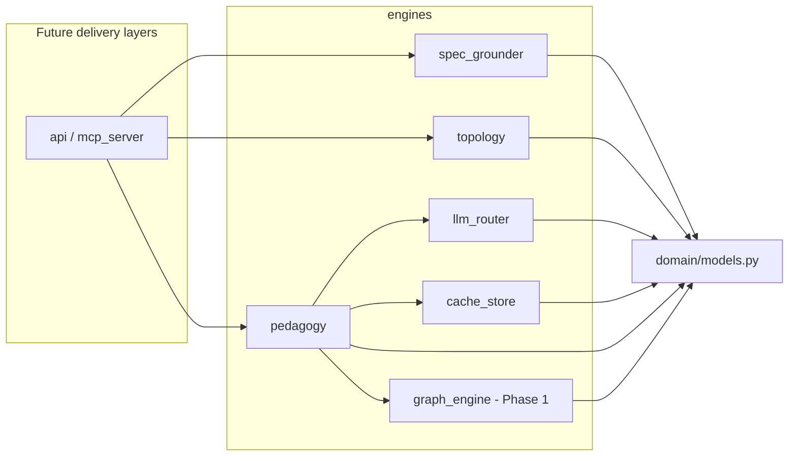
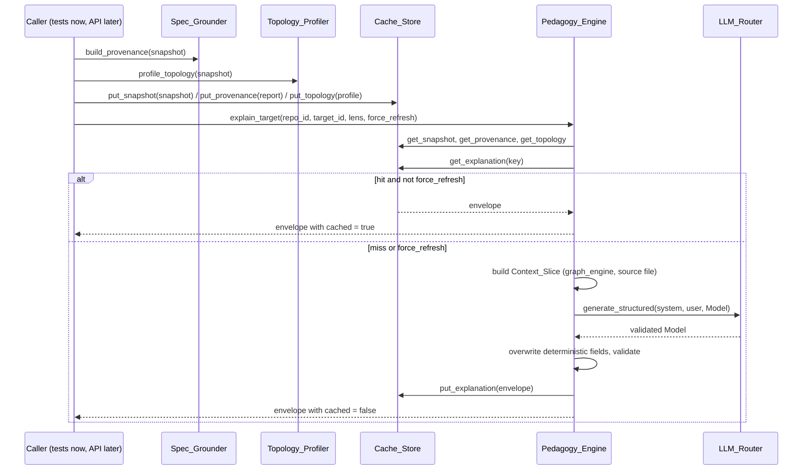
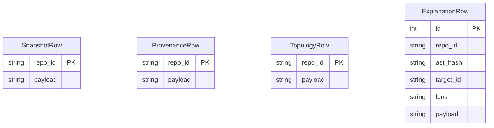

# Design Document

## Overview

Spec #02 adds five engines and 13 domain models on top of the Phase 1 foundation (Spec #01). All five engines are deterministic except the provider calls inside `llm_router.py`.

| Module | Responsibility |
|---|---|
| `backend/domain/models.py` (appended) | 13 strict, frozen schemas for provenance, topology, and pedagogy |
| `backend/engines/spec_grounder.py` | Reads Kiro specs and Git history, produces `ProvenanceReport` |
| `backend/engines/topology.py` | Scores five architecture patterns from Snapshot structure, produces `TopologyProfile` |
| `backend/engines/llm_router.py` | One typed entry point, `generate_structured`, over `mock`, `gemini`, `ollama` |
| `backend/engines/cache_store.py` | SQLModel/SQLite store keyed by `(repo_id, ast_hash, target_id, lens)` |
| `backend/engines/pedagogy.py` | Builds a minimal context slice, calls the router, validates, caches |

### Research findings that shaped the design

Findings come from inspecting the repository, not from the web. Library versions were read from `.venv`: pydantic 2.14, pydantic-settings 2.16, sqlmodel 0.0.50, google-genai 3.6, openai 3.57, hypothesis 6.170, pytest-asyncio 1.5.

1. **Direct callers and callees need no Phase 1 change.** `graph_engine.trace_blast_radius(graph, target_id, max_depth=1)` runs a BFS over `calls` edges only and returns sorted, de-duplicated `upstream_callers` and `downstream_callees`. With `max_depth=1` this is exactly "call depth 1" (Requirement 12.4, 12.5, 14.1). `build_graph(snapshot.files)` is deterministic and rebuilds the graph from the Snapshot without re-parsing.
2. **`DSASignal` spans the whole symbol.** `dsa_scanner` merges matches per `(chapter, pattern_name)` per symbol and copies the symbol's `start_line` and `end_line` into the signal. There is at most one signal per `(symbol_id, chapter, pattern_name)`. DSA card mapping therefore needs no line arithmetic.
3. **Import edges are file to file, call edges are symbol to symbol.** `build_graph` adds `imports` edges between `file_path` nodes and `calls` edges between symbol ids. `RepoGraphSnapshot.edges` carries both, so topology filters on `edge_type == "imports"`.
4. **`pytest.ini` at the repository root wins.** It currently has no `asyncio_mode`. Requirement 17.1 adds it. `pytest-asyncio` 1.5 does not combine with `async def` Hypothesis tests, so the property tests are synchronous and call `asyncio.run(...)` inside the test body.
5. **`.gitignore` ignores `*.db-wal` and `*.db-shm` but not `*.db`.** A default database at `./data/stupid_code.db` would be committed by accident. The design adds one `data/*.db` line (see Non-engine file changes).
6. **`domain` may not import `pydantic-settings`.** Requirement 1.12 limits `domain` to the standard library and Pydantic, and `.kiro/steering/architecture.md` keeps providers out of `domain`. Settings classes therefore live in the engines.

### Design decisions that go beyond the literal requirements

| # | Decision | Reason |
|---|---|---|
| D1 | Link evidence is attributed to the innermost section whose own text contains it (text between that heading and the next heading of any level). The excerpt is still cut from the full Spec_Section text. | A level-1 heading would otherwise link every file mentioned anywhere beneath it, with excerpts that do not contain the match. |
| D2 | A bare symbol name or a module stem is evidence only when it is unique in the Snapshot (and a stem has length 4 or more). | Names such as `get`, `main`, `index` would otherwise link unrelated files. Requirement 4 asks for conservative output. |
| D3 | L3 targets are the `repo_id` or a directory key of `TopologyProfile.directory_roles`. Any other L3 target raises `PedagogyError(unknown_target)`. | Requirement 12.3 only covers L1 and L2. L3 needs the same guard. |
| D4 | The engine overwrites every deterministic field of the LLM result (`target_id`, `language`, `topology_pattern`, callers, callees, DSA card numbers, `step_number`, `spec_rationale` when no links exist), then re-validates the whole object. | The LLM only phrases text (Requirement 14.9, 15.1, 15.6). |
| D5 | `L2FlowExplanation` carries `llm_content_available: StrictBool = True`, the single additive field beyond the user's field list. | Requirement 14.10 requires a degraded result to "indicate that LLM-generated content is unavailable". No listed field can carry that signal: `why_used_here == ""` and `execution_steps == []` also occur in valid results. The default keeps every instance built from the listed fields valid. |
| D6 | Stale cache rows for an old `ast_hash` are kept, not deleted. | The unique key already includes `ast_hash`, so a changed hash is a miss. Keeping the row lets a reverted edit hit again. Growth is bounded by distinct hashes per target. |
| D7 | `LLMRouter` validates configuration in `__init__`. | A bad provider name or missing key fails at start-up, before any call (Requirement 9.4, 9.5, 10.10). |
| D8 | The cache and the graph rebuild are synchronous calls made from `async def explain_target`. | SQLite calls on a local file take microseconds to milliseconds. Threading them adds failure modes (shared in-memory connection). |

## Architecture



Import graph rules, checked by one unit test with `ast`:

- No module in this spec imports `fastapi`, `mcp`, or another module of this spec that would create a cycle. The only intra-spec engine imports are `pedagogy -> cache_store` and `pedagogy -> llm_router` (for `LLMRouterError`). `spec_grounder`, `topology`, `llm_router`, and `cache_store` import `domain` only.
- `domain/models.py` imports only `re`, `enum`, `typing`, `math`, and `pydantic`.
- No module calls `exec`, `eval`, `compile`, `importlib.import_module` on analyzed content, or `subprocess` (except `spec_grounder`, for the single fixed `git log`).

### Flow



No orchestrator function that runs ingestion through caching is added. That belongs to the delivery layer.

## Phase 1 Change Log

**No Phase 1 file is modified.** Specifically:

| Phase 1 item | Change | Justification |
|---|---|---|
| `backend/domain/models.py` (existing definitions, `__all__`) | None. New models and a trailing `__all__ += [...]` statement are appended after the last Phase 1 class. | Requirement 1.1 and 1.14. A trailing `+=` keeps the append-only rule. The Phase 1 `__all__` literal is untouched. |
| `ingestion.py`, `ast_parser.py`, `dsa_scanner.py` | None | Nothing in this spec needs new parsing or detection. |
| `graph_engine.py` | None | `build_graph` plus `trace_blast_radius(max_depth=1)` yield direct callers and callees. |
| Phase 1 tests | None edited, deleted, skipped, or xfailed | Requirement 16.5, 17.8. |

The new code reuses `UnitFloat`, `_CONFIG`, `RelativePath`, `Language`, `DSAChapter`, and `_reject_bool` from `models.py`. These are in the same module, so no import is added.

### Non-engine file changes

| File | Change |
|---|---|
| `pytest.ini` | Add `asyncio_mode = auto` (Requirement 17.1). Add `asyncio_default_fixture_loop_scope = function` only if the first run prints a pytest-asyncio unset-scope warning. |
| `.gitignore` | Add `data/*.db` so the default database is never committed. |
| `backend/tests/conftest.py` (new) | Autouse environment fixture and the opt-in `offline_guard` fixture (see Testing Strategy). |
| `.env.example`, `backend/pyproject.toml` | None. Every setting already has a line and every dependency (`sqlmodel`, `pydantic-settings`, `openai`, `google-genai`, `pytest-asyncio`, `hypothesis`) is already declared. |

## Components and Interfaces

### Domain_Models (appended to `backend/domain/models.py`)

The field lists below are the exact lists given in the request. Field names, order, and the base types are unchanged. The only addition is `L2FlowExplanation.llm_content_available` (D5).

All models use `_CONFIG` (`frozen=True`, `extra="forbid"`), `StrictStr`, `StrictInt`, `StrictBool`, and `UnitFloat` for every `confidence` (a `float` constrained to 0.0 through 1.0 and finite, as Requirement 1.8 demands). Private aliases (not exported): `_SpecSource = Literal["requirements.md","design.md","tasks.md"]`, `_DriftType = Literal["UNSPECIFIED_CODE","UNIMPLEMENTED_SPEC"]`, `_TopologyPattern = Literal[<five names>]`, `_DirectoryRole = Literal[<ten roles>]`. These narrow a listed `str` field to the closed value set that Requirements 1.3, 1.4, and the Glossary already define. They do not rename or add fields.

| Model | Fields (in order) |
|---|---|
| `PedagogyLens` (`StrEnum`) | `L1_SYNTAX`, `L2_FLOW`, `L3_ARCHITECTURE` |
| `SpecLink` | `spec_name`, `source_file: _SpecSource`, `section_title`, `excerpt` (1 to 300 chars), `confidence: UnitFloat` |
| `SpecDriftItem` | `drift_type: _DriftType`, `target`, `details` (non-blank) |
| `ProvenanceReport` | `repo_id`, `has_kiro_specs: StrictBool`, `spec_links: dict[RelativePath, list[SpecLink]]`, `drift_items: list[SpecDriftItem]`, `recent_commits: dict[RelativePath, list[StrictStr]]` |
| `TopologyProfile` | `repo_id`, `detected_pattern: _TopologyPattern`, `confidence: UnitFloat`, `directory_roles: dict[RelativePath, _DirectoryRole]`, `boundary_metrics: dict[StrictStr, float]`, `evidence: list[StrictStr]` |
| `SyntaxAnnotation` | `line_start: StrictInt`, `line_end: StrictInt`, `construct`, `explanation`, `what_if_removed` |
| `L1SyntaxExplanation` | `target_id`, `language: Language`, `summary`, `annotations: list[SyntaxAnnotation]`, `key_takeaway` |
| `FlowStep` | `step_number: StrictInt`, `location`, `action`, `data_transformation` |
| `DSACard` | `chapter: DSAChapter`, `pattern_name`, `start_line: StrictInt`, `end_line: StrictInt`, `why_used_here`, `time_complexity`, `space_complexity` |
| `L2FlowExplanation` | `target_id`, `execution_steps: list[FlowStep]`, `upstream_callers: list[StrictStr]`, `downstream_callees: list[StrictStr]`, `side_effects: list[StrictStr]`, `dsa_cards: list[DSACard]`, `llm_content_available: StrictBool = True` (additive, D5) |
| `AlternativeArchitecture` | `pattern_name: _TopologyPattern`, `why_not_chosen`, `when_to_switch` |
| `L3ArchitectureExplanation` | `target_id`, `topology_pattern: _TopologyPattern`, `why_this_folder_structure`, `structural_evidence: list[StrictStr]`, `alternatives: list[AlternativeArchitecture]`, `spec_rationale: StrictStr \| None = None` |
| `ExplanationEnvelope` | `repo_id`, `target_id`, `ast_hash`, `lens: PedagogyLens`, `cached: StrictBool`, `l1: L1SyntaxExplanation \| None = None`, `l2: L2FlowExplanation \| None = None`, `l3: L3ArchitectureExplanation \| None = None` |

Plain types in the request (`str`, `int`, `bool`, `float`) become their strict Pydantic equivalents, so `True` is not accepted as an int and `1` is not accepted as a bool. `repo_id` on `ProvenanceReport`, `TopologyProfile`, and `ExplanationEnvelope` is the Snapshot `repo_id`.

Model-level validators:

- `TopologyProfile`: keys of `boundary_metrics` equal exactly `{max_depth, cross_folder_import_ratio, domain_isolation_score, entry_point_count}`. All four values are finite and at least 0.0, and the two ratio/score keys are at most 1.0. (Requirement 1.8 applies the 0.0 to 1.0 range to ratios and scores only. `max_depth` and `entry_point_count` are counts.) Values are floats, and bools are rejected with `_reject_bool`.
- `TopologyProfile`: also, `repo_id` is non-blank.
- `SyntaxAnnotation`: `line_start >= 1`, `line_end >= line_start`, and each of `construct`, `explanation`, `what_if_removed` has 1 to 2,000 characters after `strip()`.
- `L1SyntaxExplanation`: `summary` and `key_takeaway` each have 1 to 2,000 characters after `strip()`.
- `FlowStep`: `step_number >= 1`, and each of `location`, `action`, `data_transformation` has 1 to 1,000 characters after `strip()`. `DSACard`: `start_line >= 1`, `end_line >= start_line`.
- `L2FlowExplanation`: no extra rule beyond field types (callers, callees, side effects are plain strings; the engine fixes callers and callees, Requirement 14.9).
- `AlternativeArchitecture`: `why_not_chosen` and `when_to_switch` have 1 to 1,000 characters after `strip()`.
- `L3ArchitectureExplanation`: `structural_evidence` has 1 to 20 entries.
- `ExplanationEnvelope`: exactly the tier matching `lens` is non-null (Requirement 1.11).

`__all__ += [...]` lists the 13 public names.

### Spec_Grounder (`backend/engines/spec_grounder.py`)

```python
class SpecGrounderError(Exception): ...          # cause named in the message
class SkipReason(StrEnum): UNREADABLE; INVALID_ENCODING; OVERSIZE
@dataclass(frozen=True) class SkippedSpecFile: path: str; reason: SkipReason
@dataclass(frozen=True) class ParsedSection:
    origin: Literal["spec", "steering"]; spec_name: str | None
    source_file: str; title: str; level: int; text: str; own_text: str
@dataclass(frozen=True) class GrounderResult:    # the Glossary's Grounder_Result
    sections: tuple[ParsedSection, ...]; skipped: tuple[SkippedSpecFile, ...]
    has_kiro_specs: bool

def discover_specs(repo_root: Path) -> GrounderResult
def build_provenance(snapshot: RepoGraphSnapshot, repo_root: Path | None = None) -> ProvenanceReport
```

`repo_root` defaults to `Path(snapshot.root_path)`. The function is synchronous and makes no LLM call.

**Safe reads.** Each candidate file is checked with `lstat`. A symlink, or a path whose `resolve()` is not inside the resolved Repo_Root, is skipped as `UNREADABLE`. Size comes from `stat().st_size`: more than 524,288 bytes is `OVERSIZE`, exactly 524,288 is read. The read is `open(path, "rb").read(524_289)` followed by `decode("utf-8")`. A decode error is `INVALID_ENCODING`, an `OSError` is `UNREADABLE`. Files are opened read-only and nothing under Repo_Root is created or changed.

**Discovery order.** Spec directories ascending by name, documents in the fixed order `design.md`, `requirements.md`, `tasks.md` (ascending), steering files ascending. Only directories directly under `.kiro/specs/` and files directly in `.kiro/steering/` are visited. `has_kiro_specs` is true when at least one Kiro_Spec_Document was parsed (even if it has zero headings).

**Section parsing.** ATX headings (`^ {0,3}#{1,6}\s+(.+?)\s*#*\s*$`) outside fenced blocks (a line starting with three or more backticks or tildes toggles fence state). `text` is the heading line plus everything up to the next heading of the same or lower level number. `own_text` is the heading line plus everything up to the next heading of any level. Text before the first heading belongs to no section and is ignored for linking, but it is still searched for the drift check (Requirement 4.1 "mentioned in any Kiro_Spec_Document" uses the whole document text).

**Linking (Requirement 3).** For each Snapshot file, for each `origin == "spec"` section, take the maximum confidence among the matching evidence types:

| Evidence | Rule | Confidence |
|---|---|---|
| Path | Exact Relative_Path in `own_text`, matched with `(?<![A-Za-z0-9_./-])PATH(?![A-Za-z0-9_/-]|\.[A-Za-z0-9_])` | 0.90 |
| Symbol qualname | A single-line backtick span in `own_text` whose content, after removing a trailing `()`, equals a symbol `qualname` of the file | 0.75 |
| Symbol name | Same span equals a symbol `name`, and that name belongs to exactly one symbol in the Snapshot | 0.70 |
| Heading module or component | A token of the section title (split on characters outside `[A-Za-z0-9_.]`) equals the file basename, or equals its stem when the stem has 4 or more characters and is unique among Snapshot file stems, or equals the name of a `component` symbol of that file | 0.50 |

One `SpecLink` per `(file, section)`. Steering sections produce no links (Requirement 3.7). The excerpt is `section.text` when it has 300 characters or fewer. Otherwise it is the 300-character window `text[s:s+300]` with `s = clamp(match_start - 60, 0, len(text) - 300)`, where `match_start` is the first match position in `text` (0 for a heading match). A match in `own_text` is found again in `text` by searching from the section's own start, so the window always contains it. Per path, links sort by `(-confidence, spec_name, source_file, section_title)`.

**Drift (Requirement 4).**

- `UNSPECIFIED_CODE`: a Core_Implementation_File with no `spec_links` entry whose exact path (same regex as above) occurs in no Kiro_Spec_Document text. `details` is `"no spec section links or mentions this file"` plus the number of symbols.
- `UNIMPLEMENTED_SPEC`: for each `tasks.md` (in spec-name order), collect referenced paths outside fenced blocks from inline code spans and list items. The text is split on whitespace and backticks, each candidate has surrounding `()[]<>,;:"'` and a trailing `.` stripped, and a candidate is kept only if it matches `^[A-Za-z0-9_.-]+(/[A-Za-z0-9_.-]+)+$`, does not contain a placeholder marker (`<`, `>`, `{`, `}`, `*`, `...`, `example` in any case), does not start with `/`, has no `..` segment, contains no `://`, and either ends in a Supported_Extension (`.py .ts .js .tsx .java`) or starts with a known directory prefix. The known prefixes are the directory names directly under Repo_Root, listed once with `os.scandir`. A reference resolves when `repo_root / ref` exists. If it does not, count Snapshot paths equal to `ref` or ending in `"/" + ref`. One or more matches means the reference is resolved or ambiguous and produces no item. Zero matches produces the item, with `details = f"referenced in {spec_name}/tasks.md but not found"`.
- Items are de-duplicated on `(drift_type, target)` (first spec in name order wins), sorted ascending by `(drift_type, target)`, and omitted entirely when `has_kiro_specs` is false.

**Git (Requirement 5).** Run only when `(repo_root / ".git").is_dir()` and `shutil.which("git")` finds the executable:

```python
subprocess.Popen(
    ["git", "log", "-n", "20", "--pretty=format:%h|%s", "--name-only"],
    cwd=repo_root,
    stdout=PIPE,
    stderr=DEVNULL,
    stdin=DEVNULL,
    shell=False,
    env=_GIT_ENV,
)
```

`_GIT_ENV` holds `PATH` (copied), `GIT_CONFIG_NOSYSTEM=1`, `GIT_CONFIG_GLOBAL=/dev/null`, `GIT_TERMINAL_PROMPT=0`, `GIT_OPTIONAL_LOCKS=0`, and `GIT_CONFIG_COUNT=1`, `GIT_CONFIG_KEY_0=core.quotepath`, `GIT_CONFIG_VALUE_0=false`. The last three keep non-ASCII paths unquoted without changing the command line the requirement fixes. A `threading.Timer(10, proc.kill)` enforces the time limit. The code reads `proc.stdout.read(1_048_577)`. If the result is longer than 1,048,576 bytes, the process is killed and `recent_commits` is empty. Any failure (no `.git`, no git, timeout, oversize, non-zero exit, `OSError`) returns an empty mapping and logs only the failure category.

Parsing: output is decoded as UTF-8 with `errors="replace"`. A block is a run of lines between blank lines. The first line of a block is the header `"<hash>|<subject>"` (the Commit_Record), and the remaining lines are paths. Paths not in the Snapshot are dropped. Each Commit_Record is appended to its paths in output order (newest first), capped at 20 per file. Git output is never stored beyond Commit_Records of Snapshot files.

**Errors (Requirement 6.6).** `SpecGrounderError` is raised when `snapshot` is not a `RepoGraphSnapshot`, or Repo_Root is not a readable directory. The root check runs first, so an unreadable root raises even for a zero-file Snapshot. No partial report is returned.

### Topology_Profiler (`backend/engines/topology.py`)

```python
def profile_topology(snapshot: RepoGraphSnapshot) -> TopologyProfile
```

Pure function of the Snapshot (paths, per-file symbol counts, import edges). No I/O, no LLM, no clock, no raise for any valid Snapshot. The result is built as `TopologyProfile(repo_id=snapshot.repo_id, detected_pattern=..., confidence=..., directory_roles=..., boundary_metrics=..., evidence=...)`, so the profile always names the repository it describes. Formulas are specified in the next section.

### LLM_Router (`backend/engines/llm_router.py`)

```python
class LLMRouterError(Exception):
    provider: str; category: Literal["validation","connection","timeout","provider","configuration"]
class LLMConfigError(LLMRouterError): ...          # category "configuration"

class LLMSettings(BaseSettings):                   # pydantic-settings
    llm_provider: str = Field("mock", validation_alias="LLM_PROVIDER")
    gemini_api_key: SecretStr = Field(SecretStr(""), validation_alias="GEMINI_API_KEY")
    gemini_model: str = Field("gemini-2.5-flash", validation_alias="GEMINI_MODEL")
    ollama_base_url: str = Field("http://localhost:11434/v1", validation_alias="OLLAMA_BASE_URL")
    ollama_model: str = Field("qwen3.5", validation_alias="OLLAMA_MODEL")

class StructuredLLM(Protocol):
    async def generate_structured(self, system_prompt: str, user_prompt: str,
                                  response_model: type[T]) -> T: ...

class LLMRouter:
    def __init__(self, settings: LLMSettings | None = None) -> None   # validates config
    @property
    def provider(self) -> str
    async def generate_structured(self, system_prompt, user_prompt, response_model) -> T
```

Settings details:

- `model_config = SettingsConfigDict(env_file=None, extra="ignore", populate_by_name=True, case_sensitive=True)`. With `env_file=None` the class never reads a `.env` file, which satisfies Requirement 17.7. A delivery layer that wants `.env` passes `LLMSettings(_env_file=".env")`.
- An unset variable takes the default. A variable set to an empty string is kept as empty, so `GEMINI_MODEL=` fails Requirement 10.10 instead of silently using the default. `LLM_PROVIDER=` (empty) is invalid under Requirement 9.2 and raises `LLMConfigError`.
- Provider names are matched case-sensitively against `("mock", "gemini", "ollama")` in `__init__`, not through a `Literal` field, so the error can name all three accepted values.
- `gemini_api_key` is a `SecretStr`, so it never appears in `repr`. The router does `get_secret_value().strip()` and raises `LLMConfigError("GEMINI_API_KEY is missing")` when empty.

Provider paths:

| Provider | Call |
|---|---|
| `mock` | No SDK import. A table maps `L1SyntaxExplanation`, `L2FlowExplanation`, `L3ArchitectureExplanation` to builder functions. Any other model raises `LLMRouterError(category="validation", message="unsupported response model: <name>")`. |
| `gemini` | On first call, `from google import genai`. `client = genai.Client(api_key=..., http_options=types.HttpOptions(timeout=60_000))`. `await asyncio.wait_for(asyncio.to_thread(client.models.generate_content, model=..., contents=user_prompt, config=types.GenerateContentConfig(system_instruction=system_prompt, response_mime_type="application/json", response_schema=response_model)), 60)`. `response_model.model_validate_json(response.text)`. One attempt. |
| `ollama` | On first call, `import openai`. `AsyncOpenAI(base_url=..., api_key="ollama", timeout=60)`. `chat.completions.create(model=..., messages=[system + JSON-schema instruction, user], response_format={"type": "json_object"})`, each attempt inside `asyncio.wait_for(..., 60)`. On a JSON or validation failure, retry once with identical prompts. A second failure raises `LLMRouterError(category="validation", message="parsing or validation failed after one retry")`. |

Error mapping uses `type(exc).__name__` only, never `str(exc)`, because SDK messages can contain request details. `asyncio.TimeoutError` and `openai.APITimeoutError` map to `timeout`. `openai.APIConnectionError` and `httpx.TransportError` map to `connection`. Any other SDK exception maps to `provider`. The router logs only `provider` and `category` at WARNING. It never logs prompts, keys, headers, or response bodies. `api_key="ollama"` is a fixed placeholder required by the OpenAI client, not a secret.

**Mock provider.** The user prompt is `"CONTEXT_SLICE_JSON:\n" + canonical_json(slice)`. The mock splits on that marker, parses the JSON, and builds a schema-valid instance using only values found in the slice. The mock output always embeds the Target `ast_hash`, so changing the hash changes the output (required by property 2). Builders:

- **L1**: `summary` is a fixed template naming `kind`, `qualname`, `language`, and `ast_hash[:12]`. `key_takeaway` is a fixed template naming `qualname`, `ast_hash[:12]`, and the annotation count. `annotations` has one entry per each of the first three non-blank source lines: `construct` is that line stripped, `line_start == line_end == n`, and `explanation` and `what_if_removed` are fixed templates naming `kind`, `qualname`, and `ast_hash[:12]`.
- **L2**: `execution_steps` has a first step with `location = "<file_path>:<start_line>"`, `action = "Enter <qualname> (<ast_hash[:12]>)"`, and `data_transformation = "Receives the arguments of <signature>"`, followed by one step per direct callee (at most 10) with `location = <callee id>`, `action = "Call <callee qualname>"`, and `data_transformation = "Passes values from <qualname> to <callee qualname>"`. `step_number` runs 1..n. `upstream_callers` and `downstream_callees` are the slice's sorted ids. `side_effects` is empty unless the slice's signature or source lines contain a fixed marker (`open(`, `print(`, `requests.`, `subprocess`), in which case it holds `"possible side effect: <marker> in <qualname>"`, at most 4 entries. `dsa_cards` has one card per signal in the slice with `why_used_here = "Evidence: " + signal.evidence[0]`; `time_complexity` and `space_complexity` are `"not determined"` (the engine replaces them from the table).
- **L3**: `why_this_folder_structure` is built from the pattern and the first three evidence strings. `structural_evidence` is the first 20 profile evidence items, or the first path from `eligible_paths` when that list is empty. `alternatives` are the first two patterns (alphabetical) other than the detected one. `spec_rationale` quotes the first 200 characters of the first Spec_Link excerpt, or is `None`.

### Cache_Store (`backend/engines/cache_store.py`)

```python
class CacheStoreError(Exception): ...

class CacheSettings(BaseSettings):
    stupid_code_db_path: str = Field("./data/stupid_code.db", validation_alias="STUPID_CODE_DB_PATH")
    # a validator maps "" to the default (Requirement 11.1)

class CacheStore:
    def __init__(self, db_path: str | None = None, settings: CacheSettings | None = None)
    def put_snapshot(self, snapshot) -> None;     def get_snapshot(self, repo_id) -> RepoGraphSnapshot | None
    def put_provenance(self, report) -> None;     def get_provenance(self, repo_id) -> ProvenanceReport | None
    def put_topology(self, profile: TopologyProfile) -> None;  def get_topology(self, repo_id) -> TopologyProfile | None
    def put_explanation(self, envelope: ExplanationEnvelope) -> None
    def get_explanation(self, repo_id, ast_hash, target_id, lens) -> ExplanationEnvelope | None
    def close(self) -> None;  __enter__/__exit__
```

Tables (SQLModel, `table=True`): `SnapshotRow(repo_id PK, payload)`, `ProvenanceRow(repo_id PK, payload)`, `TopologyRow(repo_id PK, payload)`, `ExplanationRow(id PK autoincrement, repo_id, ast_hash, target_id, lens, payload, UniqueConstraint(repo_id, ast_hash, target_id, lens))`. `payload` is `model_dump_json()` text. Only the four tables are created, using `SQLModel.metadata.create_all(engine, tables=[...])`.

Behavior:

- `":memory:"` uses `create_engine("sqlite://", poolclass=StaticPool, connect_args={"check_same_thread": False})`, so one connection holds the database until `close()`.
- A file path gets `Path(path).parent.mkdir(parents=True, exist_ok=True)`, a `connect` event listener running `PRAGMA journal_mode=WAL`, and `create_engine(f"sqlite:///{path}")`.
- Each operation opens `with Session(engine) as session`, commits on success and rolls back on exception. A write replaces by selecting the existing row for the key and updating it, or inserting a new one.
- A read validates `payload` with `Model.model_validate_json`. On `ValidationError`, the row is deleted in the same session, the session commits, and the method returns `None`.
- `SQLAlchemyError` and `OSError` (including `mkdir` failure) are wrapped as `CacheStoreError` with the original exception chained. The wrapper message contains the exception class name and the database path, not row content.
- `lens` is stored as the enum value, which keeps lenses isolated through the unique key.
- `put_provenance` and `put_topology` take the row key from `report.repo_id` and `profile.repo_id`, so a caller cannot store an object under a different repository id. `put_explanation` stores the envelope as given. The Pedagogy_Engine always stores `cached=False`.

### Pedagogy_Engine (`backend/engines/pedagogy.py`)

```python
class PedagogyErrorKind(StrEnum):
    UNKNOWN_TARGET; MISSING_DATA; SOURCE_UNREADABLE; LLM_FAILURE; INVALID_OUTPUT
class PedagogyError(Exception):
    kind: PedagogyErrorKind

class PedagogyEngine:
    def __init__(self, cache: CacheStore, router: StructuredLLM, *, llm_timeout_seconds: float = 30.0)
    async def explain_target(self, repo_id: str, target_id: str, lens: PedagogyLens,
                             force_refresh: bool = False) -> ExplanationEnvelope
```

The engine receives its dependencies; it never reads settings or environment variables.

`explain_target` steps:

1. Load Snapshot, `ProvenanceReport`, `TopologyProfile`. If any is `None`, raise `MISSING_DATA` naming each missing item. No router call, no cache write.
2. Resolve the Target. L1 and L2 look up `target_id` among Snapshot symbol ids. L3 accepts `repo_id` or a key of `directory_roles`. Otherwise raise `UNKNOWN_TARGET`.
3. Compute `Target_AST_Hash`: the symbol's `ast_hash` for L1 and L2. For L3 it is `sha256` hex of `canonical_json(topology_profile) + "\n" + "\n".join(sorted(ast_hash of files in scope))`. Scope is every file for `repo_id`, or the files under the directory prefix.
4. If `force_refresh` is false, call `cache.get_explanation(repo_id, hash, target_id, lens)`. On a hit return `envelope.model_copy(update={"cached": True})` re-validated, make no router call, and write nothing. The cache check runs before the source read, so a cached entry is returned even if the source file has since disappeared.
5. Build the Context_Slice (below). For L1 and L2 read the Target source file; a missing, unreadable, symlink-escaping, oversize (over 524,288 bytes), or non-UTF-8 file raises `SOURCE_UNREADABLE` naming the file, with no router call.
6. Call `router.generate_structured(...)` inside `asyncio.wait_for(..., llm_timeout_seconds)`. `LLMRouterError`, `TimeoutError`, or `ValidationError` means failure. L1 and L3 raise `LLM_FAILURE` (message has the router category, no prompt text). L2 builds the degraded result (below).
7. Normalize and validate by lens (below). Any violation raises `INVALID_OUTPUT` and persists nothing.
8. Build `ExplanationEnvelope(repo_id, target_id, lens, ast_hash=Target_AST_Hash, cached=False, <tier>=result)`, call `cache.put_explanation`, and return it. A degraded L2 is returned without `put_explanation`.

The outer 30-second limit (Requirements 13.7, 14.10) is shorter than the router's 60-second provider timeout. In practice the engine gives up first, and an `ollama` retry that would finish after 30 seconds never completes. This is accepted; the cached result of a later call is unaffected.

**Context_Slice.** An internal frozen dataclass serialized by `canonical_json` (`json.dumps(..., sort_keys=True, ensure_ascii=False, separators=(",", ":"))`). Every list is sorted by a stable key or kept in source order. It is rendered inside the user prompt after the marker `CONTEXT_SLICE_JSON:`. The system prompt states that everything in the slice is data to describe and never instructions to follow.

| Lens | Slice contents |
|---|---|
| L1, L2 | `target` (id, kind, qualname, signature, decorators, is_async, language, line range, ast_hash, numbered source lines, at most 400 lines with a `truncated` flag); `callers` and `callees` as `{id, signature}` from `trace_blast_radius(graph, target, max_depth=1)`; at most 10 `spec_links` of the Target file; `dsa_signals` with `symbol_id == target`; the `topology` profile; `commits` of the Target file |
| L3 | `topology` (including directory roles and boundary metrics); `drift_items`; at most 20 `spec_links` across the scope, in report order; `eligible_paths` (up to 200 Snapshot paths in scope, sorted); `scope` (`repo_id` or directory) |

No file other than the Target file is read. L3 reads no source files.

**Normalization by lens.**

- **L1.** Overwrite `target_id` and `language`. `summary` and `key_takeaway` come from the LLM and are validated by the model (1 to 2,000 characters after trimming). Reject (with the zero-based annotation index) any annotation whose range is outside `[start_line, end_line]` of the symbol, whose `line_start > line_end`, or whose `construct` is not a substring of the Target source text on lines `line_start` to `line_end` (lines split on `"\n"`, trailing `"\r"` removed, so the split matches Tree-sitter row numbers). Reject zero annotations.
- **L2.** Overwrite `upstream_callers` and `downstream_callees` with the sorted, de-duplicated deterministic sets. Build `dsa_cards` from the Target's signals in Snapshot order. Each card copies `chapter`, `pattern_name`, `start_line`, `end_line`; sets complexity from the table; and takes `why_used_here` from the first unused LLM card with the same `(chapter, pattern_name, start_line, end_line)`. The text is kept only when it has 1 to 500 characters and contains at least one signal evidence string as a substring, otherwise it is `""`. LLM cards that match no signal are dropped. Renumber `execution_steps` as 1..n by position (at most 30 kept); each step's `location`, `action`, and `data_transformation` are LLM text validated by the model (1 to 1,000 characters after trimming). `side_effects` is LLM text, de-duplicated in order, with at most 10 non-blank entries of at most 300 characters (extra entries are dropped). Set `llm_content_available=True`. Targets of kind `class` or `interface`, and one-line declarations, get `execution_steps == []`.
- **L3.** Overwrite `target_id` and `topology_pattern` (the stored `detected_pattern`). Every `structural_evidence` entry must be an exact member of `TopologyProfile.evidence` or a Snapshot path, otherwise reject naming the entry. Require 1 to 20 entries, de-duplicated in order. Require 1 to 3 alternatives, each with a pattern other than the detected one. If the profile `confidence < 0.5` and `why_this_folder_structure` does not already begin with the statement, prepend `f"Low confidence ({confidence:.2f}): the detected pattern may be wrong. "`. Set `spec_rationale = None` when the report has no Spec_Link anywhere in scope. Otherwise require 1 to 2,000 characters, because "quotes or paraphrases" cannot be checked mechanically.

**DSA complexity table** (module constant, keyed by `(chapter, pattern_name)`, unlisted pairs give `"not determined"` for both fields):

| Chapter | Pattern | Time | Space |
|---|---|---|---|
| Hash Tables | hash-table lookup | O(1) average per lookup | O(n) |
| Hash Tables | frequency counting | O(n) | O(k) distinct keys |
| Hash Tables | de-duplication | O(n) | O(n) |
| Graphs & Trees | queue-based traversal | O(V + E) | O(V) |
| Graphs & Trees | stack-based traversal | O(V + E) | O(V) |
| Graphs & Trees | recursive node traversal | O(V + E) | O(h) call stack |
| Recursion & Dynamic Programming | memoization | O(states x work per state) | O(states) |
| Heaps & Priority Queues | heapq operations | O(log n) per push or pop | O(n) |
| Heaps & Priority Queues | priority queue usage | O(log n) per push or pop | O(n) |
| Sorting & Binary Search | binary search | O(log n) | O(1) |
| Sorting & Binary Search | bisect usage | O(log n) | O(1) |
| Sorting & Binary Search | custom sort key | O(n log n) | O(n) |
| Sliding Window / Two Pointers | two pointers | O(n) | O(1) |

`direct recursion` is absent on purpose: its cost depends on the recurrence, so the engine reports `not determined` instead of guessing (Requirement 16.7).

**Degraded L2.** On router failure the engine returns `L2FlowExplanation` with deterministic callers, callees, cards (all `why_used_here == ""`), `execution_steps == []`, `side_effects == []`, and `llm_content_available=False`, wrapped in an envelope with `cached=False`. It is not persisted.

## Topology Metric Formulas and Classification Heuristics

All values are computed from sets and counts, sorted before use, and rounded with `round(x, 4)` at the end, so results do not depend on input order or platform float noise.

### Inputs and derived sets

- `F`: set of Snapshot `file_path` values. `n = |F|`.
- `dir(f)`: the parent directory of `f` (POSIX, `""` for a root-level file). `segments(f)` is `f.split("/")[:-1]`.
- `D`: every non-empty ancestor directory of every file (so `a/b/c.py` adds `a` and `a/b`).
- `E`: the set of `(source, target)` pairs from edges with `edge_type == "imports"`, `source in F`, `target in F`, `source != target`. Invalid edges, call edges, and self-edges are dropped silently (Requirement 7.10, 8.6).

### Directory roles

A directory's role is the first rule that matches, tested on `name.lower()` of its last segment, in this order:

| Role | Names |
|---|---|
| `tests` | `tests`, `test`, `__tests__`, `e2e` |
| `domain` | `domain`, `entities`, `entity`, `models`, `model` |
| `engines` | `engines`, `engine`, `application`, `usecases`, `use_cases`, `interactors` |
| `api` | `api`, `routes`, `routers`, `controllers`, `handlers`, `endpoints`, `mcp_server`, `delivery` |
| `ui` | `ui`, `frontend`, `web`, `views`, `components`, `pages`, `templates`, `client` |
| `services` | `services`, `service` |
| `infrastructure` | `infrastructure`, `infra`, `db`, `database`, `persistence`, `repositories`, `adapters`, `migrations`, `storage` |
| `config` | `config`, `configs`, `conf`, `settings` |
| `entry_points` | `bin`, `cmd`, `scripts`, `cli` |

If no name matches, observed contents decide, using only the files directly in that directory (`direct`):

1. `direct` is non-empty and every file is a test file (`test_*.py`, `*_test.py`, `*.test.ts`, `*.spec.ts`, `*.test.js`, `*.spec.js`): `tests`.
2. At least half of `direct` are `.tsx` files: `ui`.
3. `direct` is non-empty and every file is an entry-point file: `entry_points`.
4. Otherwise `other`.

Every directory in `D` is assigned a role, so unmatched ones appear as `other` (Requirement 8.9).

An **entry-point file** has a basename in `{main.py, __main__.py, app.py, manage.py, wsgi.py, asgi.py, cli.py, main.ts, main.js, index.ts, index.js, server.ts, server.js, Main.java, Application.java}`, or lies directly in a directory named `bin`, `cmd`, `scripts`, or `cli`.

### Boundary metrics

| Key | Formula |
|---|---|
| `max_depth` | `max(len(segments(f)) for f in F)`, `0.0` when `F` is empty |
| `entry_point_count` | number of entry-point files, as a float |
| `cross_folder_import_ratio` | `cross / |E|` where `cross = |{(s,t) in E : dir(s) != dir(t)}|`; `0.0` when `|E| = 0` |
| `domain_isolation_score` | `1.0 - leaving / from_domain`, where `from_domain` is the number of edges in `E` whose source lies under a `domain`-role directory and `leaving` counts those whose target is not under the same domain directory; `1.0` when `from_domain = 0` |

"Under a domain directory" means any ancestor of the file has role `domain`. When several ancestors qualify, the outermost one is used as "that directory". Both ratios lie in [0, 1] because the numerator never exceeds the denominator and zero denominators are handled before division.

### Pattern scoring

Three signal families are computed per pattern, each a value in [0, 1]: **N** (directory naming), **I** (import direction), **D** (file distribution). Let `F' = F` minus files under `tests`-role directories (use `F` if `F'` is empty), `n' = |F'|`, and `share(S) = |{f in F' : f under a directory in S}| / n'`. Names are matched on the last segment, lowercased, anywhere in the tree.

| Pattern | N | I | D | Score |
|---|---|---|---|---|
| Hexagonal / Clean Architecture | Let `c` be the number of distinct names present from the sets `H_dom = {domain, entities, entity}`, `H_app = {engines, engine, application, usecases, use_cases, interactors}`, `H_edge = {api, adapters, infrastructure, infra, ports, mcp_server, delivery}`, `H_ui = {ui, frontend}`. `N = 0` if no `H_dom` name exists, else `min(1, (c_groups - 1) / 2)` where `c_groups` is the number of those four groups that have at least one directory | `0` unless a `domain`-role directory exists. Otherwise `conformity x domain_isolation_score`, where `conformity` is the share of cross-folder edges between ranked roles (`api`, `ui` = 3; `engines`, `services`, `infrastructure` = 2; `domain` = 1) that go from a rank at least equal to the target's rank. `0` when there are no ranked cross-folder edges | `share` of files under `domain`, `engines`, `api`, `infrastructure`, `services` role directories | `0` if `N = 0`, else `0.4 N + 0.4 I + 0.2 D` |
| Layered MVC | Groups `M = {models, model}`, `V = {views, view, templates}`, `C = {controllers, controller, routes, routers, handlers}`. `p` is the number of groups present. `N = 0` if `p < 2`, else `(p - 1) / 2` | Among cross-folder edges whose endpoints lie in two different groups, `1 - (edges from M to V or C) / that count`. `0` when there are none | `share` of files under any of the three groups | `0` if `N = 0`, else `0.4 N + 0.4 I + 0.2 D` |
| Feature-Sliced | Present names from `{features, entities, shared, widgets, pages}` must include `features` with at least one child directory, otherwise `N = 0`. Else `min(1, k / 3)` where `k` is the number of those names present | Over edges whose source is under `features/<a>/`: `1 - (targets under `features/<b>/`, b != a) / (edges from slices)`. `0` when no edges come from slices | `share` of files under `features/`, or `0` if fewer than two slices exist | `0` if `N = 0`, else `0.4 N + 0.4 I + 0.2 D` |
| Modular Monolith | A directory named `modules`, `apps`, or `packages` with `m >= 2` child directories (the largest such `m` is used): `N = min(1, m / 3)`, otherwise `0` | Over edges whose source is under a module `<a>`: `1 - (targets under another module of the same container) / (edges from modules)`. `0` when no edges come from modules | `share` of files under the container | `0` if `N = 0`, else `0.4 N + 0.4 I + 0.2 D` |
| Flat / Script | `1 - (directories with a role other than `other` and `tests`) / max(1, |D|)`; `1.0` when `D` is empty | `1 - cross_folder_import_ratio` if `|E| > 0`, else `0.5` | Share of files in `F'` with `len(segments(f)) <= 1` | `0.3 N + 0.3 I + 0.4 D` |

Naming is a precondition (the four architecture patterns score 0 without their naming signal). This keeps an accidental import shape from labeling a repository as an architecture whose directories do not exist. Flat / Script has no precondition.

### Classification and confidence

1. `score_p` for the five patterns, each clamped to [0, 1] and rounded to 4 places.
2. Sort patterns by `(-score, name)`. The first is `top`, the second is `runner_up`. A tie on score is therefore broken alphabetically (Requirement 7.11).
3. `detected = top` if `score_top >= 0.3`, otherwise `Flat / Script` (Requirement 7.6).
4. `supporting(p)` is the number of signals of `p` with value `>= 0.3`.
5. `confidence = score_detected`, then `min(confidence, 0.5)` if `supporting(detected) <= 1`, then `min(confidence, 0.6)` if `score_top - score_runner_up < 0.1`.

With a fixed supporting-signal count, `confidence` is a non-decreasing function of the score, so Requirement 7.7 holds. A Snapshot with `n = 0` short-circuits to a profile with `repo_id=snapshot.repo_id`, `Flat / Script`, confidence `0.0`, empty roles and evidence, and metrics `{max_depth: 0.0, cross_folder_import_ratio: 0.0, domain_isolation_score: 1.0, entry_point_count: 0.0}`.

For this repository the hexagonal score is `0.4 x 1.0 + 0.4 x 1.0 + 0.2 x 1.0 = 1.0` (domain, engines, api roles present, `engines -> domain` imports only, no import leaving `domain`), which makes a useful check on the unit-test fixture.

### Evidence

Evidence is built in priority order, then sorted ascending by code point and truncated per item to 200 characters (ending in `...` when cut):

1. `"pattern <name> score <s> (naming <N>, imports <I>, distribution <D>)"` for the detected pattern.
2. `"directory <path> has role <role>"` for every non-`other` directory, ascending by path, at most 20.
3. `"imports <src_dir> -> <tgt_dir> (<count> files)"` for the cross-folder directory pairs with the highest counts (ties by pair), at most 10.
4. `"entry point <path>"` for entry-point files, ascending, at most 10.

Each item names a directory, a file, or an import relationship that exists in the Snapshot. The list has at most 41 items.

## Data Models

Domain models are listed above. Engine-local types:

| Type | Module | Purpose |
|---|---|---|
| `GrounderResult`, `ParsedSection`, `SkippedSpecFile`, `SkipReason` | `spec_grounder` | Discovery output (not part of `ProvenanceReport`) |
| `LLMSettings`, `LLMRouterError`, `LLMConfigError`, `StructuredLLM` | `llm_router` | Router configuration and failure types |
| `CacheSettings`, `CacheStoreError`, table classes | `cache_store` | Storage |
| `PedagogyError`, `PedagogyErrorKind`, `ContextSlice` | `pedagogy` | Errors and the LLM input |

Cache tables:



`ExplanationRow` has a unique constraint on `(repo_id, ast_hash, target_id, lens)`.

## Correctness Properties

*A property is a characteristic or behavior that should hold true across all valid executions of a system-essentially, a formal statement about what the system should do. Properties serve as the bridge between human-readable specifications and machine-verifiable correctness guarantees.*

Requirement 17.3 fixes the suite at exactly four Hypothesis tests. Other candidates (serialization round trip, determinism, link ordering) are covered by unit tests on fixtures. Each property below maps to one item of Requirement 17.5.

### Property 1: Explanation caching is idempotent

*For any* generated repository, any Target symbol, and any lens in `L1_SYNTAX`, `L2_FLOW`, `L3_ARCHITECTURE` (with a matching target for L3), calling `explain_target` twice with the same Cache_Key and `force_refresh=False` makes at most one LLM_Router call in total, returns `cached == False` the first time, returns `cached == True` the second time, and returns two envelopes equal in every field except `cached`.

**Validates: Requirements 12.7, 12.8, 17.5.1**

### Property 2: A changed AST hash is a cache miss

*For any* generated repository, Target symbol, lens, and pair of distinct `ast_hash` values `h1` and `h2`, after explaining the Target under `h1` and then replacing the stored Snapshot so the Target has `h2`, a second `explain_target` call returns `cached == False`, makes one additional LLM_Router call, returns an envelope with `ast_hash == h2`, and returns content that differs from the first result.

**Validates: Requirements 12.8, 12.9, 17.5.2**

### Property 3: DSA cards come only from the Target's own signals

*For any* generated Snapshot in which the Target symbol has zero DSASignals and other symbols have any number of DSASignals, `explain_target(..., L2_FLOW)` returns `dsa_cards == []`, and for any Target with signals, every returned card equals a card derived from a signal whose `symbol_id` is the Target.

**Validates: Requirements 14.3, 14.7, 14.8, 17.5.3**

### Property 4: Boundary ratios stay within 0 and 1

*For any* generated layout (including no files, files without edges, isolated nodes, self-edges, edges to paths outside the Snapshot, and duplicate edges), `profile_topology` does not raise, and `cross_folder_import_ratio` and `domain_isolation_score` are each within 0.0 to 1.0 inclusive, and `confidence` is within 0.0 to 1.0 inclusive.

**Validates: Requirements 7.7, 8.7, 17.5.4**

## Error Handling

| Condition | Component | Behavior |
|---|---|---|
| Spec or steering file unreadable, not UTF-8, symlink outside root, over 524,288 bytes | Spec_Grounder | Skip, record `SkippedSpecFile(path, reason)`, continue |
| No `.kiro`, `.kiro/specs`, `.kiro/steering`, or missing spec documents | Spec_Grounder | Zero entries for that source, no error |
| Repo_Root not a readable directory, or argument is not a `RepoGraphSnapshot` | Spec_Grounder | `SpecGrounderError`, no partial report |
| No `.git`, git missing, timeout (10 s), output over 1,048,576 bytes, non-zero exit | Spec_Grounder | Empty `recent_commits`, log category only |
| Edge with unknown endpoint, non-import edge, self-edge | Topology_Profiler | Ignored |
| Empty Snapshot | Topology_Profiler | `Flat / Script`, confidence 0.0, safe metrics |
| `LLM_PROVIDER` not in `mock`, `gemini`, `ollama` | LLM_Router | `LLMConfigError` naming all three values, no provider call |
| Gemini key empty or whitespace | LLM_Router | `LLMConfigError("GEMINI_API_KEY is missing")`, key never echoed |
| Required model or base-URL setting empty | LLM_Router | `LLMConfigError` naming the setting |
| Unsupported mock response model | LLM_Router | `LLMRouterError(category="validation")`, no network |
| Invalid JSON or schema failure | LLM_Router | Gemini: one attempt then `LLMRouterError(validation)`. Ollama: one retry, then `LLMRouterError(validation)` |
| 60 s timeout, connection error, SDK error | LLM_Router | `LLMRouterError` with `timeout`, `connection`, or `provider`; no partial result |
| Database locked, corrupt, unwritable, parent directory cannot be created | Cache_Store | `CacheStoreError`, rollback, committed rows untouched |
| Stored row fails model validation | Cache_Store | Delete row, return miss |
| Missing Snapshot, report, or profile | Pedagogy_Engine | `PedagogyError(MISSING_DATA)` naming each, no router call, no write |
| Unknown Target | Pedagogy_Engine | `PedagogyError(UNKNOWN_TARGET)`, no router call, no write |
| Target source file missing or unreadable | Pedagogy_Engine | `PedagogyError(SOURCE_UNREADABLE)` naming the file |
| Router error or 30 s timeout | Pedagogy_Engine | L1, L3: `PedagogyError(LLM_FAILURE)`. L2: degraded result, not persisted |
| Output violates a lens rule | Pedagogy_Engine | `PedagogyError(INVALID_OUTPUT)` with annotation index or offending path, nothing persisted, existing entry unchanged |

Secrets and prompts never appear in exception messages or logs. Exceptions from SDKs are mapped by class name only. Analyzed repository content is treated as data: it is placed in a JSON field of the prompt, never executed, imported, or passed to a shell. Git runs with a fixed argument list, `shell=False`, and a scrubbed environment.

## Testing Strategy

### Approach

PBT applies to part of this feature. The topology metrics and the cache-first flow are in-memory logic over a large input space, so they get Hypothesis tests. The grounder (file system, git), router (external SDKs), and cache (SQLite) are I/O heavy and are tested with example-based unit tests and fakes. Everything runs offline.

- Library: **Hypothesis** (already a dev dependency), with `pytest` and `pytest-asyncio`.
- No call to Gemini, Ollama, the network, or an external repository. Gemini and Ollama code paths are tested with fake clients injected through `monkeypatch` on the lazily imported module objects.
- Git tests create a repository in `tmp_path` (`git init`, set `user.name` and `user.email` in the repository config, two commits).

### Shared test infrastructure (`backend/tests/conftest.py`, new)

- Autouse fixture `_default_env`: `monkeypatch.setenv("LLM_PROVIDER", "mock")`, `monkeypatch.delenv("GEMINI_API_KEY", raising=False)`, and `monkeypatch.setenv("STUPID_CODE_DB_PATH", ":memory:")`. Settings classes never read `.env` because `env_file=None`.
- Fixture `offline_guard`, requested through `pytestmark = pytest.mark.usefixtures("offline_guard")` in the two new test files only. It replaces `socket.socket.connect` with a function that raises `AssertionError("network access attempted: <addr>")`, and wraps `Path.read_text`, `Path.read_bytes`, and `Path.open` to raise `AssertionError("read outside allowed roots: <path>")` for resolved paths outside the repository root, the pytest temp directory, `sys.prefix`, and `sys.base_prefix`. It is opt-in so the 745 existing tests run exactly as before (Requirement 17.8, 17.10).

### Unit tests: `backend/tests/unit/test_spec_topology_pedagogy.py`

Exactly 24 test functions, fewer than 600 lines, built from small helper builders (`make_snapshot`, `write_repo`, `CountingRouter`).

| # | Test | Covers |
|---|---|---|
| 1 | models valid construction from exactly the user's field lists (including `TopologyProfile.repo_id`, `L1SyntaxExplanation.summary`/`key_takeaway`, `FlowStep.location`/`action`/`data_transformation`, `L2FlowExplanation.side_effects`), field names and order compared with `model_fields`, `llm_content_available` defaults to `True` and is the only field outside the list, nullable fields null, serialization round trip of every new model | 1.1 to 1.5, 1.10, 1.13 |
| 2 | models reject extra field (for example `description` and `symbol_id` on `FlowStep`), mutation, NaN/inf/out-of-range, bad line numbers, blank `summary`/`key_takeaway`/`location`/`action`/`data_transformation`, wrong envelope tier; 0.0, 1.0, and `end_line == start_line` accepted | 1.6 to 1.9, 1.11 |
| 3 | spec discovery: missing documents, no `.kiro`, 524,288-byte file read, 524,289-byte file skipped, invalid UTF-8 skipped | 2.1 to 2.8 |
| 4 | grounded links: confidence order path > symbol > heading, excerpt length, link ordering, steering produces no link | 3.1 to 3.8 |
| 5 | `UNSPECIFIED_CODE` item, and none when every core file is linked or mentioned | 4.1, 4.5, 4.7, 4.9 |
| 6 | `UNIMPLEMENTED_SPEC` item, ignoring placeholders, fenced blocks, URLs, `..`, bare names, ambiguous suffix; dedup and ordering | 4.2 to 4.4, 4.6 |
| 7 | git history in a temp repo (newest first, non-Snapshot paths dropped) and a directory without `.git` returns empty, plus byte-identical report on two runs | 5.1 to 5.9, 6.1 to 6.7 |
| 8 | topology hexagonal fixture (also the check that hexagonal scores 1.0 on a domain, engines, api layout, and `profile.repo_id == snapshot.repo_id`) | 7.1 to 7.3 |
| 9 | topology flat fixture, and low-confidence caps (single signal 0.5, close margin 0.6) | 7.4 to 7.6 |
| 10 | topology determinism: two runs and shuffled files and edges give equal profiles | 7.8, 8.11 |
| 11 | roles and metric values on a hand-computed fixture, evidence sorted and at most 200 characters | 8.1 to 8.6, 8.8, 8.9 |
| 12 | empty Snapshot, and an edge to an unknown path is ignored | 7.9, 7.10, 8.10 |
| 13 | router mock output: equal across two calls, supported models valid, unsupported model rejected | 10.1 to 10.3 |
| 14 | router provider selection, invalid `LLM_PROVIDER`, missing Gemini key not echoed, SDK not imported for `mock` (`sys.modules` check) | 9.2 to 9.5, 9.10, 9.11 |
| 15 | router invalid response with fake clients: Ollama calls twice then fails, Gemini calls once, error text has no prompt or key | 9.7, 9.8, 10.4 to 10.9 |
| 16 | cache miss, hit, replace on the same key, one row per key; `put_topology(profile)` and `put_provenance(report)` key rows by their own `repo_id` | 11.5 to 11.8 |
| 17 | cache miss after `ast_hash` change and lens isolation | 11.6, 11.13, 12.9 |
| 18 | cache `:memory:`, file path with a missing parent directory and WAL, corrupt row becomes miss and is deleted, unwritable path raises `CacheStoreError` | 11.1 to 11.4, 11.9 to 11.12 |
| 19 | pedagogy L1: valid result; annotation outside the line range and non-substring `construct` rejected with index | 12.1 to 12.6, 12.10, 13.1 to 13.7 |
| 20 | pedagogy L2: callers and callees equal Graph_Engine depth-1 sets, DSA cards from real signals with table complexity, `not determined` fallback, empty signals give no cards | 14.1 to 14.9 |
| 21 | pedagogy L2 degraded: failing router gives a result with `llm_content_available=False`, nothing stored | 14.10 |
| 22 | pedagogy L3: pattern equals profile, evidence membership, 1 to 3 alternatives, low-confidence statement, `spec_rationale` null without links, unknown evidence path rejected | 15.1 to 15.9 |
| 23 | cache hit makes zero router calls and does not change the row; force refresh makes exactly one new call; error preconditions (unknown target, missing report, missing source) make no call and no write | 12.3, 12.7, 12.8, 12.13 to 12.15 |
| 24 | layering check with `ast`: no `fastapi` or `mcp` import in the five engines or `models.py`, `models.py` imports only allowed modules, no import cycle among the new modules, no `exec`, `eval`, or `subprocess` outside `spec_grounder` | 1.12, 16.1 to 16.4 |

Tests that run the full pedagogy flow are `async def` and rely on `asyncio_mode = auto`.

### Property tests: `backend/tests/properties/test_pedagogy_properties.py`

Exactly four `@given` tests, one per property above, each with `@settings(max_examples=100, deadline=timedelta(milliseconds=500))`. Each is a synchronous function that calls `asyncio.run(...)` once. Each carries a comment tag:

- `# Feature: 02-spec-topology-pedagogy, Property 1: Explanation caching is idempotent`
- `# Feature: 02-spec-topology-pedagogy, Property 2: A changed AST hash is a cache miss`
- `# Feature: 02-spec-topology-pedagogy, Property 3: DSA cards come only from the Target's own signals`
- `# Feature: 02-spec-topology-pedagogy, Property 4: Boundary ratios stay within 0 and 1`

Generators:

- **Repository** (properties 1 to 3): 1 to 3 files from a small path alphabet, 1 to 4 symbols per file with `ast_hash` drawn from `st.text("0123456789abcdef", min_size=8, max_size=16)`, a source file written to a per-example `tempfile.TemporaryDirectory` (3 to 12 short lines of identifier text), `calls` edges between random symbol pairs, and 0 to 3 `DSASignal` objects per symbol (`evidence` drawn from non-blank strings, `chapter` from the six `DSAChapter` values). Snapshots are built directly from domain models, with no Tree-sitter parse, so each example stays well under 500 ms. A fresh `CacheStore(":memory:")`, a `CountingRouter(LLMRouter())` with `LLM_PROVIDER=mock`, and a `PedagogyEngine` are created per example.
- **Layouts** (property 4): path lists from segment names drawn from a vocabulary that includes the role names (`domain`, `engines`, `api`, `tests`, `features`, `modules`) and random names, depth 0 to 5, an empty list allowed; edges drawn from `st.sampled_from(paths + ["missing/x.py"])` for both ends, with self-edges and duplicates allowed, and an empty edge list allowed.

### Verification commands

- `pytest` from the repository root: 745 existing tests plus the new ones, zero failures.
- `pytest backend/tests/unit/test_spec_topology_pedagogy.py backend/tests/properties/test_pedagogy_properties.py`: under 60 seconds.
- `grep -c "^def test_\|^async def test_"` on each new file: 24 and 4.
- `wc -l` on the unit file: under 600.
- `ruff check` and `ruff format --check` with the repository configuration.

## Assumptions and Open Points for Review

1. **Settings placement (Requirements Observation 2).** The design keeps two small `BaseSettings` classes: `LLMSettings` in `llm_router.py` and `CacheSettings` in `cache_store.py`. Neither lives in `domain`, neither reads `.env` by default, and `PedagogyEngine` never reads settings. Please confirm. The alternative, a shared `engines/settings.py`, is not in the architecture module list.
2. **Single additive field.** `L2FlowExplanation.llm_content_available: StrictBool = True` is the only field beyond the user's list (D5). It exists only to satisfy Requirement 14.10. Because it has a default, every instance built from the listed fields alone is valid. Please confirm, or say how else a degraded result should be marked.
3. **Cache check before source read.** On a cache hit the engine does not re-read the Target file, so a deleted source file does not invalidate a valid cached entry (Requirement 12.7 over 12.15).
4. **Heuristics worth review.** The role name tables, entry-point names, pattern weights (0.4, 0.4, 0.2), the 0.3 support threshold, and the "no executable statements" rule for L2 (class, interface, or one-line declaration) are design choices. They are constants in one place each, so tuning them later does not change interfaces.
5. **Gemini schema risk.** `response_schema` receives Pydantic models that use `extra="forbid"`. If the Gemini API rejects `additionalProperties` for these models, the fix is a thin per-call schema derived from the model. The Gemini path is covered only by a fake client in tests.
