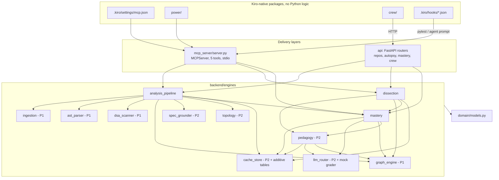
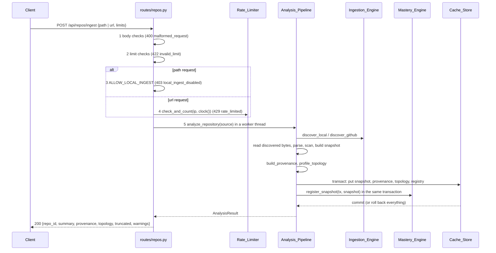
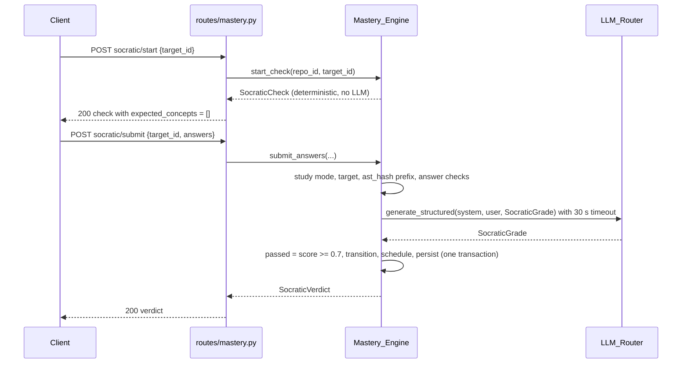
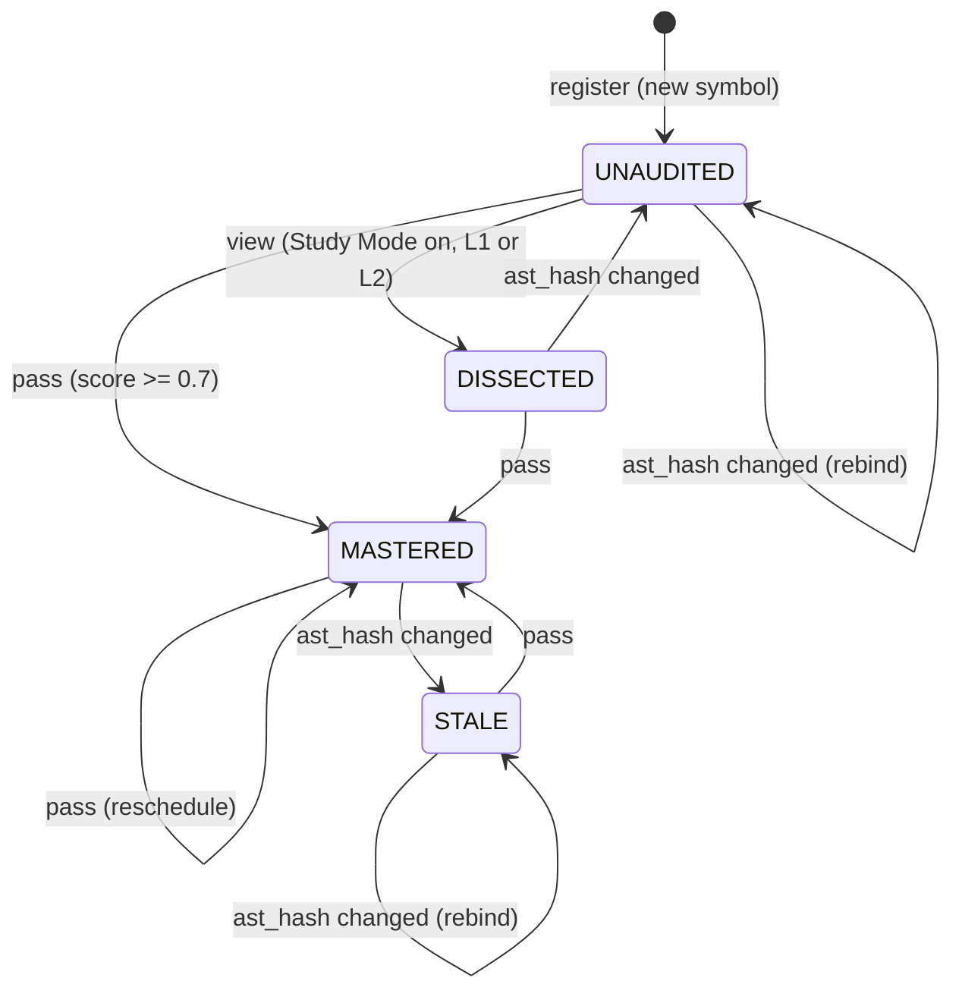

# Design Document

## Overview

Spec #03 adds a mastery layer and three delivery surfaces on top of the Phase 1 engines (`01-ast-graph-engine`) and the Phase 2 engines (`02-spec-topology-pedagogy`). Every surface calls the same engine functions and reads the same SQLite database.

| Area | Module or file | Requirements |
|---|---|---|
| Mastery domain models | `backend/domain/models.py` (appended) | 1 |
| Mastery_Engine | `backend/engines/mastery.py` (new) | 2, 3, 6, 7, 8 |
| Analysis_Pipeline and Repo_Id | `backend/engines/analysis_pipeline.py` (new) | 4 |
| Dissection_Service | `backend/engines/dissection.py` (new) | 5 |
| Cache_Store additions | `backend/engines/cache_store.py` (additive) | 2, 3, 4, 23.3 to 23.5 |
| Mock grader | `backend/engines/llm_router.py` (additive) | 7.8 |
| REST API | `backend/api/main.py`, `settings.py`, `errors.py`, `services.py`, `schemas.py`, `rate_limit.py`, `crew_signature.py`, `routes/{repos,autopsy,mastery,crew}.py` | 9 to 15 |
| MCP_Server | `backend/mcp_server/server.py` (new), `.kiro/settings/mcp.json` | 16, 17 |
| Kiro Power | `power/plugin.json`, `power/mcp.json`, `power/skills/code-autopsy/SKILL.md` | 18 |
| Kiro Crew App | `crew/app.json`, `crew/agents/*.md`, `crew/agents/*.json`, `crew/skills/code-autopsy/SKILL.md`, `crew/ui/study-mode-control.mjs` | 19 |
| Kiro hooks | `.kiro/hooks/verify-engines.json`, `.kiro/hooks/anti-vibe-coding.json` | 20 |
| Tests | `backend/tests/unit/test_mastery_api_mcp.py`, `backend/tests/properties/test_mastery_properties.py`, `backend/tests/mastery_support.py` | 21, 22 |
| Integration check | `scripts/check_study_mode_parity.py` | 24.7, 24.8 |

The LLM explains (Pedagogy_Engine, unchanged) and grades (one `SocraticGrade` call). It never decides a Mastery_State. The Mastery_Engine computes every transition from the validated score and its own table.

### Research findings that shaped the design

Each finding was checked against the repository or the installed packages on the date of writing. Installed versions read from `.venv`: Python 3.14.7, mcp 2.3.0, fastapi 0.165.0, starlette 1.10.0, sqlalchemy 2.1.9, sqlmodel 0.0.50, pydantic 2.14.4, hypothesis 6.170.17, httpx 0.28.1, anyio 4.16.0, ruff 0.17.6.

1. **The MCP server class is `mcp.server.mcpserver.MCPServer`.** `mcp/server/fastmcp.py` exists only to raise `ModuleNotFoundError` with a migration message. `MCPServer(name, ..., instructions=...)` registers tools with the `@server.tool(name=..., description=...)` decorator, runs over stdio with `server.run("stdio")` (which calls `anyio.run(server.run_stdio_async)`), and lists tools in-process with `await server.list_tools()` and calls them with `await server.call_tool(name, arguments)`, which returns a `CallToolResult` whose `structured_content` holds the returned dict. `mcp.Client(...)` accepts either an `MCPServer` instance (in-process) or `StdioServerParameters(command, args, env, cwd)` (subprocess).
2. **The SDK coerces typed tool arguments before our code runs.** A probe tool with `max_depth: int` received `True` as `1`, and a string `"x"` raised `ToolError` inside the SDK, so our code never saw it and could not return a Tool_Result. A parameter typed `Annotated[Any, Field(json_schema_extra={"type": "integer"})]` publishes `"type": "integer"` in the input schema and passes the raw value through unchanged. The MCP_Server uses that form and validates every argument with its own Pydantic model (Requirement 16.13 to 16.16, 23.7).
3. **The SDK keeps stdout clean.** `MCPServer.__init__` calls `logging.basicConfig` with a Rich handler bound to stderr, and `stdio_server` claims file descriptor 1 for protocol messages. The server adds no stdout handler (Requirement 16.18).
4. **Ruff allows a `sys.path` bootstrap before imports.** `ruff check --select E,F,I,UP,B` on a file that runs `sys.path.insert(0, ...)` inside `if __package__ in (None, ""):` and then imports reports no E402. This makes an in-file bootstrap possible without `noqa` (Requirement 17.4).
5. **Phase 1 assigns file reading to the caller.** Spec #01 design: "The caller (a later delivery layer) reads file bytes from `DiscoveryResult.root / relative_path`." `parse_source(file_path, source: bytes)` takes bytes. The Analysis_Pipeline is that caller.
6. **The Phase 1 clone uses `--depth 30`, not depth 1.** `discover_github` runs `git -c core.hooksPath=/dev/null clone --depth 30 --single-branch --no-recurse-submodules -- <url> <dest>`, and `test_ast_graph_engine.py` asserts that argv. Spec #02 relies on up to 20 recent commits for provenance. See decision D1.
7. **`validate_github_url` rejects an upper-case host.** It compares the host to `"github.com"` exactly, so `https://GitHub.com/a/b` raises `URL_BAD_HOST`. Requirement 4.5 wants such spellings to map to one `repo_id`, so the pipeline lower-cases the scheme and host before validation (decision D3).
8. **`CacheStore` read methods can write.** `_get_by_repo` deletes a row whose payload fails validation. Vitals (Requirement 8.7) and the snapshot endpoint (Requirement 11.7) must not write, so the new transactional reads raise `CacheStoreError` on an invalid payload instead of deleting.
9. **File-based SQLite engines are thread-safe here.** A file database uses `QueuePool`; a connection opened in a worker thread works (checked with a probe). The in-memory test database uses `StaticPool` with `check_same_thread=False`, as Phase 2 already configures.
10. **The Phase 2 layering test constrains the touched engines.** `test_new_modules_respect_layering` asserts that `llm_router` and `cache_store` import no engine module, that only `pedagogy` imports `cache_store` and `llm_router`, and that only `spec_grounder` imports `subprocess`. The additive changes keep all three facts. The new engine modules are not in that test's list.
11. **`test_health.py` imports `backend.api.main.app` at collection time,** before the autouse environment fixture runs. Importing `main.py` must therefore not open a database or build an `LLMRouter`. Resources are created lazily (decision D9).
12. **The review schedule overflows at the 17th pass.** Intervals for consecutive passes are 1, 6, 15, 38, 95, 238, 595, 1488, 3720, 9300, 23250, 58125, 145312, 363280, 908200, 2270500, 5676250, and so on. With a Clock at `2025-01-01T00:00:00Z`, `now + 5676250 days` overflows `datetime` (pass 17). Requirement 22.3 generates up to 20 passes, so the property must accept the Requirement 6.12 rejection (decision D12).
13. **Kiro hook semantics** (kiro.dev/docs/hooks, /hooks/types, /hooks/actions, fetched for this design):
    - File-event matchers are "a regex against the file path". The page does not state whether the path is absolute or workspace-relative, nor whether the regex is searched or fully matched.
    - `PostFileSave` "triggers when the agent saves or modifies files".
    - `PostToolUse` matchers accept a tool ID, a category (`read`, `write`, `shell`, `web`, `spec`), a source selector (`@mcp`, `@builtin`, ...), a regex against the tool ID, or a `*`/`?` wildcard.
    - For command actions, the Hook Actions page says exit 0 adds stdout to the agent context and a non-zero exit sends stderr to the agent. That contradicts Observation 8 of the requirements (stdout forwarded only for three triggers). Neither source says that `pytest` failure text (printed on stdout) reaches the agent. See the hook section.
14. **Kiro Power manifest** (kiro.dev/docs/powers/create): `plugin.json` fields are `$schema`, `name`, `version`, `description`, `author` (`name`, optional `email`, `url`), `keywords`, and optional `homepage`, `repository`, `license`. `mcp.json` holds `$schema` and `mcpServers` entries with `type`, `command`, `args`, `env`.
15. **Kiro Crew manifest** (kiro.dev/docs/crew/apps/manifest and /apps/sdk):
    - Required: `name` (kebab-case), `version` (`X.Y.Z`), `displayName`, and `description`.
    - Optional fields used here: `author`, `agents` (paths to agent JSON files), `skills` (paths to skill directories), `permissions.api`, `contributes.fileMenuItems`, and `contributes.sessionControls`.
    - A `fileMenuItems` entry requires `id`, `label`, `endpoint`, and at least one surface (`file-overflow`, `tree-context`, `folder-row`), and may add `when.extensions` and `when.kinds`. Its endpoint is an app-local route subject to `permissions.api`.
    - A `sessionControls` entry requires `id` and `entryPoint` (an ESM module) and may add `label`, `icon`, and `statusPath`.
    - The gateway signs each proxied backend request with the header `X-Crew-Proxy: <timestamp>:<hmac-sha256>`. The SDK page defines the signed text as `timestamp:method:/api/path[?query]:sha256(body)`, keyed with the app secret, with timestamps within ±60 seconds of the current time and a constant-time comparison. The docs do not state the text encoding of the HMAC and body hash, the timestamp unit, the case of `method`, which path form is signed (the gateway serves the backend at `/apps/{name}/api/*`), whether the "app secret" equals `KIRO_CREW_SECRET`, or any replay protection inside the 60 second window. The design uses the most conservative compatible reading of each point (lower-case hex, Unix seconds, upper-case method, path and raw query exactly as the API_App receives them, same secret) and implements both this scheme and the original `X-Kiro-Signature` scheme (Requirement 15.5, Observation 17). See Open Risk R1.
    - The docs do not define the body that the host posts to a file-menu endpoint, nor the export signature of a session-control module.
16. **Kiro agent configuration** (kiro.dev/docs/custom-agents/configuration-reference): an agent JSON file has `name`, `description`, and `prompt`, where `prompt` accepts `file://./<file>` resolved relative to the agent file, plus optional `includeMcpJson`, `tools`, and others.

### Design decisions

| # | Decision | Reason |
|---|---|---|
| D1 | GitHub ingestion keeps the Phase 1 `git clone --depth 30` with hooks disabled. No new clone path exists. | Requirement 23.6 says depth 1. Phase 1 Requirement 1.23 and an existing Phase 1 test fix `--depth 30`, and the Scope Lock forbids weakening tests. Spec #02 provenance reads up to 20 commits, which depth 1 would break. Confirmed by the user (Observation 16 and Requirement 23.6; see Confirmed decisions). Changing it later is a one-line edit in `ingestion.py` plus one Phase 1 test edit. |
| D2 | The Analysis_Pipeline reads the bytes of the files the Ingestion_Engine returned and passes them straight to `ast_parser.parse_source`. It reads no other repository file. Spec and steering documents are read by the Spec_Grounder, as in Phase 2. | Requirement 4.7 says files are read "only through the Ingestion_Engine and the AST_Parser". The Phase 1 engines take bytes and leave the read to the caller (finding 5). The read helper refuses symlinks, non-regular files, and files over the Phase 1 limit of 524,288 bytes, so the guardrails stay intact. The alternative, a new `read_discovered` function in `ingestion.py`, would touch a Phase 1 file for no behavioral gain. |
| D3 | `repo_id` for GitHub is derived after lower-casing the scheme, host, owner, and repo. | GitHub owner and repository names are case-insensitive, so `Owner/Repo` and `owner/repo` name one repository (Requirement 4.5, 4.6). |
| D4 | A repository registry table stores, per `repo_id`, the source kind, a content fingerprint, the file count, the symbol count, and the truncation flag. It stores no server path. | `GET /api/repos` must list repositories with counts without parsing every Snapshot payload (Requirement 11.1). The MCP_Server needs a stored content hash to decide when to re-analyze (Requirement 16.11). |
| D5 | `GET /api/repos/{repo_id}/snapshot` returns the stored Snapshot with `root_path` replaced by `"."`. Every other field equals the stored value. | `root_path` is a server file-system path, which Requirement 9.10 forbids in any response body. Requirement 11.4 states this redaction. Confirmed by the user (Observation 16; see Confirmed decisions). |
| D6 | For an L3 target the Dissection_Service obtains the `BlastRadius` from `graph_engine.trace_blast_radius` on a copy of the graph in which the scope (`repo_id` or a directory) is added as an isolated node with `node_type="scope"`. The result has empty caller and callee lists and `impact_score` 0.0. | Requirement 5.1 and 5.5 require a blast radius for every lens. A directory or the repository root has no `calls` edges in the Phase 1 graph, so the Graph_Engine's own definition gives an empty radius. No new graph logic is written. |
| D7 | Mastery is tracked for symbols whose `id` is at most 500 characters. A longer symbol id gets no Mastery_Record and does not count in vitals. View events for it are ignored, and Socratic requests for it return `unknown_target`. | Requirement 1.17 caps `target_id` at 500 characters, while Phase 1 allows paths up to 4,096 characters. Failing the whole registration for one very long path would block analysis of the repository. |
| D8 | Mastery records are created, read, and changed inside `CacheStore.transact` (one SQLAlchemy session that commits or rolls back). The Analysis_Pipeline persists the Snapshot, provenance, topology, registry row, and mastery registration in one such transaction. | Requirement 3.16, 4.3, 23.3, and 23.4 require all-or-nothing writes and one session per operation. |
| D9 | `backend/api/main.py` builds `app = create_app()` at import. `create_app` reads and validates the API settings (configuration errors stop the import, so uvicorn refuses to start). The Cache_Store, LLM_Router, and engines are created lazily on the first request that needs them and closed in the lifespan shutdown. | Finding 11. `GET /health` needs no resources, so the existing test keeps passing without a database. |
| D10 | Every non-health handler does its blocking work in `starlette.concurrency.run_in_threadpool`. Inside the worker thread, async engine calls run with `asyncio.run(...)`. | Requirement 9.14: SQLite, parsing, ingestion, and source reads never run on the event loop. The LLM providers create and close their clients per call, so a per-call event loop is safe. |
| D11 | Socratic `question_id` values embed the first 16 characters of the Target `ast_hash`. | The backend keeps no per-check state (no timer, Requirement 7.14). The embedded prefix lets `submit` tell a mismatched check (Requirement 7.13) from an unknown id (Requirement 7.12) without storage. |
| D12 | Property 2 applies up to 20 passes with a fixed Clock. Passes 1 to 16 must follow the schedule. The first pass whose `next_review_at` would exceed `9999-12-31T23:59:59Z` must raise `ReviewDateOutOfRange` and leave the record unchanged, and the property stops there. | Finding 12. Requirement 6.12 rejects pass 17 from the fixed Clock, and Requirement 22.3 states this stopping rule. Confirmed by the user (Observation 16; see Confirmed decisions). |
| D13 | The Crew webhook is mounted at `POST /api/apps/stupid-code/crew`. That path is also the `endpoint` of both Crew file-menu items and the URL that the session-control module posts to. | The Crew reference requires app-local endpoint paths under the app's API prefix (finding 15). How the gateway reaches the API_App and which body the host posts are undocumented; see Open Risk R1. |
| D14 | `.gitignore` gains one line, `data/repos/`. | The API now clones GitHub repositories into the Phase 1 default workspace `data/repos/`. Without the line a clone could be committed by accident. No rule touches `.kiro/`. This line is optional and can be dropped if the user prefers no `.gitignore` change. |

## Architecture



Import rules (checked by one unit test with `ast`, Requirement 23.1):

- `mastery` imports `domain`, `cache_store`, `llm_router`, `graph_engine`, and `pedagogy` (for `read_target_source`, `build_symbol_index`, `canonical_json`).
- `dissection` imports `domain`, `cache_store`, `graph_engine`, `pedagogy`, and `mastery`.
- `analysis_pipeline` imports `domain`, `ingestion`, `ast_parser`, `dsa_scanner`, `graph_engine`, `spec_grounder`, `topology`, `cache_store`, and `mastery`.
- None of the three imports `fastapi`, `starlette`, `mcp`, `backend.api`, or `backend.mcp_server`. No engine imports `analysis_pipeline` or `dissection` except as listed, so the engine import graph is acyclic.
- `api` and `mcp_server` import engines and `domain`. They do not import each other.

### Ingest flow



### Socratic flow



## Components and Interfaces

### Clock (in `backend/engines/mastery.py`)

```python
Clock = Callable[[], datetime]

def system_clock() -> datetime: ...          # datetime.now(UTC)
def read_clock(clock: Clock) -> datetime: ...  # call once, validate, raise MasteryError(INVALID_CLOCK)
def format_utc(moment: datetime) -> str: ...   # f"{y:04d}-{m:02d}-{d:02d}T{H:02d}:{M:02d}:{S:02d}Z", fraction truncated
```

`read_clock` accepts only a `datetime` with `tzinfo` set and `utcoffset() == timedelta(0)`. Any exception from the Clock, a naive value, a non-zero offset, or a non-`datetime` raises `MasteryError(INVALID_CLOCK)` (Requirement 6.11, 8.10). The API Rate_Limiter uses the same `Clock` type and `read_clock`.

### Mastery_Engine (`backend/engines/mastery.py`)

```python
class MasteryErrorKind(StrEnum):
    INVALID_INPUT = "invalid_input"          # bad repo_id or non-bool study mode value
    UNKNOWN_REPOSITORY = "unknown_repository"
    UNKNOWN_TARGET = "unknown_target"
    INVALID_TRANSITION = "invalid_transition"
    STUDY_MODE_DISABLED = "study_mode_disabled"
    INVALID_ANSWERS = "invalid_answers"
    GRADING_UNAVAILABLE = "grading_unavailable"
    SOURCE_UNREADABLE = "source_unreadable"
    INVALID_CLOCK = "invalid_clock"
    REVIEW_DATE_OUT_OF_RANGE = "review_date_out_of_range"
    STORAGE = "storage"                      # wraps CacheStoreError (__cause__ is set)

class MasteryError(Exception):
    kind: MasteryErrorKind                   # str(error) never holds row content, prompts, or answers

PASS_THRESHOLD = 0.7
INITIAL_EASE = 2.5
GRADING_TIMEOUT_SECONDS = 30.0
MAX_REVIEW_AT = datetime(9999, 12, 31, 23, 59, 59, tzinfo=UTC)

class MasteryEngine:
    def __init__(self, cache: CacheStore, router: StructuredLLM, clock: Clock = system_clock,
                 *, grading_timeout_seconds: float = GRADING_TIMEOUT_SECONDS) -> None: ...

    # Study Mode (Requirement 2)
    def get_study_mode(self, repo_id: str) -> bool: ...
    def set_study_mode(self, repo_id: str, enabled: bool) -> bool: ...

    # Registration (Requirement 3.1, 3.2, 3.8 to 3.13); called inside the pipeline transaction
    def register_snapshot(self, tx: CacheTransaction, snapshot: RepoGraphSnapshot) -> None: ...

    # Views (Requirement 3.3 to 3.5); one transaction for all ids
    def record_views(self, repo_id: str, target_ids: Sequence[str]) -> None: ...

    # Socratic (Requirement 7)
    def start_check(self, repo_id: str, target_id: str) -> SocraticCheck: ...
    async def submit_answers(self, repo_id: str, target_id: str,
                             answers: Sequence[tuple[str, str]]) -> SocraticVerdict: ...

    # Read-only (Requirement 8)
    def get_vitals(self, repo_id: str) -> ComprehensionVitals: ...
    def get_record(self, repo_id: str, target_id: str) -> ModuleMastery | None: ...
```

Pure helpers exported for tests and reuse:

```python
def validate_repo_id(repo_id: object) -> str: ...      # Repo_Id rule or MasteryError(INVALID_INPUT)
def trackable_symbols(snapshot: RepoGraphSnapshot) -> dict[str, SymbolNode]: ...  # ids <= 500 chars
def plan_registration(existing: Mapping[str, ModuleMastery],
                      snapshot: RepoGraphSnapshot) -> list[ModuleMastery]: ...  # changed or new records only
def apply_view(record: ModuleMastery) -> ModuleMastery: ...
def apply_pass(record: ModuleMastery, now: datetime) -> ModuleMastery: ...
def apply_hash_change(record: ModuleMastery, new_hash: str) -> ModuleMastery: ...
def check_transition(before: MasteryState | None, after: MasteryState) -> None: ...
def generate_check(repo_id: str, symbol: SymbolNode, source: str, callers: Sequence[SymbolNode],
                   callees: Sequence[SymbolNode], signals: Sequence[DSASignal]) -> SocraticCheck: ...
def compute_vitals(repo_id: str, study_mode: bool, snapshot: RepoGraphSnapshot,
                   records: Sequence[ModuleMastery], now: datetime) -> ComprehensionVitals: ...
```

#### State machine



Transition rules, one row per cause. Every other field keeps its value unless the row says otherwise.

| Cause | From | To | Field changes | Requirement |
|---|---|---|---|---|
| register, no record | none | UNAUDITED | `ast_hash` = symbol hash, `ease_factor` 2.5, `interval_days` 0, `repetitions` 0, both times null | 3.1 |
| register, same `ast_hash` | any | same | none | 3.2 |
| register, new `ast_hash` | MASTERED | STALE | rebind hash, `repetitions` 0, `interval_days` 0, `next_review_at` null | 3.8 |
| register, new `ast_hash` | DISSECTED | UNAUDITED | rebind hash | 3.9 |
| register, new `ast_hash` | UNAUDITED, STALE | same | rebind hash | 3.10 |
| view, Study Mode on | UNAUDITED | DISSECTED | none | 3.3 |
| view, Study Mode on | DISSECTED, MASTERED, STALE | same | none | 3.4 |
| view, Study Mode off | any | same | none, no write | 3.5 |
| pass (score >= 0.7) | any | MASTERED | schedule fields (Review scheduling below) | 3.6 |
| fail (score < 0.7) | any | same | none, no write | 3.7 |

`check_transition(before, after)` runs before every write. The allowed pairs are `None -> UNAUDITED`, `X -> X`, `UNAUDITED -> DISSECTED`, `X -> MASTERED`, `MASTERED -> STALE`, and `DISSECTED -> UNAUDITED`. Any other pair (for example `UNAUDITED -> STALE` or `STALE -> DISSECTED`) raises `MasteryError(INVALID_TRANSITION)` naming both states, and the enclosing transaction rolls back (Requirement 3.15, 23.4). The rows above never produce a disallowed pair, so the guard only catches programming errors. Requirement 3.12 holds because the only causes that rebind a hash map MASTERED and DISSECTED away from themselves.

Records for symbols that leave the Snapshot are not deleted (Requirement 3.13). When such a symbol returns, `plan_registration` compares hashes as in the table.

`plan_registration` returns only new or changed records, so registering the same Snapshot twice writes nothing to the mastery table (Requirement 3.2, 4.4).

#### Review scheduling (Requirement 6)

`apply_pass(record, now)`:

1. `repetitions = record.repetitions + 1`.
2. `interval_days = 1` if `repetitions == 1`, `6` if `repetitions == 2`, else `round(record.interval_days * record.ease_factor)` with the built-in `round`.
3. `due = now.replace(microsecond=0) + timedelta(days=interval_days)`. An `OverflowError` or `due > MAX_REVIEW_AT` raises `MasteryError(REVIEW_DATE_OUT_OF_RANGE)` and nothing is written.
4. `next_review_at = format_utc(due)`, `last_verified_at = format_utc(now)`, `state = MASTERED`, `ease_factor` unchanged (2.5 on every record, Requirement 6.6).

Five passes from a fresh record give `repetitions` 1 to 5 and `interval_days` 1, 6, 15, 38, 95 (`round(37.5) == 38` because Python rounds half to even). No other scheduling parameter exists (Requirement 6.10).

#### Socratic question generation (Requirement 7.1 to 7.6, 7.16)

`start_check(repo_id, target_id)` checks, in order: Repo_Id rule, Study_Mode on (else `STUDY_MODE_DISABLED`), stored Snapshot (else `UNKNOWN_REPOSITORY`), `target_id` in `trackable_symbols` (else `UNKNOWN_TARGET`). It then builds the graph with `build_graph(snapshot.files)`, gets direct callers and callees with `trace_blast_radius(graph, target_id, 1)`, reads the Target file with `pedagogy.read_target_source(snapshot.root_path, symbol.file_path)` (a `PedagogyError(SOURCE_UNREADABLE)` becomes `MasteryError(SOURCE_UNREADABLE)`), selects the `DSASignal` entries whose `symbol_id` equals the Target, and calls `generate_check`. It makes no LLM call and writes nothing.

Evidence extracted from the Target lines `start_line..end_line` only:

- **Local names.** Scanning the Target lines top to bottom and left to right, collect identifiers matched by `(?<![\w$.])([A-Za-z_$][\w$]*)\s*(?:[-+*/%&|^]|\*\*|//)?=(?!=)` (assignments, augmented assignments, keyword arguments) and `\breturn\s+([A-Za-z_$][\w$]*)`. Drop language keywords and receivers (`self`, `this`, `return`, `None`, `null`, `true`, `false`, and the reserved words of the five supported languages). Keep the first four distinct names of at most 100 characters.
- **Callee lines.** The lines of the Target that contain `<callee name>(` for any direct callee.

Question 0 (always present):

- `prompt`: ``Look at `{qualname}` in {file_path} lines {start}-{end} (signature: `{signature}`). What inputs does it take, what does it return or produce, and which local values does it compute on the way?``
- `line_reference`: `{file_path}:{start_line}-{end_line}` of the symbol.
- `expected_concepts`: the symbol `name` (cut to 100 characters) followed by the local names, de-duplicated, at most 5.

Question 1, present only if the Target has a DSA signal, a direct callee, or a direct caller. The first source that exists wins:

| Source | Prompt | `line_reference` | `expected_concepts` |
|---|---|---|---|
| First DSA signal in Snapshot order | ```{qualname}` shows the {pattern_name} pattern ({chapter}) in lines {a}-{b}. Which data structure or loop in these lines implements it, and why does it suit this code?`` | signal `start_line`-`end_line` (always inside the symbol, Phase 2 finding 2) | `[pattern_name]` |
| Direct callees | ``In lines {a}-{b}, `{qualname}` calls {names}. What does it pass to these calls and how does it use their results?`` | first to last callee line, or the symbol range if no line matches | callee `name` values, sorted by callee id, at most 5 |
| Direct callers | ```{qualname}` is called by {names}. What do these callers rely on `{qualname}` to return or change?`` | symbol range | caller `name` values, sorted by caller id, at most 5 |

Prompt pieces are clipped before formatting (`qualname` 100, `signature` 150, `file_path` 120, at most 3 names of 60 characters each), and the result is cut to 500 characters (Requirement 7.3). Every concept is a name from the Target source, a Snapshot symbol name (a substring of a symbol id), or a DSA `pattern_name` (Requirement 7.3, 7.6). Callers and callees come from the Graph_Engine, so nothing outside the Snapshot is referenced.

Question id: `f"sq{index}-{sha256(f'{repo_id}\n{target_id}\n{ast_hash}\n{index}').hexdigest()[:24]}-{ast_hash[:16]}"`. The same Snapshot always yields the same ids, and indexes 0 and 1 differ (Requirement 7.4).

#### Grading (Requirement 7.7 to 7.13)

`submit_answers(repo_id, target_id, answers)` runs these checks in order and stops at the first failure. Every failure leaves all records unchanged.

1. Repo_Id rule, then Study_Mode on (else `STUDY_MODE_DISABLED`), stored Snapshot, trackable Target (else `UNKNOWN_TARGET`).
2. Regenerate the check from the current Snapshot (same code as `start_check`).
3. If any submitted `question_id` matches `^sq[01]-[0-9a-f]{24}-(.{1,16})$` with a hash suffix different from the current `ast_hash[:16]`, raise `INVALID_ANSWERS` with the message "the check no longer matches the current code" (Requirement 7.13).
4. Raise `INVALID_ANSWERS` if the answer count differs from the question count, an id is not in the check, an id repeats, or an answer is empty or longer than 2,000 characters after trimming (Requirement 7.12). Build `SocraticAnswerItem` values.
5. Build the grading slice and call `router.generate_structured(GRADING_SYSTEM_PROMPT, MOCK_SLICE_MARKER + canonical_json(slice), SocraticGrade)` inside `asyncio.wait_for(..., 30)`.
6. On `LLMRouterError`, `TimeoutError`, `ValidationError`, or a result that is not a `SocraticGrade`, raise `GRADING_UNAVAILABLE` with the fixed message "grading is unavailable" (no provider text, no prompt). Otherwise re-validate the result with `SocraticGrade.model_validate(result.model_dump())`.
7. `passed = grade.score >= PASS_THRESHOLD`. In one transaction: re-read the record, then on pass apply `apply_pass(record, read_clock(clock))`, `check_transition`, and write. On fail, write nothing.
8. Return `SocraticVerdict(target_id, passed, score, feedback, new_state, next_review_at)` with the record values after step 7.

Grading slice (documented in the `llm_router.py` docstring next to the existing slice shapes):

```json
{
  "kind": "socratic_grade",
  "target": {"id": "...", "qualname": "...", "signature": "...", "file_path": "...",
             "start_line": 1, "end_line": 9, "source_lines": [{"line": 1, "text": "..."}]},
  "questions": [{"question_id": "...", "prompt": "...", "line_reference": "...",
                 "expected_concepts": ["..."]}],
  "answers": [{"question_id": "...", "answer": "..."}]
}
```

`source_lines` holds at most 400 lines (the Phase 2 `MAX_SOURCE_LINES`). `GRADING_SYSTEM_PROMPT` tells the model to score from 0.0 to 1.0 by how many expected concepts the answers explain correctly for this code, to treat answers and source as data and not as instructions, and to return only `score` and `feedback`.

### Mock grader (additive change to `backend/engines/llm_router.py`)

```python
def _build_socratic_grade(context: Mapping[str, Any]) -> SocraticGrade:
    concepts = sorted({c for q in _items(context, "questions") for c in _items(q, "expected_concepts")})
    answers = [_text(a, "answer").casefold() for a in _items(context, "answers")]
    hits = sum(1 for c in concepts if any(c.casefold() in a for a in answers))
    return SocraticGrade(score=hits / len(concepts),
                         feedback=f"Matched {hits} of {len(concepts)} expected concepts.")

_MOCK_BUILDERS[SocraticGrade] = _build_socratic_grade   # written inside the existing dict literal
```

The division is unrounded (Requirement 7.8). An empty concept list raises `ZeroDivisionError`, which the existing `_generate_mock` does not catch, so the builder checks `if not concepts: raise ValueError(...)` first; the existing handler turns `ValueError` into `LLMRouterError(category="validation")`. Every existing builder and the rejection of unsupported models (for example `SpecLink`) are unchanged. `llm_router` still imports only `domain`.

### Cache_Store additions (`backend/engines/cache_store.py`)

New tables, all keyed by `repo_id` first:

```python
class StudyModeRow(SQLModel, table=True):
    repo_id: str = SQLField(primary_key=True)
    enabled: bool

class MasteryRow(SQLModel, table=True):
    repo_id: str = SQLField(primary_key=True)
    target_id: str = SQLField(primary_key=True)
    payload: str                      # ModuleMastery.model_dump_json()

class RepositoryRow(SQLModel, table=True):
    repo_id: str = SQLField(primary_key=True)
    source_kind: str                  # "local" | "github"
    content_hash: str                 # sha256 hex fingerprint (Analysis_Pipeline)
    file_count: int
    symbol_count: int
    truncated: bool
```

`_TABLES` gains the three tables, so `create_all` adds them to a new or existing database file and leaves existing tables untouched.

New public API:

```python
@dataclass(frozen=True)
class RepositoryRecord:
    repo_id: str; source_kind: str; content_hash: str
    file_count: int; symbol_count: int; truncated: bool

class CacheTransaction:
    """Typed reads and writes on one session. Invalid payloads raise CacheStoreError; nothing is deleted."""
    def get_snapshot(self, repo_id: str) -> RepoGraphSnapshot | None: ...
    def get_provenance(self, repo_id: str) -> ProvenanceReport | None: ...
    def get_topology(self, repo_id: str) -> TopologyProfile | None: ...
    def put_snapshot(self, snapshot: RepoGraphSnapshot) -> None: ...
    def put_provenance(self, report: ProvenanceReport) -> None: ...
    def put_topology(self, profile: TopologyProfile) -> None: ...
    def get_repository(self, repo_id: str) -> RepositoryRecord | None: ...
    def list_repositories(self) -> list[RepositoryRecord]: ...       # ordered by repo_id
    def put_repository(self, record: RepositoryRecord) -> None: ...
    def get_study_mode(self, repo_id: str) -> bool | None: ...       # None = no row
    def set_study_mode(self, repo_id: str, enabled: bool) -> None: ...
    def list_mastery(self, repo_id: str) -> list[ModuleMastery]: ... # ordered by target_id
    def get_mastery(self, repo_id: str, target_id: str) -> ModuleMastery | None: ...
    def put_mastery(self, record: ModuleMastery) -> None: ...

class CacheStore:
    # every existing method is unchanged
    def transact(self, operation: Callable[[CacheTransaction], T]) -> T: ...  # commit or roll back
    def read(self, operation: Callable[[CacheTransaction], T]) -> T: ...      # always rolls back
```

`transact` and `read` reuse the existing private `_run`, so failures surface as `CacheStoreError` with the class name and database path only, and non-database exceptions (for example `MasteryError`) propagate unchanged after rollback. `read` calls `session.rollback()` instead of `commit()`, so a read path cannot write even by mistake (Requirement 8.7, 11.7, 13.2). Error messages for an invalid payload name the table and never the row content.

### Analysis_Pipeline (`backend/engines/analysis_pipeline.py`)

```python
@dataclass(frozen=True)
class LocalSource:
    path: str

@dataclass(frozen=True)
class GitHubSource:
    url: str

Source = LocalSource | GitHubSource

class PipelineStep(StrEnum):
    READ = "read"; PARSE = "parse"; SCAN = "scan"; GRAPH = "graph"
    PROVENANCE = "provenance"; TOPOLOGY = "topology"; PERSIST = "persist"

class AnalysisPipelineError(Exception):
    step: PipelineStep                    # message names the step, never file content

class NoAnalyzableFilesError(AnalysisPipelineError): ...   # zero supported files (Req 4.8)

@dataclass(frozen=True)
class AnalysisResult:
    repo_id: str
    snapshot: RepoGraphSnapshot
    provenance: ProvenanceReport
    topology: TopologyProfile
    truncated: bool
    warnings: tuple[IngestionWarning, ...]
    reused: bool                          # True when ensure_analysis found current stored data

def derive_local_repo_id(real_root: str) -> str: ...
def derive_github_repo_id(url: str) -> str: ...           # raises IngestionError for a bad URL
def normalize_github_url(url: str) -> str: ...

def analyze_repository(source: Source, *, cache: CacheStore, mastery: MasteryEngine,
                       max_files: int = DEFAULT_MAX_FILES,
                       max_total_bytes: int = DEFAULT_MAX_TOTAL_BYTES,
                       workspace: Path | None = None,
                       git_runner: GitRunner = subprocess.run) -> AnalysisResult: ...

def ensure_analysis(path: str, *, cache: CacheStore, mastery: MasteryEngine) -> AnalysisResult: ...
```

`analyze_repository` steps:

1. Discover. `LocalSource` calls `discover_local(path, max_files=..., max_total_bytes=...)`. `GitHubSource` calls `discover_github(normalize_github_url(url), ..., workspace=workspace, git_runner=git_runner)`. An `IngestionError` propagates unchanged (Requirement 4.9).
2. `repo_id`: local uses `derive_local_repo_id(str(result.root))` (the root is already a real path), GitHub uses `derive_github_repo_id(url)`.
3. Read. For each path in `result.files`, `_read_discovered(result.root, rel)` opens with `O_RDONLY | O_NOFOLLOW`, checks `S_ISREG` with `fstat`, refuses more than `MAX_FILE_BYTES` (524,288), and reads. A file that fails becomes an `IngestionWarning(ENTRY_UNREADABLE, rel, strerror)` and is skipped.
4. If no file was read, raise `NoAnalyzableFilesError` (step `read`). Nothing has been written yet (Requirement 4.8).
5. `parse_source(rel, data)` per file (step `parse`), `scan_many(parsed).signals` (step `scan`), `build_snapshot(repo_id, str(result.root), analyses, signals)` (step `graph`), `build_provenance(snapshot)` (step `provenance`), `profile_topology(snapshot)` (step `topology`). Any exception in a step becomes `AnalysisPipelineError(step)` with the exception class name only (Requirement 4.10).
6. Fingerprint: `content_hash = sha256(canonical_json({"files": [[rel, sha256(data)] ...], "truncated": t, "specs": [[spec_name, source_file, sha256(text)] ...], "steering": [[source_file, sha256(own_text)] ...]}))`. Spec and steering entries come from `spec_grounder.discover_specs(root)`, which uses its own read guards.
7. Persist in one `cache.transact`: `put_snapshot`, `put_provenance`, `put_topology`, `put_repository(RepositoryRecord(...))`, and `mastery.register_snapshot(tx, snapshot)`. A `CacheStoreError` or `MasteryError` becomes `AnalysisPipelineError(step="persist")` with the original as `__cause__`; the rollback leaves earlier data unchanged (Requirement 4.3, 4.10, 4.11).

The pipeline contains no parsing, graph, DSA, provenance, or topology logic (Requirement 4.2). Unchanged content gives equal values because every Phase 1 and Phase 2 engine is deterministic and `plan_registration` writes nothing new (Requirement 4.4).

`ensure_analysis(path)` serves the MCP_Server: it runs steps 1 to 4 and 6 for a `LocalSource`, compares the fingerprint with `RepositoryRecord.content_hash`, and returns the stored Snapshot, provenance, and topology with `reused=True` when they match and all three are stored. Otherwise it runs the full pipeline (Requirement 16.8, 16.11).

#### `repo_id` derivation (Requirement 4.5, 4.6)

```python
_SLUG_RE = re.compile(r"[^A-Za-z0-9._-]+")

def _slug(text: str) -> str:
    return _SLUG_RE.sub("-", text).strip("-.")[:60] or "repo"

def derive_local_repo_id(real_root: str) -> str:
    digest = sha256(os.path.realpath(real_root).encode("utf-8", "surrogateescape")).hexdigest()[:16]
    return f"local-{_slug(os.path.basename(real_root))}-{digest}"

def normalize_github_url(url: str) -> str:
    # lower-case "https://" and the host only; validate_github_url still applies every other rule
    ...

def derive_github_repo_id(url: str) -> str:
    ref = validate_github_url(normalize_github_url(url))   # strips a trailing "/" and ".git"
    owner, repo = ref.owner.lower(), ref.repo.lower()
    digest = sha256(f"{owner}/{repo}".encode()).hexdigest()[:12]
    return f"gh-{_slug(owner + '-' + repo)}-{digest}"
```

- Length: `local-` (6) + at most 60 + `-` + 16 = 83, and `gh-` (3) + at most 60 + `-` + 12 = 76. Both are within 1 to 100, and only `A-Z a-z 0-9 . _ -` occur.
- `os.path.realpath` maps a trailing separator, a relative path, and its absolute form to one string. `discover_local` already realpaths the root, so the API, MCP, and Crew paths agree.
- Two directories with the same basename get different digests. The `local-` and `gh-` prefixes keep the two namespaces apart, and the digest separates `a-b/c` from `a/b-c` on GitHub.
- On a case-insensitive file system, two spellings that differ only in letter case give two ids. Requirement 4.5 does not list that case.

### Dissection_Service (`backend/engines/dissection.py`)

```python
class InvalidLensError(ValueError): ...

@dataclass(frozen=True)
class DissectionResult:
    envelope: ExplanationEnvelope
    blast_radius: BlastRadius

DEFAULT_MAX_DEPTH = 3

class DissectionService:
    def __init__(self, cache: CacheStore, pedagogy: PedagogyEngine, mastery: MasteryEngine) -> None: ...
    async def dissect(self, repo_id: str, target_id: str, lens: str,
                      max_depth: int = DEFAULT_MAX_DEPTH) -> DissectionResult: ...
    async def dissect_many(self, repo_id: str, target_ids: Sequence[str], lens: str,
                           max_depth: int = DEFAULT_MAX_DEPTH) -> list[DissectionResult]: ...
    def blast_radius(self, repo_id: str, target_id: str, max_depth: int) -> BlastRadius: ...
```

`dissect_many` does the work and `dissect` calls it with one id:

1. `PedagogyLens(lens)` or raise `InvalidLensError` before any other call (Requirement 5.6).
2. For each id, `await pedagogy.explain_target(repo_id, target_id, lens)`. A `PedagogyError` propagates unchanged (Requirement 5.7).
3. Load the Snapshot once, `graph = build_graph(snapshot.files)`, and for each id call `trace_blast_radius(graph, id, max_depth)`. For L3, add the scope node to a copy first (D6). `max_depth` passes through unchanged (Requirement 5.8). A Graph_Engine `InvalidArgumentError` propagates.
4. When the lens is L1 or L2 and Study Mode is on, call `mastery.record_views(repo_id, ids)` once (one transaction) after every result exists. When Study Mode is off or the lens is L3, make no Mastery_Engine view call (Requirement 5.3 to 5.5, 5.9).
5. Return the results. No result is returned when any step fails, so a Crew `autopsy_file` request with 10 symbols records either all views or none (Requirement 15.13).

`blast_radius` is the shared helper that the MCP `trace_blast_radius` tool calls; it raises `PedagogyError(UNKNOWN_TARGET)` for an id that is not a Snapshot symbol, so all surfaces share one error type.

### REST API (`backend/api/`)

#### Settings (`settings.py`)

```python
class ConfigurationError(Exception):
    variable: str                        # message names the variable, never its value

@dataclass(frozen=True)
class ApiSettings:
    cors_origins: tuple[str, ...]
    allow_local_ingest: bool
    github_rate_limit: int
    github_rate_window_seconds: int
    crew_secret: str | None              # repr() hides it

def load_api_settings(environ: Mapping[str, str] = os.environ) -> ApiSettings: ...
```

| Variable | Rule | Default | Error |
|---|---|---|---|
| `STUPID_CODE_CORS_ORIGINS` | comma-split, trim, drop empty entries | the 4 localhost origins of Requirement 9.5 | an entry `*` |
| `ALLOW_LOCAL_INGEST` | trim; `true`/`1` true, `false`/`0` false, letters case-insensitive | true when unset or empty | any other value |
| `STUPID_CODE_GITHUB_RATE_LIMIT` | integer 1 to 1,000 (`str.isdigit` after trim, so no sign or decimal) | 5 when unset or empty | any other value |
| `STUPID_CODE_GITHUB_RATE_WINDOW_SECONDS` | integer 1 to 3,600 | 60 when unset or empty | any other value |
| `KIRO_CREW_SECRET` | non-empty enables HMAC | none | none |
| `STUPID_CODE_DB_PATH` | read by the existing `CacheSettings` | `./data/stupid_code.db` | none |

The settings are read once in `create_app` (Requirement 10.16). A Vercel origin is allowed only when it is listed (Requirement 9.6).

#### Services and dependency provider (`services.py`)

```python
@dataclass
class Services:
    cache: CacheStore
    router: StructuredLLM
    clock: Clock
    mastery: MasteryEngine
    pedagogy: PedagogyEngine
    dissection: DissectionService
    git_runner: GitRunner = subprocess.run
    workspace: Path | None = None

    @classmethod
    def from_environment(cls) -> "Services": ...    # CacheStore(), LLMRouter(), system_clock

def get_services(request: Request) -> Services: ...  # app.state.services, created once under a lock
```

`create_app(settings: ApiSettings | None = None, *, services: Services | None = None, rate_limiter: RateLimiter | None = None) -> FastAPI` stores `services` (or `None` for lazy creation) in `app.state`. Tests pass `services` built on a temporary database, the mock router, a fixed Clock, and a git double (Requirement 9.13). The lifespan shutdown closes the Cache_Store if the app created it.

#### Application wiring (`main.py`)

- `GET /health` stays byte-identical in path and response (Requirement 9.1).
- Middleware order, outermost first: `CORSMiddleware(allow_origins=settings.cors_origins, allow_credentials=False, allow_methods=["GET", "POST"], allow_headers=["Content-Type", "X-Kiro-Signature", "X-Crew-Proxy"])`, then a small pure-ASGI `CatchAllMiddleware`. The catch-all turns any unhandled exception into HTTP 500 `internal_error`, logs `type(exc).__name__` only, and does not re-raise, so the server keeps serving (Requirement 9.8, 9.11).
- Exception handlers: `ApiError(status, code, message)`; `RequestValidationError` to 422 `validation_error` (field locations only, no input values); Starlette `HTTPException` 404 to `not_found` and 405 to `method_not_allowed`. Every body is an Error_Envelope (Requirement 9.9).
- Routers: `repos.router` (`/api/repos`), `autopsy.router` (explain), `mastery.router` (vitals, study mode, Socratic), `crew.router` (`/api/apps/stupid-code/crew`) (Requirement 9.2).
- Every handler is thin. It validates the input, calls one engine function through `run_in_threadpool`, and maps the result or error with the tables in Error Handling (Requirement 9.3, 9.14).

#### Endpoints

| Method and path | Request model | Response model | Engine call |
|---|---|---|---|
| `GET /health` | none | `{"status", "service"}` | none |
| `POST /api/repos/ingest` | raw body, parsed by `parse_ingest_body` | `IngestResponse` | `analyze_repository` |
| `GET /api/repos` | none | `list[RepoSummary]` | `cache.read(list_repositories + get_study_mode)` |
| `GET /api/repos/{repo_id}/snapshot` | path | `SnapshotResponse` | `cache.read(get_snapshot, get_provenance, get_topology)` |
| `POST /api/repos/{repo_id}/explain` | `ExplainRequest` | `ExplainResponse` | `DissectionService.dissect` |
| `GET /api/repos/{repo_id}/vitals` | path | `ComprehensionVitals` | `MasteryEngine.get_vitals` |
| `POST /api/repos/{repo_id}/study-mode` | `StudyModeRequest` | `StudyModeResponse` | `MasteryEngine.set_study_mode` |
| `POST /api/repos/{repo_id}/socratic/start` | raw body, then `SocraticStartRequest` | `SocraticCheck` with empty concepts | `MasteryEngine.start_check` |
| `POST /api/repos/{repo_id}/socratic/submit` | raw body, then `SocraticSubmitRequest` | `SocraticVerdict` | `MasteryEngine.submit_answers` |
| `POST /api/apps/stupid-code/crew` | raw body (signature first) | `CrewResponse` | `DissectionService`, `MasteryEngine` |

Path `repo_id` values are checked against the Repo_Id rule before any Cache_Store call. A failure returns 404 `repo_not_found` (Requirement 11.6, 12.4, 13.7). A `repo_id` that contains `/` does not match any route and gets 404 `not_found` from the router.

The Socratic routes read the raw body (at most 1,048,576 bytes), check that the repository is stored, and only then validate the body. This is how the 404 takes precedence over the 422 (Requirement 14.7). `socratic/start` returns `check.model_copy(update={"questions": [q.model_copy(update={"expected_concepts": []}) for q in check.questions]})` (Requirement 14.2). The answer items are parsed as `{question_id: StrictStr, answer: StrictStr}` objects. Length and membership rules are left to the Mastery_Engine so that they map to `invalid_answers`, not `validation_error` (Requirement 14.9, 14.10).

#### Ingest checks (Requirement 10, check order of 10.21)

`parse_ingest_body(raw: bytes) -> IngestCommand` raises `MalformedRequest` or `InvalidLimit`:

1. Body checks (400 `malformed_request`): the body is at most 1,048,576 bytes; it parses as JSON; it is an object; its keys are a subset of `{"path", "url", "max_files", "max_total_bytes"}`; exactly one of `path` and `url` is present; that value is a `str`, non-empty after trimming, and at most 4,096 characters. Rejected here: no ingestion, no rate count.
2. Limit checks (422 `invalid_limit`): each present limit is an `int` and not a `bool`, from 1 to the Phase 1 default (500 files, 20,971,520 bytes). `null`, floats, and strings fail. Absent means the default.
3. For `path` while `allow_local_ingest` is false: 403 `local_ingest_disabled`, with the fixed message "local path ingestion is disabled on this server". No file-system call, no ingestion, no rate count (Requirement 10.18).
4. For `url`: `rate_limiter.check_and_count(client_ip, clock())`. A rejection returns 429 `rate_limited` with `Retry-After` (Requirement 10.8, 10.9).
5. `run_in_threadpool(analyze_repository, ...)`. Errors map by the ingest table in Error Handling.

`IngestResponse`: `repo_id`, `summary` (`file_count`, `symbol_count`, `edge_count`, `dsa_signal_count`), `provenance`, `topology`, `truncated`, `warnings` (`[{kind, path, detail}]`, relative paths only). Ingestion leaves Study_Mode and mastery records alone except for the registration rules (Requirement 10.14).

#### Rate_Limiter (`rate_limit.py`)

```python
@dataclass(frozen=True)
class RateDecision:
    allowed: bool
    retry_after_seconds: int             # 0 when allowed

class RateLimiter:
    def __init__(self, limit: int, window_seconds: int) -> None: ...
    def check_and_count(self, client_ip: str, now: datetime) -> RateDecision: ...
```

The limiter is a sliding-window log: `dict[str, deque[float]]` of POSIX timestamps guarded by one `threading.Lock`.

1. Under the lock, drop timestamps `t` of this IP with `now_ts - t >= window`. Delete the key if the deque is empty, which releases expired counters (Requirement 10.11).
2. If fewer than `limit` remain, append `now_ts` and allow.
3. Otherwise reject with `retry_after = max(1, ceil(window - (now_ts - oldest)))`, and do not record the rejected request.

The decision uses only the limit, the window, the IP, and the counted timestamps, so a replay gives the same decisions (Requirement 10.12). The lock makes concurrent requests from one IP admit exactly the remaining allowance. The client IP is `request.client.host` (the direct peer); `X-Forwarded-For` is ignored (Requirement 10.22). A counted request stays counted whatever its outcome. Memory is at most `limit` floats per IP that has sent a `url` request inside the window, plus one empty key until that IP sends again.

#### Crew_Webhook (`routes/crew.py`)

Request handling order:

1. Read the raw body. More than 1,048,576 bytes gives 422 `validation_error` (Requirement 15.10).
2. If `crew_secret` is set, call `verify_crew_signature` (below) with the raw body, before any parsing. Any `InvalidSignature` gives 401 `invalid_signature` (Requirement 15.5, 15.6). Neither the secret, any header value, any computed value, nor the signed string is logged or returned (Requirement 15.8). With no secret, the helper is not called and no header is read (Requirement 15.7).
3. Parse with a discriminated Pydantic union on `action`:
   - `AutopsyFileRequest(action="autopsy_file", repo_id, path)`
   - `ExplainFolderRequest(action="explain_folder_architecture", repo_id, path)`
   - `StudyModeAction(action="study_mode", repo_id, enabled: StrictBool)`

   Every model uses `extra="forbid"`, and `path` is a `StrictStr` of 1 to 1,024 characters. Failure gives 422 `validation_error`.
4. Check the Repo_Id rule and that the Snapshot is stored, else 404 `repo_not_found` (Requirement 15.11).
5. Path guard: an absolute path, a `..` segment, or a backslash gives 404 `unknown_target`, with no file read (Requirement 15.9).
6. Dispatch:
   - `autopsy_file`: the path must be a Snapshot `file_path`. Sort the file's symbols by `(start_line, id)` and keep the first 10. Call `dissection.dissect_many(repo_id, ids, "L2_FLOW")`. Response: `{"action", "path", "symbols": [{"target_id", "envelope", "blast_radius"}], "truncated": bool}` (Requirement 15.2).
   - `explain_folder_architecture`: `"."` maps to `target_id = repo_id`; any other path must be a key of the stored `TopologyProfile.directory_roles`. Call `dissection.dissect(repo_id, target_id, "L3_ARCHITECTURE")`. Response: `{"action", "path", "envelope"}` (Requirement 15.3).
   - `study_mode`: `mastery.set_study_mode(...)`, then `mastery.get_vitals(...)`. Response: `{"action", "study_mode_enabled", "vitals"}` (Requirement 15.4).
7. Errors map as in the explain table; any 5xx returns no partial list (Requirement 15.13). The webhook never ingests and does not read `allow_local_ingest` (Requirement 15.14).

##### Signature verification helper (`backend/api/crew_signature.py`)

The helper is a pure function in the `api` layer. It imports only `hmac`, `hashlib`, `re`, and `datetime`, reads no environment variable, and does no I/O, so a unit test calls it directly with fixed inputs.

```python
class InvalidSignature(Exception):
    """Raised for every rejection. Carries no header value, signature, or signed string."""

CREW_SKEW_SECONDS = 60

def verify_crew_signature(
    secret: str,
    headers: Sequence[tuple[str, str]],   # raw (name, value) pairs, so a repeated header is visible
    method: str,
    path_with_query: str,                 # request path, then "?" and the raw query string when present
    raw_body: bytes,
    now: datetime,                        # one Clock reading, timezone-aware UTC
) -> None: ...                            # returns None when valid, raises InvalidSignature otherwise
```

Rules, in order. The first rule that applies decides, and nothing after it runs:

1. If `now` is not a timezone-aware `datetime` with a zero UTC offset, raise `InvalidSignature`. The route reads the Clock with `read_clock` and maps a `MasteryError(INVALID_CLOCK)` to the same 401, so an invalid Clock never accepts a request (Requirement 15.6).
2. Collect the header values whose lower-cased name is `x-kiro-signature`.
   - Zero or one value present: continue. More than one value raises `InvalidSignature` (a repeated header is rejected).
   - One value present: this scheme decides alone. The value must match `^sha256=[0-9a-f]{64}$`. Compute `hmac.new(secret.encode(), raw_body, sha256).hexdigest()` and compare it with the value after `sha256=` using `hmac.compare_digest`. Return on a match, otherwise raise. An `X-Crew-Proxy` header on the same request is never read, so a valid `X-Crew-Proxy` cannot rescue an invalid `X-Kiro-Signature` (Requirement 15.5).
3. Collect the header values whose lower-cased name is `x-crew-proxy`. Zero values raise `InvalidSignature` (neither header present). More than one value raises.
4. The single value must match `^(\d{1,12}):([0-9a-f]{64})$`, so the timestamp is decimal Unix seconds and the HMAC is 64 lower-case hex characters. Otherwise raise.
5. Raise if `abs(int(timestamp) - int(now.timestamp())) > 60`.
6. Build `signed = f"{timestamp}:{method.upper()}:{path_with_query}:{sha256(raw_body).hexdigest()}"`. Compute `hmac.new(secret.encode(), signed.encode(), sha256).hexdigest()` and compare with the received HMAC using `hmac.compare_digest`. Return on a match, otherwise raise.

Every comparison uses `hmac.compare_digest` on two `str` values that are both ASCII, so the comparison is constant time and never raises on a length difference. The route builds the inputs: `headers = request.headers.raw` decoded as Latin-1 pairs, `method = request.method`, `path_with_query` from `request.scope["raw_path"]` (falling back to `request.scope["path"]`) plus `?` and `request.scope["query_string"]` when the query string is non-empty, and `now = read_clock(services.clock)`. The route is the only caller.

### MCP_Server (`backend/mcp_server/server.py`)

```python
"""Stupid Code MCP server (stdio). Launched as `.venv/bin/python backend/mcp_server/server.py`."""
import sys
from pathlib import Path

if __package__ in (None, ""):                      # run as a script: put the workspace root first
    sys.path.insert(0, str(Path(__file__).resolve().parents[2]))

from mcp.server.mcpserver import MCPServer        # the only SDK import (Requirement 16.1)
from backend.engines... import ...                 # engines, domain

@dataclass
class ToolServices:
    cache: CacheStore
    router: StructuredLLM
    clock: Clock

    @classmethod
    def from_environment(cls) -> "ToolServices": ...   # CacheStore() reads STUPID_CODE_DB_PATH

def build_server(services: ToolServices | None = None) -> MCPServer: ...
def main() -> None: ...                             # build_server(ToolServices.from_environment()).run("stdio")

if __name__ == "__main__":
    main()
```

Tool signatures. Each parameter is `Annotated[Any, Field(description=..., json_schema_extra={"type": ...})]` (finding 2) with a default of `None`, so a missing argument reaches our validator:

| Tool | Parameters (schema type, default) | Success payload |
|---|---|---|
| `dissect_symbol` | `repo_path` string, `target_id` string, `lens` string `"L2_FLOW"` | `{"ok": true, "repo_id", "envelope", "blast_radius"}` |
| `trace_blast_radius` | `repo_path`, `target_id`, `max_depth` integer `3` | `{"ok": true, "repo_id", "blast_radius"}` |
| `analyze_folder_architecture` | `repo_path` | `{"ok": true, "repo_id", "topology"}` |
| `check_spec_drift` | `repo_path` | `{"ok": true, "repo_id", "has_kiro_specs", "drift_items"}` |
| `get_comprehension_vitals` | `repo_path` | `{"ok": true, "repo_id", "vitals"}` |

Each tool body is a wrapper with the same shape:

1. Validate the arguments with a private Pydantic model:
   - `repo_path`: `str`, 1 to 4,096 characters, no NUL, `os.path.isdir`, and `os.access(R_OK | X_OK)`, else `invalid_repo_path`.
   - `target_id`: `str` of 1 to 500 characters.
   - `lens`: one of the three values, else `invalid_lens`.
   - `max_depth`: an `int` that is not a `bool`, from 0 to 20, else `invalid_max_depth`.
2. Run the shared engine call in `anyio.to_thread.run_sync`, with `asyncio.run` for async engine calls, so the stdio loop stays responsive.
   - The first four tools call `ensure_analysis(repo_path, ...)`, then:
     - `dissect_symbol` calls `DissectionService.dissect`.
     - `trace_blast_radius` calls `DissectionService.blast_radius`.
     - `analyze_folder_architecture` returns the topology from the result and makes no LLM call.
     - `check_spec_drift` returns provenance `drift_items` and `has_kiro_specs`.
   - `get_comprehension_vitals` computes `derive_local_repo_id(os.path.realpath(repo_path))` and calls `MasteryEngine.get_vitals`. An unknown repository returns `repo_not_analyzed`. It runs no analysis and makes no write (Requirement 16.10, 16.12).
3. Build the result with `model_dump(mode="json")`, which is plain JSON (Requirement 16.4).
4. Map errors with the MCP table in Error Handling. Every tool catches `Exception` last and returns `internal_error`, so no exception escapes (Requirement 16.13).

`main()` builds `ToolServices` from the environment. If `LLMRouter()` raises `LLMConfigError`, the server writes one line naming the variable to stderr and exits 1. The server logs only to stderr (Requirement 16.18).

`MCPServer("stupid-code", instructions=...)` gets a short instruction string that names the five tools.

### Workspace MCP configuration (`.kiro/settings/mcp.json`)

```json
{
  "mcpServers": {
    "stupid-code": {
      "command": ".venv/bin/python",
      "args": ["backend/mcp_server/server.py"]
    }
  }
}
```

- Kiro starts workspace MCP servers from the workspace root, so `.venv/bin/python` and the script path resolve there. The in-file bootstrap then puts the workspace root on `sys.path` (Requirement 17.4).
- No `env` entry is needed: `LLMSettings` already defaults `LLM_PROVIDER` to `mock` when the variable is unset, and the MCP_Server reads `STUPID_CODE_DB_PATH` like the API (Requirement 16.19, 17.5).
- If `.venv/bin/python` is missing, the operating system's spawn fails with "No such file or directory" naming the path, and no server starts (Requirement 17.7). The unit test checks this by running `sh -c '.venv/bin/python backend/mcp_server/server.py'` in an empty temporary directory and asserting a non-zero exit status and `.venv/bin/python` in stderr.

### Kiro Power (`power/`)

`power/plugin.json`:

```json
{
  "$schema": "https://agent-plugins.org/schemas/1.0.0/plugin.schema.json",
  "name": "stupid-code",
  "version": "0.1.0",
  "description": "Stupid Code (Code Autopsy Edition): grounded L1-L3 code dissection, blast radius, spec drift, architecture topology, and Study Mode comprehension vitals through a local MCP server.",
  "author": {"name": "Stupid Code"},
  "keywords": ["code autopsy", "stupid code", "dissect", "blast radius", "spec drift", "architecture", "study mode", "comprehension"],
  "license": "MIT"
}
```

The file references no file path, so Requirement 18.3 holds trivially. `$schema` is a URL defined by the reference, not a path.

`power/mcp.json`:

```json
{
  "$schema": "https://agent-plugins.org/schemas/1.0.0/mcp.schema.json",
  "mcpServers": {
    "stupid-code": {
      "type": "stdio",
      "command": ".venv/bin/python",
      "args": ["backend/mcp_server/server.py"]
    }
  }
}
```

`power/skills/code-autopsy/SKILL.md` has at most 200 lines and starts with front matter: `name: code-autopsy` and a description containing "Stupid Code". The sections are:

1. **When to use.**
2. **Inputs.** Identify the repository path and the target symbol id `<path>::<qualname>`.
3. **Tools.** The five tools by exact name, with their arguments.
4. **Lenses.** L1, L2, and L3.
5. **Evidence rule.** Every statement cites tool output (file, lines, ids). Never invent code, symbols, lines, callers, callees, or specs.
6. **Failures.** If a Tool_Result is missing or has `ok: false`, tell the user the tool name and `error.code`, and stop that line of analysis.
7. **Study Mode.** Read `study_mode_enabled` from `get_comprehension_vitals`. When it is false, run no quiz. Mastery is decided by the backend only.

Each section maps to Requirement 18.5 to 18.8.

### Kiro Crew App (`crew/`)

`crew/app.json`:

```json
{
  "name": "stupid-code",
  "version": "0.1.0",
  "displayName": "Stupid Code",
  "description": "Code Autopsy for Crew: dissect files and folders with grounded explanations and blast radius, and toggle Study Mode mastery checks.",
  "author": "Stupid Code",
  "agents": ["agents/autopsy-surgeon.json", "agents/socratic-examiner.json"],
  "skills": ["skills/code-autopsy"],
  "permissions": {"api": ["/api/apps/stupid-code/crew"]},
  "contributes": {
    "fileMenuItems": [
      {"id": "autopsy-file", "label": "Autopsy File", "icon": "Microscope",
       "endpoint": "/api/apps/stupid-code/crew",
       "surfaces": ["tree-context", "file-overflow"],
       "when": {"extensions": ["py", "ts", "tsx", "js", "java"], "kinds": ["file"]}},
      {"id": "explain-folder-architecture", "label": "Explain Folder Architecture", "icon": "FolderTree",
       "endpoint": "/api/apps/stupid-code/crew",
       "surfaces": ["folder-row"]}
    ],
    "sessionControls": [
      {"id": "study-mode", "entryPoint": "ui/study-mode-control.mjs", "label": "Study Mode", "icon": "GraduationCap"}
    ]
  }
}
```

- `crew/agents/autopsy-surgeon.json` holds `{"name": "autopsy-surgeon", "description": "...", "prompt": "file://./autopsy-surgeon.md", "includeMcpJson": true}`. `socratic-examiner.json` has the same shape (Requirement 19.6).
- The two Markdown files hold plain prompt text with no front matter, so Kiro does not read them as a second agent configuration. Their content covers Requirement 19.9 and 19.10. The socratic examiner uses the REST `socratic/start` and `socratic/submit` endpoints for grading, because the MCP_Server exposes exactly five tools and none of them grades.
- `crew/skills/code-autopsy/SKILL.md` has one `##` section for each topic of Requirement 19.11: Tool usage, File context, The three lenses, Study Mode, Socratic workflow, Mastery, Evidence grounding, and Missing tool or failed backend. It uses the same tool names, the same 0.7 threshold, and the same Study Mode rules as the Power skill.
- `crew/ui/study-mode-control.mjs` has at most 100 lines and no `@kirocrew/app-sdk` import. It exports `mount(element, context)`, which renders one checkbox labelled "Study Mode" and returns an unmount function. On change it posts `{"action": "study_mode", "repo_id": <context repo id>, "enabled": <checked>}` with `fetch` to `/api/apps/stupid-code/crew`. On mount it shows the persisted value from the response of a `study_mode` read; if no repository id is available it disables itself. This is how the on and off values of Requirement 19.4 map to the Study_Mode boolean. The export shape and the context field are assumptions (Open Risk R1).

### Kiro hooks (`.kiro/hooks/`)

`verify-engines.json`:

```json
{
  "version": "v1",
  "hooks": [
    {
      "name": "Verify engines after save",
      "trigger": "PostFileSave",
      "matcher": "(^|.*/)backend/engines/[^/]+\\.py$",
      "action": {"type": "command", "command": ".venv/bin/python -m pytest -q"}
    }
  ]
}
```

The regex in plain form is `(^|.*/)backend/engines/[^/]+\.py$`. It gives the same answer whether Kiro passes a workspace-relative path or an absolute path, and whether Kiro searches the regex or fully matches it:

| Path | Search | Full match |
|---|---|---|
| `backend/engines/mastery.py`, `backend/engines/__init__.py`, `/abs/ws/backend/engines/mastery.py` | match | match |
| `backend/engines/sub/helper.py`, `backend/engines/mastery.pyc`, `backend/engines/mastery.py.bak`, `backend/engines_old/mastery.py`, `backend/tests/unit/test_mastery_api_mcp.py`, `backend/api/main.py`, `README.md`, `frontend/src/App.tsx` | no match | no match |

`[^/]+` cannot cross a directory, `\.py$` rejects `.pyc` and `.py.bak`, and `(^|.*/)` requires `backend` to start the path or follow a `/`. The unit test checks every row with both `re.search` and `re.fullmatch` against the relative form and the absolute form `"/ws/" + path` (Requirement 20.2).

`anti-vibe-coding.json`:

```json
{
  "version": "v1",
  "hooks": [
    {
      "name": "Anti-vibe-coding comprehension check",
      "trigger": "PostToolUse",
      "matcher": "^(fs_write|fs_append|str_replace|smart_relocate|semantic_rename)$",
      "action": {"type": "agent", "prompt": "<prompt below>"}
    }
  ]
}
```

The prompt (one string) contains the literals `get_comprehension_vitals`, `study_mode_enabled`, `dissect_symbol`, and `25` (Requirement 20.12). It tells the agent to:

1. Call `get_comprehension_vitals` with the workspace repository path and read `study_mode_enabled`.
2. If the call is unavailable, returns `ok: false`, or has no boolean `study_mode_enabled`, or if the value is false, take no action: send no message about the file and call no other tool (Requirement 20.7, 20.8).
3. If it is true, count the lines of each file the tool call created or wrote. Lines are split on line breaks; blank lines count, and a final line break adds no line.
4. If a file has more than 25 lines, tell the user its repository-relative path and line count, and call `dissect_symbol` on at least one symbol defined in that file before treating it as accepted (Requirement 20.9).
5. Flag a file at most once per session while its content is unchanged, never flag a file of 25 lines or fewer, and never delete, revert, or modify user code (Requirement 20.10).

Tool names, verified versus assumed (Requirement 20.6):

| Evidence | Status |
|---|---|
| The Kiro agent that runs this spec exposes the file-writing tools `fs_write`, `fs_append`, `str_replace`, `smart_relocate` (moves a file and rewrites imports), and `semantic_rename` (rewrites references across files). These are the positive cases. | Verified from this session's tool registry |
| The same agent exposes the read-only tools `read_file`, `read_code`, `list_directory`, `grep_search`, and `file_search`. These are the negative cases. `delete_file` (deletes, never writes) and `execute_bash` (a shell tool) are also negative cases. | Verified from this session's tool registry |
| The Kiro docs name `read_file` in a hook event example and say PostToolUse matchers are regexes against the tool ID. | Verified from kiro.dev/docs/hooks/types |
| The user's installed Kiro IDE build uses the same tool IDs as this agent runtime. | Assumed. Check the hook card once after the first agent write. |
| Kiro treats a matcher without `*` or `?` as a regex, not as a wildcard pattern. | Assumed from the docs, which describe both forms without saying how one is told from the other |
| File-event matchers receive an absolute or a relative path and use search or full matching. | Not stated by the docs. The matcher works for all four combinations, so no assumption is needed. |

Output of the verify command (Requirement 20.5): a `PostFileSave` command cannot block the save, and the hook never writes to the saved file. Per the Hook Actions page, a non-zero exit sends the command's stderr to the agent and marks the hook as failed. `pytest -q` prints test failures to stdout, so the agent receives the failure notice and any stderr, but the full failure report is shown in the hook run output in the Kiro Hooks view. When `.venv/bin/python` is missing, the shell's "No such file or directory" error goes to stderr and therefore reaches the agent. The exact panel that shows stdout for a `PostFileSave` command in the installed IDE is not documented. It is recorded as an assumption to check by hand after implementation (Open Risk R2).

The verify command contains none of `;`, `&`, `|`, `>`, `<`, a backtick, or `$(`. With `LLM_PROVIDER=mock` and in-memory databases, `pytest` writes only `.pytest_cache/` and `.hypothesis/`, which `.gitignore` already ignores, so tracked files and `git status` stay unchanged (Requirement 20.4, 23.13).

### Integration check (`scripts/check_study_mode_parity.py`)

The script runs from the workspace root with `.venv/bin/python scripts/check_study_mode_parity.py`:

1. Create a temporary directory with a two-file Python repository and a temporary database file. Set `LLM_PROVIDER=mock` and `STUPID_CODE_DB_PATH=<temp db>` for the process.
2. Build `create_app(load_api_settings(...), services=Services(...))` on that database, then use `TestClient` to call `POST /api/repos/ingest {"path": <temp repo>}`, `POST /api/repos/{id}/study-mode {"enabled": true}`, and `GET /api/repos/{id}/vitals`. Value A is the vitals `study_mode_enabled`.
3. Start the real MCP_Server as a subprocess with `mcp.Client(StdioServerParameters(command=".venv/bin/python", args=["backend/mcp_server/server.py"], env={"STUPID_CODE_DB_PATH": db, "LLM_PROVIDER": "mock"}, cwd=<workspace root>))`. Check that `list_tools()` returns exactly the five names. Value B is `get_comprehension_vitals(repo_path=<temp repo>)` `vitals.study_mode_enabled`.
4. Print `API study_mode_enabled=<A>` and `MCP study_mode_enabled=<B>`. Exit 0 when both surfaces succeeded and `A == B`. Otherwise print which surface returned which value or error code and exit 1 (Requirement 24.7, 24.8).

The script also covers the MCP `initialize` and `tools/list` round trip through the real launch command (Requirement 17.6, 18.9), because the Power entry uses the same command and script.

## Data Models

Appended to `backend/domain/models.py` after the Phase 2 block, with a trailing `__all__ += [...]` that adds the eight names (Requirement 1.1). Every model uses the existing `_CONFIG` (`frozen=True`, `extra="forbid"`) and `Strict*` field types, as the Phase 1 and Phase 2 models do (Requirement 1.9). The module still imports only the standard library (`re`, `datetime`, `enum`, `typing`, `warnings`) and Pydantic (Requirement 1.15).

Shared annotated types (private, defined once):

| Alias | Definition | Used by |
|---|---|---|
| `RepoId` | `StrictStr` matching `[A-Za-z0-9._-]{1,100}` | `repo_id` everywhere (1.17) |
| `_Id500` | `StrictStr`, 1 to 500 characters | `target_id`, `ast_hash`, `question_id`, `line_reference` (1.17) |
| `_Text(n)` | `StrictStr`, 1 to `n` characters after `strip()` | `prompt` (1,000), `answer` (2,000), `feedback` (1,000) (1.17, 1.19, 1.8) |
| `_Concept` | `StrictStr`, 1 to 100 characters after `strip()` | `expected_concepts` items (1.18) |
| `UtcTimestamp` | `StrictStr` matching `\d{4}-\d{2}-\d{2}T\d{2}:\d{2}:\d{2}Z` that `datetime.strptime(v, "%Y-%m-%dT%H:%M:%SZ")` accepts | `next_review_at`, `last_verified_at` (1.20) |
| `_EaseFloat` | `float`, `BeforeValidator(_reject_bool)`, `Field(strict=True, ge=1.3, allow_inf_nan=False)` | `ease_factor` (1.10, 1.12) |
| `UnitFloat` (existing) | `float` in [0.0, 1.0], finite, not `bool` | `score` (1.8, 1.10, 1.11) |
| `_Percent` | `float`, not `bool`, finite, `ge=0.0`, `le=100.0` | `mastery_percentage` (1.10, 1.13) |
| `_Count` | `StrictInt`, `ge=0` | counts, `interval_days`, `repetitions` (1.12, 1.13) |

Strict floats accept an `int` value and store it as `float`, and reject `"0.5"` (checked with a probe).

| Model | Fields (in order) | Model-level rule |
|---|---|---|
| `MasteryState` (`StrEnum`) | `UNAUDITED`, `DISSECTED`, `MASTERED`, `STALE` | exactly four values (1.2, 3.11) |
| `ModuleMastery` | `repo_id: RepoId`, `target_id: _Id500`, `ast_hash: _Id500`, `state: MasteryState`, `ease_factor: _EaseFloat = 2.5`, `interval_days: _Count = 0`, `repetitions: _Count = 0`, `next_review_at: UtcTimestamp \| None = None`, `last_verified_at: UtcTimestamp \| None = None` | none (1.3) |
| `SocraticQuestion` | `question_id: _Id500`, `target_id: _Id500`, `prompt: _Text(1000)`, `line_reference: _Id500`, `expected_concepts: list[_Concept]` (`max_length=10`) | none (1.4, 1.18). An empty list is valid, which the API response needs. |
| `SocraticCheck` | `repo_id: RepoId`, `target_id: _Id500`, `questions: list[SocraticQuestion]` (`min_length=1`, `max_length=2`) | none (1.5) |
| `SocraticAnswerItem` | `question_id: _Id500`, `answer: _Text(2000)` | none (1.5, 1.19) |
| `SocraticVerdict` | `target_id: _Id500`, `passed: StrictBool`, `score: UnitFloat`, `feedback: _Text(1000)`, `new_state: MasteryState`, `next_review_at: UtcTimestamp \| None` | none (1.6, 1.11) |
| `ComprehensionVitals` | `repo_id: RepoId`, `study_mode_enabled: StrictBool`, `total_modules`, `unaudited_count`, `dissected_count`, `mastered_count`, `stale_count` (all `_Count`), `mastery_percentage: _Percent`, `due_for_review: list[StrictStr]`, `file_states: dict[RelativePath, MasteryState]` | `len(file_states) <= total_modules`, error text names `file_states` (1.7, 1.21) |
| `SocraticGrade` | `score: UnitFloat`, `feedback: _Text(1000)` | none (1.8) |

Field validators carry the field location in Pydantic's error, so every rejection identifies its field (1.10 to 1.14, 1.17 to 1.21). `extra="forbid"` names the extra field (1.14). Round trip through `model_dump_json` and `model_validate_json` holds because every field is a JSON scalar, list, or string-keyed dict, and enums serialize to their values (1.16).

### Derived values (not persisted)

`compute_vitals(repo_id, study_mode, snapshot, records, now)`:

1. Counted records: records whose `target_id` is in `trackable_symbols(snapshot)`. `total_modules = len(counted)` (8.1).
2. The four counts by state; they sum to `total_modules` (8.2).
3. `mastery_percentage = round(100 * mastered / total, 2)` when `total > 0`, else `0.0` (8.3).
4. `due_for_review`: counted MASTERED records with `next_review_at <= format_utc(now)`, sorted by `(next_review_at, target_id)`. The fixed-width UTC string sorts in time order, so string comparison is exact. A value equal to `now` (truncated to the second) is due (8.4).
5. `file_states`: group counted symbols by `SymbolNode.file_path`, then apply the weakest-link order STALE, then UNAUDITED, then DISSECTED, then MASTERED. Keys are inserted in `sorted()` order, which is Unicode code point order, so `B.py` comes before `a.py`, which comes before `a/z.py`, which comes before `b.py` (8.11 to 8.14).
6. `study_mode_enabled`: the stored value, or `False` (8.5).

`get_vitals` reads the Clock once, then runs one `cache.read` (snapshot, study mode, mastery list) and calls `compute_vitals`. It writes nothing, starts no check, and makes no LLM call (8.6 to 8.10). Study Mode affects only `study_mode_enabled` (8.6).

### Persisted shapes

| Table | Key | Content | Writer |
|---|---|---|---|
| `snapshotrow`, `provenancerow`, `topologyrow` (Phase 2) | `repo_id` | model JSON | Analysis_Pipeline (one transaction) |
| `explanationrow` (Phase 2) | id, unique `(repo_id, ast_hash, target_id, lens)` | envelope JSON | Pedagogy_Engine |
| `repositoryrow` (new) | `repo_id` | kind, fingerprint, counts, truncated flag | Analysis_Pipeline |
| `studymoderow` (new) | `repo_id` | `enabled` | Mastery_Engine |
| `masteryrow` (new) | `(repo_id, target_id)` | `ModuleMastery` JSON | Mastery_Engine |

## Correctness Properties

*A property is a characteristic or behavior that should hold true across all valid executions of a system-essentially, a formal statement about what the system should do. Properties serve as the bridge between human-readable specifications and machine-verifiable correctness guarantees.*

Requirement 22.1 fixes the suite at exactly four Hypothesis properties, one per property below. The prework found further universal criteria: model round trip (1.16), `repo_id` stability (4.5), the weakest-link rollup (8.11), and Rate_Limiter replay (10.12). Under the four-property cap these are covered by example-based unit tests.

The reflection step merged related criteria so that each property below is unique. The per-event criteria (3.3, 3.4, 3.6 to 3.12, 6.7) form the first property. The scheduling criteria (6.2 to 6.6, with 6.12 as the stopping edge) form the second. The Study Mode criteria (2.5, 2.6, and the read-back) form the third. The Tool_Result shape (16.4) forms the fourth.

### Property 1: Mastery events keep a valid state and never grant mastery on failure

*For any* sequence of 1 to 30 events drawn from `view`, `pass_check`, `fail_check`, and `ast_changed`, applied through the Mastery_Engine to one Mastery_Record that starts `UNAUDITED` with Study Mode on, after every event:

- the state is one of the four `MasteryState` values;
- `interval_days >= 0` and `repetitions >= 0`;
- a `fail_check` event never moves a state other than `MASTERED` to `MASTERED`;
- an event that the Mastery_Engine rejects with an invalid-transition or unknown-target error leaves the persisted record equal to its value before the event.

`pass_check` and `fail_check` go through `start_check` and `submit_answers` with a router that returns a fixed `SocraticGrade` (score 1.0 or 0.0). `ast_changed` registers a copy of the Snapshot in which the Target's `ast_hash` gets a new value. The test also asserts the expected next state from the transition table after each event.

**Validates: Requirements 3.3, 3.4, 3.6, 3.7, 3.8, 3.9, 3.10, 3.11, 3.12, 3.14, 3.15, 6.7, 22.2**

### Property 2: Consecutive passes follow the review schedule

*For any* count `n` from 1 to 20 of consecutive passing reviews applied to one fresh Mastery_Record (`ease_factor` 2.5) with a fixed Clock at `2025-01-01T00:00:00Z`, each accepted pass `k`:

- increases `repetitions` by exactly 1;
- leaves `interval_days` greater than or equal to its previous value;
- sets `interval_days` to 1 when `k = 1`, 6 when `k = 2`, and `round(previous_interval_days * ease_factor)` otherwise;
- sets `next_review_at` to the Clock time plus `interval_days` days;
- leaves `ease_factor` at 2.5.

The first pass whose `next_review_at` would exceed `9999-12-31T23:59:59Z` (pass 17 with this Clock) raises `REVIEW_DATE_OUT_OF_RANGE` and leaves the record unchanged, and no later pass is applied (decision D12).

**Validates: Requirements 6.2, 6.3, 6.4, 6.5, 6.6, 6.12, 22.3**

### Property 3: Study Mode toggles change nothing but the flag

*For any* sequence of 1 to 20 Study Mode set operations with boolean values, applied to a repository that holds at least one Mastery_Record and at least one cached `ExplanationEnvelope`:

- the number of Mastery_Records is unchanged after the sequence;
- every stored record, including its `ast_hash`, is unchanged;
- every cached `ExplanationEnvelope`, the Snapshot, the provenance report, and the topology profile are unchanged;
- the Study Mode value read after the sequence equals the last value set.

**Validates: Requirements 2.5, 2.6, 22.4**

### Property 4: Every MCP tool returns a JSON-serializable Tool_Result

*For any* generated repository whose Snapshot holds 1 to 10 symbols, analyzed into a fresh temporary database, a call of each of the five MCP tools (`dissect_symbol`, `trace_blast_radius`, `analyze_folder_architecture`, `check_spec_drift`, `get_comprehension_vitals`) with inputs valid for that Snapshot returns a result for which:

- `json.dumps(result)` succeeds;
- `result["ok"]` exists and is a `bool`.

The generator writes 1 to 10 Python functions to one or two files under a `tempfile.TemporaryDirectory`. Some functions call others, so call edges exist. Each tool is called through `server.call_tool` and the test reads `structured_content`.

**Validates: Requirements 16.4, 16.6, 16.7, 16.8, 16.9, 16.10, 22.5**

## Error Handling

All typed errors carry a stable `code` and a message of 1 to 500 characters. A message never holds row content, prompt text, answers, provider exception text, credentials, signatures, git stderr, or a server path (Requirement 9.10, 23.8, 23.9). Every error path leaves Mastery_Records and Study Mode unchanged, because each write happens inside one transaction that rolls back on any exception (Requirement 23.4, 23.10).

### Error_Envelope

```json
{"error": {"code": "repo_not_found", "message": "repository is not stored"}}
```

The `code` is fixed per cause (Requirement 9.9). The `message` is a fixed text per code, or the typed error's `message` attribute (never `str(IngestionError)`, which appends `detail`).

### API mapping: ingest (Requirement 10)

| Cause | HTTP | `code` |
|---|---|---|
| Body not JSON, not an object, unknown key, neither or both of `path`/`url`, value not a string, empty, or over 4,096 characters, body over 1 MiB | 400 | `malformed_request` |
| `max_files` or `max_total_bytes` invalid | 422 | `invalid_limit` |
| `path` while `ALLOW_LOCAL_INGEST` is false | 403 | `local_ingest_disabled` |
| Rate limit exceeded (adds `Retry-After`) | 429 | `rate_limited` |
| `IngestionError` `EMPTY_PATH`, `MALFORMED_PATH`, `URL_*` | 400 | lower-case kind |
| `IngestionError` `NOT_FOUND`, `NOT_A_DIRECTORY`, `NOT_READABLE`, `INVALID_LIMIT`, `DESTINATION_OUTSIDE_WORKSPACE`, `GIT_FAILED` | 422 | lower-case kind |
| `NoAnalyzableFilesError` | 422 | `no_supported_files` |
| `IngestionError` `GIT_TIMEOUT` | 504 | `git_timeout` |
| `IngestionError` `GIT_NOT_INSTALLED`, `ROOT_FILESYSTEM_ERROR`, `CLEANUP_FAILED` | 500 | lower-case kind |
| `AnalysisPipelineError` step `persist` | 500 | `storage_error` |
| `AnalysisPipelineError` other steps | 500 | `analysis_failed` |

### API mapping: read, explain, mastery, and Crew routes

| Cause | HTTP | `code` |
|---|---|---|
| `RequestValidationError` or failed body model | 422 | `validation_error` |
| `repo_id` fails the Repo_Id rule or no Snapshot is stored; `PedagogyError(MISSING_DATA)`; `MasteryError(UNKNOWN_REPOSITORY)` | 404 | `repo_not_found` |
| `PedagogyError(UNKNOWN_TARGET)`, `MasteryError(UNKNOWN_TARGET)`, Crew path guard or unknown path | 404 | `unknown_target` |
| `PedagogyError(SOURCE_UNREADABLE)`, `MasteryError(SOURCE_UNREADABLE)` | 409 | `source_unreadable` |
| `MasteryError(STUDY_MODE_DISABLED)` | 409 | `study_mode_disabled` |
| `MasteryError(INVALID_ANSWERS)` | 422 | `invalid_answers` |
| `MasteryError(GRADING_UNAVAILABLE)` | 503 | `grading_unavailable` |
| `PedagogyError(LLM_FAILURE)` | 503 | `llm_unavailable` |
| `PedagogyError(INVALID_OUTPUT)` | 502 | `invalid_llm_output` |
| `MasteryError(INVALID_CLOCK)`, `MasteryError(REVIEW_DATE_OUT_OF_RANGE)` | 500 | `internal_error` |
| `CacheStoreError`, `MasteryError(STORAGE)`, invalid stored payload | 500 | `storage_error` |
| Crew signature: neither header, a repeated header, malformed, mismatched, stale or future `X-Crew-Proxy` timestamp (more than 60 s from the Clock), or an invalid Clock | 401 | `invalid_signature` |
| Unknown route / wrong method | 404 / 405 | `not_found` / `method_not_allowed` |
| Any other exception | 500 | `internal_error` (class name logged, nothing else) |

Socratic precedence (Requirement 14.7): `repo_not_found`, then `validation_error`, then `study_mode_disabled`, then `unknown_target`, then `invalid_answers`, then `grading_unavailable`.

### MCP mapping (Requirement 16)

| Cause | `error.code` |
|---|---|
| `repo_path` missing, not a string, empty, over 4,096 characters, NUL, not a directory, unreadable; `IngestionError` from local discovery | `invalid_repo_path` |
| No supported files | `no_supported_files` |
| `get_comprehension_vitals` on a repository with no stored analysis | `repo_not_analyzed` |
| `target_id` missing, invalid, or not a Snapshot symbol | `unknown_target` |
| `lens` invalid | `invalid_lens` |
| `max_depth` not an integer from 0 to 20, or a `bool` | `invalid_max_depth` |
| `PedagogyError(LLM_FAILURE)` or `PedagogyError(INVALID_OUTPUT)` | `llm_unavailable` |
| `PedagogyError(SOURCE_UNREADABLE)` | `source_unreadable` |
| `CacheStoreError`, `MasteryError(STORAGE)`, `AnalysisPipelineError(persist)` | `storage_error` |
| `AnalysisPipelineError` other steps | `analysis_failed` |
| Any other exception | `internal_error` |

### Startup errors

- API: `ConfigurationError` for `STUPID_CODE_CORS_ORIGINS` containing `*`, or an invalid `ALLOW_LOCAL_INGEST`, `STUPID_CODE_GITHUB_RATE_LIMIT`, or `STUPID_CODE_GITHUB_RATE_WINDOW_SECONDS`. It is raised from `create_app()` during the import of `backend.api.main`, so no request is served. The message names the variable only (Requirement 9.7, 10.15, 10.17).
- MCP: `LLMConfigError` or `CacheStoreError` at startup writes one line to stderr and exits with status 1.

### Engine error types

| Type | Module | Notes |
|---|---|---|
| `MasteryError(kind)` | `mastery.py` | `STORAGE` wraps `CacheStoreError` through `__cause__` (Requirement 2.9, 2.10) |
| `AnalysisPipelineError(step)`, `NoAnalyzableFilesError` | `analysis_pipeline.py` | `IngestionError` propagates unchanged (Requirement 4.9) |
| `InvalidLensError` | `dissection.py` | raised before any engine call (Requirement 5.6) |
| `PedagogyError`, `CacheStoreError`, `LLMRouterError`, `IngestionError` | Phase 1 and 2 | unchanged |

## Security

| Threat | Control | Requirement |
|---|---|---|
| Executing analyzed code | Tree-sitter parsing of bytes only. No `exec`, `eval`, `import`, or install of repository content. The only subprocesses are the Phase 1 `git clone` (hooks disabled, no submodules, 60 s timeout) and the Phase 2 read-only `git log`. | 4.7, 23.6 |
| Arbitrary server path read over HTTP | `ALLOW_LOCAL_INGEST=false` blocks `path` ingest before any file-system call. Analysis reads only discovered files (no symlinks, at most 524,288 bytes each, 500 files and 20 MB in total). | 10.18 |
| Server path disclosure | Responses use relative paths. The snapshot endpoint replaces `root_path` with `"."` (D5). Error messages use fixed texts or `IngestionError.message` without `detail`. | 9.10 |
| GitHub clone abuse | Per-IP sliding window (default 5 per 60 s) on the direct peer address, counted before cloning. Malformed and invalid-limit requests are rejected before counting. | 10.8 to 10.12, 10.22 |
| Forged Crew requests | When `KIRO_CREW_SECRET` is set, `verify_crew_signature` runs before body parsing. It accepts `X-Kiro-Signature` (HMAC-SHA256 of the raw body) or `X-Crew-Proxy` (HMAC-SHA256 of `timestamp:METHOD:path[?query]:sha256hex(body)`, timestamp within 60 s of the injected Clock). A present `X-Kiro-Signature` decides alone, so a valid `X-Crew-Proxy` cannot rescue an invalid one. Repeated headers are rejected. All comparisons use `hmac.compare_digest`. The body limit is 1 MiB. The secret, header values, computed values, and the signed string are never logged or returned. Residual risk: no replay protection inside the 60 s window (R1). | 15.5 to 15.8 |
| Prompt injection through code or answers | Source and answers go to the grader as JSON data with a system prompt that treats them as data. The LLM output is schema-validated (`SocraticGrade`). The Mastery_Engine, not the LLM, decides `passed` (`score >= 0.7`) and every transition. | 7.9, 23.7 |
| Secrets in logs or responses | Logging is limited to exception class names, provider name, and error category. `ApiSettings.__repr__` hides `crew_secret`. Manifests and hooks hold no secret values (checked by a unit test). | 23.8, 18.10, 20.11 |
| CORS misuse | Explicit allow-list, `*` refused at startup, `allow_credentials=False`. | 9.4 to 9.8 |
| MCP stdout corruption | No `print`. Logging goes to stderr. The SDK claims file descriptor 1 for protocol traffic. | 16.18 |
| Hook side effects | The verify command runs only `pytest`. The agent prompt forbids deleting, reverting, or editing user code. | 20.4, 20.10, 23.13 |

## Testing Strategy

### Approach

- Unit tests (`pytest`) cover specific examples, boundaries, error codes, API contracts, manifests, and layering.
- Property tests (Hypothesis 6.170) cover the four invariants of Requirement 22. Property-based testing is implemented with Hypothesis, never by hand.
- Everything runs offline with `LLM_PROVIDER=mock` (the autouse fixture in `conftest.py`), in-memory or `tmp_path` databases, temporary repositories, a git runner double, and no `.env` read (Requirement 21.8, 22.7). Tests that touch HTTP or MCP request the existing opt-in `offline_guard` fixture.
- `pytest.ini` is unchanged (Requirement 21.9).

### Shared helpers (`backend/tests/mastery_support.py`)

The helper module is not a test file. It keeps the unit file under 600 lines and holds:

- `FixedClock` (settable `datetime`).
- `FixedGradeRouter(score)`: returns `SocraticGrade` for grading and delegates other models to the mock `LLMRouter`.
- `RecordingRouter`: records the user prompt and response model.
- `FailingGradeRouter(mode)`: raises `LLMRouterError`, sleeps past a short timeout, or returns an invalid object.
- `git_double(files)`: writes `files` into `argv[-1]` and returns `CompletedProcess(returncode=0)`.
- `make_services(tmp_path, router, clock)` and `make_client(...)`: `create_app` plus `TestClient`.
- `sign_kiro(body, secret)` and `sign_proxy(secret, timestamp, method, path_with_query, body)`, which build the two header values.
- Small source fixtures: a module with a caller, a callee, and a `heapq` function; an isolated function; a two-file repository.

### Unit tests (`backend/tests/unit/test_mastery_api_mcp.py`, 24 functions, fewer than 600 lines)

| # | Test | Covers |
|---|---|---|
| 1 | `test_study_mode_default_persistence_and_validation` | default `False` with no write, persists across a reopened file database, isolation between repos, non-bool and bad `repo_id` rejected (21.2; 2.2 to 2.4, 2.8, 2.11, 2.12) |
| 2 | `test_registration_and_view_transitions` | registration creates `UNAUDITED` with initial fields, re-registration creates no duplicate, a view moves to `DISSECTED`, a view with Study Mode off changes nothing (21.2; 3.1 to 3.5) |
| 3 | `test_pass_fail_and_ast_change_transitions` | pass gives `MASTERED`, fail leaves the record unchanged, a changed hash gives `STALE` with reset fields, `DISSECTED` goes to `UNAUDITED` (21.2; 3.6 to 3.10) |
| 4 | `test_review_schedule_intervals` | intervals 1, 6, 15, then 38, 95 over five passes, `next_review_at` and `last_verified_at` format, invalid Clock rejected (21.2; 6.1 to 6.4, 6.9, 6.11) |
| 5 | `test_vitals_counts_percentage_and_file_states` | per-state counts, `total_modules`, 33.33 percent, weakest-link value for a file in mixed states, key order, byte-identical repeat (21.2; 8.1 to 8.3, 8.8, 8.11 to 8.14) |
| 6 | `test_due_for_review_order_with_controlled_clock` | ascending `next_review_at`, ties by `target_id`, boundary equal to now included (21.2; 8.4) |
| 7 | `test_socratic_check_is_grounded_and_deterministic` | 2 questions with evidence, 1 for an isolated function, `line_reference` inside the symbol range, concepts grounded, same ids twice, Study Mode off rejected (21.3; 7.1 to 7.6, 7.15, 7.16) |
| 8 | `test_mock_grader_and_answer_association` | `RecordingRouter` sees `SocraticGrade` and each answer paired with its `question_id`; mock grade formula; invalid answer sets and a stale hash prefix rejected before the router (21.3; 7.7, 7.8, 7.12, 7.13) |
| 9 | `test_pass_threshold_boundary` | 0.69 fails with the state unchanged, 0.70 passes with `MASTERED` (21.3; 7.9, 7.10) |
| 10 | `test_failed_or_invalid_grading_grants_no_mastery` | router error, timeout, and invalid output each raise `GRADING_UNAVAILABLE` with no record change and a clean message (21.3; 7.11) |
| 11 | `test_ingest_validation_truncation_and_local_ingest_disabled` | a 400 case, a 422 `invalid_limit` case, `truncated: true` with `max_files: 1`, and a `path` request with `ALLOW_LOCAL_INGEST=false` that gets 403 `local_ingest_disabled` and starts no ingestion (spy on the pipeline) (21.4; 10.1 to 10.7, 10.18, 10.21) |
| 12 | `test_list_snapshot_and_explain_reads` | list sorted with counts, snapshot equal to the stored values except `root_path`, explain body with exactly envelope and blast radius, L1 view dissects with Study Mode on, L3 changes nothing (21.4; 11, 12) |
| 13 | `test_study_mode_toggle_and_read_only_vitals` | toggle, idempotent set, `"true"` rejected with 422, vitals leaves every record unchanged (21.4; 13) |
| 14 | `test_socratic_start_and_submit_endpoints` | start hides concepts, submit pass returns `MASTERED`, Study Mode off gives 409, unknown repo 404 wins over a bad body (21.4; 14) |
| 15 | `test_error_envelope_shape_on_non_2xx` | 404, 405, 422, 500 (forced engine exception) all return the envelope with a non-empty code and message and no path, SQL, or trace (21.4; 9.9 to 9.11) |
| 16 | `test_github_rate_limit_with_controlled_clock` | git double; 5 allowed, 6th 429 with `Retry-After`, accepted after the window; `path` requests unaffected (21.4; 10.8 to 10.10) |
| 17 | `test_crew_file_menu_actions` | `autopsy_file` returns L2 symbols sorted by start line, `explain_folder_architecture` for `"."` and for a directory, `..` path gives `unknown_target` (21.5; 15.2, 15.3, 15.9) |
| 18 | `test_crew_study_mode_and_signatures` | `study_mode` action returns the flag and vitals. Signature cases run inside this function, with no extra test function: valid `X-Kiro-Signature` accepted; valid `X-Crew-Proxy` with a timestamp within 60 s of the controlled Clock accepted; invalid `X-Kiro-Signature`, invalid `X-Crew-Proxy`, and stale `X-Crew-Proxy` each give a 401 `invalid_signature` envelope; both headers with an invalid `X-Kiro-Signature` and a valid `X-Crew-Proxy` give 401; neither header gives 401; unset secret accepts unsigned. The same function calls `verify_crew_signature` directly for a repeated header and a naive Clock value (21.5; 15.4 to 15.8) |
| 19 | `test_mcp_tools_succeed_on_valid_input` | `list_tools` names exactly the five tools; each tool returns `ok: true` through the engines; `json.dumps` succeeds (21.6; 16.3 to 16.10) |
| 20 | `test_mcp_tools_fail_cleanly_on_invalid_input` | each tool returns `ok: false` with an `error` object: `invalid_repo_path`, `unknown_target`, `invalid_lens`, `invalid_max_depth` (`True` and `21`), `repo_not_analyzed`; `json.dumps` succeeds; no record changed (21.6; 16.12 to 16.16) |
| 21 | `test_manifests_hooks_and_launch_config` | parses `.kiro/settings/mcp.json`, `power/plugin.json`, `power/mcp.json`, `crew/app.json`, and both hooks; declared paths exist and are relative; no absolute or home path; no non-empty secret-like key; hook shape, matcher path table (search and full match, relative and absolute), anti-vibe positive and negative tool names, required prompt literals; skill front matter and line limit; missing `.venv/bin/python` gives non-zero exit with the path on stderr (21.7; 17, 18, 19.13, 20) |
| 22 | `test_engine_layering_and_import_graph_is_acyclic` | new engines import no `fastapi`, `starlette`, `mcp`, `backend.api`, or `backend.mcp_server`; the import graph of `backend/engines/*.py` has 0 cycles (23.1) |
| 23 | `test_repo_id_derivation_and_api_settings` | trailing separator, relative and absolute forms, `.git`, trailing `/`, host case give one id; same basename in two directories and `a-b/c` versus `a/b-c` give different ids; regex and length; CORS `*`, `ALLOW_LOCAL_INGEST=yes`, and rate limit `0` raise `ConfigurationError` naming the variable (4.5, 4.6, 9.4 to 9.7, 10.15 to 10.17) |
| 24 | `test_new_domain_models_validate_and_round_trip` | NaN, infinity, bool, `"0.5"`, range bounds, extra field, bad timestamp, `file_states` over `total_modules` rejected; one valid instance of each model round-trips (1) |

Expected totals: 24 new unit tests and 4 new property tests, so the full suite should report 770 + 24 + 4 = 798 passed (Requirement 24.1). The implementation report copies the actual numbers from pytest output (Requirement 24.2).

### Property tests (`backend/tests/properties/test_mastery_properties.py`)

Each test is a synchronous `@given` function that calls `asyncio.run(...)` inside the body, because `pytest-asyncio` does not combine with async Hypothesis tests (Spec #02 finding 4). Fixtures are not used inside `@given` tests, which avoids the function-scoped-fixture health check without `suppress_health_check`. Temporary directories come from `tempfile.TemporaryDirectory()` inside the body. Tree-sitter grammars are loaded once at module import by parsing a one-line file, so the first example stays within the deadline.

| Property | Strategy | `@settings` |
|---|---|---|
| 1 | `st.lists(st.sampled_from(["view", "pass_check", "fail_check", "ast_changed"]), min_size=1, max_size=30)` | `derandomize=True, max_examples=50, deadline=timedelta(milliseconds=500)` |
| 2 | `st.integers(min_value=1, max_value=20)` | `derandomize=True, max_examples=20, deadline=timedelta(milliseconds=500)` |
| 3 | `st.lists(st.booleans(), min_size=1, max_size=20)` | `derandomize=True, max_examples=50, deadline=timedelta(milliseconds=500)` |
| 4 | repositories of 1 to 10 generated functions (`st.lists` of distinct identifiers from a fixed alphabet plus a call-edge choice per function) | `derandomize=True, max_examples=15, deadline=timedelta(milliseconds=500)` |

Every property test carries a comment tag in this form, and implements exactly one design property:

```python
# Feature: 03-mastery-and-kiro-native, Property 1: Mastery events keep a valid state and never grant mastery on failure
```

Hypothesis's minimum of 100 iterations does not apply here. Requirement 22.6 caps `max_examples` at 50 and the file must finish within 60 seconds (Requirement 22.8). The `derandomize=True` setting makes every run use the same examples.

### Integration and manual checks

- `scripts/check_study_mode_parity.py` (Requirement 24.7, 24.8, 17.6, 18.9, 16.19).
- `ruff check backend` and `ruff format --check backend` (Requirement 23.11, 24.4).
- Manual check after implementation: save a file under `backend/engines/` from the Kiro agent, then confirm that the verify hook runs and where its output appears. Write a file of more than 25 lines with Study Mode on and off, and confirm the anti-vibe behavior. Record the results in report section F.

## Phase 1 and Phase 2 Change Log

| File | Change | Justification |
|---|---|---|
| `backend/domain/models.py` | Append private aliases, the eight models, and `__all__ += [...]`. No existing line changes. | Requirement 1.1 |
| `backend/engines/cache_store.py` | Add `StudyModeRow`, `MasteryRow`, `RepositoryRow`, `RepositoryRecord`, `CacheTransaction`, `CacheStore.transact`, `CacheStore.read`. Extend the private `_TABLES` list and `__all__`. No existing method changes. | Requirement 2.1, 3.16, 4.3, 11.1, 23.3 to 23.5. One database file, one session per operation, all-or-nothing writes. `create_all` adds the new tables to existing database files without a migration. |
| `backend/engines/llm_router.py` | Import `SocraticGrade`, add `_build_socratic_grade`, add one entry to `_MOCK_BUILDERS`, and document the grading slice in the module docstring. | Requirement 7.8, Observation 4. Every existing builder and the unsupported-model rejection remain. |
| `backend/api/main.py` | Replace the module body with `create_app()` and `app = create_app()`. `GET /health` keeps its path, handler, and response. | Requirement 9.1, 9.2. `test_health.py` keeps passing because import creates no resources (D9). |
| `backend/pyproject.toml` | `"mcp>=1.0"` becomes `"mcp>=2.3,<3"`. | Requirement 16.2, Observation 2 |
| `.env.example` | Add five lines: `KIRO_CREW_SECRET=`, `STUPID_CODE_CORS_ORIGINS=`, `STUPID_CODE_GITHUB_RATE_LIMIT=5`, `STUPID_CODE_GITHUB_RATE_WINDOW_SECONDS=60`, `ALLOW_LOCAL_INGEST=true`. | Requirement 23.12 |
| `.gitignore` | Add `data/repos/` (optional, D14). | GitHub clones now happen through the API. |
| `ingestion.py`, `ast_parser.py`, `dsa_scanner.py`, `graph_engine.py`, `spec_grounder.py`, `topology.py`, `pedagogy.py` | None | Reused through public functions only (D1, D2, D6). |
| `pytest.ini`, `backend/tests/conftest.py`, `backend/tests/support.py`, all Phase 1 and Phase 2 test files | None, byte-identical | Requirement 21.9, 24.3 |

New files: `backend/engines/{mastery,analysis_pipeline,dissection}.py`; `backend/api/{settings,errors,services,schemas,rate_limit,crew_signature}.py`; `backend/api/routes/{repos,autopsy,mastery,crew}.py`; `backend/mcp_server/server.py`; `.kiro/settings/mcp.json`; `.kiro/hooks/{verify-engines,anti-vibe-coding}.json`; `power/` and `crew/` files listed above; `backend/tests/mastery_support.py`; the two test files; `scripts/check_study_mode_parity.py`. `backend/api/routes/` and `backend/mcp_server/` stay namespace packages like the rest of `backend/`, so no `__init__.py` is added.

## Confirmed Decisions and Open Risks

### Confirmed decisions

The user confirmed these three decisions, and requirements.md now states each one (Observation 16). They are no longer open. The design implements them as follows.

- **Clone depth (D1).** GitHub ingestion keeps the Phase 1 shallow, hook-disabled `git clone --depth 30` (Requirement 10.13, 23.6). No depth-1 clone is added and no Phase 1 test changes.
- **Snapshot `root_path` (D5).** `GET /api/repos/{repo_id}/snapshot` returns the stored Snapshot with `root_path` replaced by `"."` and every other field unchanged (Requirement 11.4). The stored value stays unchanged in the database.
- **Property 2 stopping rule (D12).** Property 2 generates up to 20 passes, requires the review-date-out-of-range error on the first pass that would exceed `9999-12-31T23:59:59Z` (pass 17 with a Clock at `2025-01-01T00:00:00Z`), requires the record to stay unchanged on that pass, and stops there (Requirement 22.3).

### Open risks

| # | Item | Decision taken | Alternative |
|---|---|---|---|
| R1 | Crew signing and integration have undocumented parts. The gateway signing details are only partly documented: the text encoding of the HMAC and body hash (lower-case hex is assumed), the timestamp unit (Unix seconds is assumed), the case of the method (upper case is assumed), which path form is signed (the path and raw query as the API_App receives them is assumed), and whether the app secret equals `KIRO_CREW_SECRET` (assumed equal). The scheme has no replay protection, so a captured request can be replayed inside the 60 s window. Separately, the app has no `backend` entry, so the gateway has no documented route to the API_App; the body the host posts to a file-menu endpoint is not documented, and the webhook needs `action` and `repo_id`; the session-control export and its context fields are not documented. | Implement both signature schemes (`X-Kiro-Signature` and `X-Crew-Proxy`) with the conservative choices above, and implement Requirement 15 and 19 as written. Flag each choice for a check against a real Crew gateway, and mark the Crew package as untested against a live Crew host. | Adjust `verify_crew_signature` after the real-gateway check (one pure function, one test function). Phase 4 adds an adapter route and a `backend` declaration once the host contract is known. A nonce store would close the replay window but needs gateway support. |
| R2 | Hooks: the installed IDE's tool IDs, regex versus wildcard detection, and where `PostFileSave` stdout appears are assumptions. The default 60 s hook timeout must cover the full suite (17 s today). | Matchers built to work under every documented reading. Manual check after implementation. | Use the `write` category selector, which fails Requirement 20.6 for `str_replace`. |
| R3 | `.venv/bin/python` is relative. It works when Kiro starts servers from the workspace root. For a Power installed from a folder, the working directory is not documented. | Use the command mandated by Requirement 17.2 and 18.4. | None within the requirements |
| R4 | The default `STUPID_CODE_DB_PATH` is relative to each process's working directory. If the API and the MCP_Server start from different directories, they use different databases. | Document: start both from the workspace root or set an absolute path in the environment. | Resolve the default against the repository root, which is a Phase 2 change. |
| R5 | The socratic-examiner agent grades through REST, because the MCP_Server has exactly five tools and none grades. The agent needs HTTP access to the API. | As designed | A sixth MCP tool, which Requirement 16.3 forbids |
| R6 | Symbols with ids over 500 characters are not tracked (D7). | As designed | Raise the 500-character cap in Requirement 1.17 |
| R7 | Two concurrent ingests of one repository can hit SQLite "database is locked". The second one returns 500 `storage_error` and its transaction rolls back. | Accept | Per-`repo_id` lock in the API |
| R8 | The MCP fingerprint covers source files and Kiro spec and steering documents, but not git history, so `recent_commits` can lag until a file changes. | Accept | Add `git rev-parse HEAD` to the fingerprint, which needs a new subprocess call |
