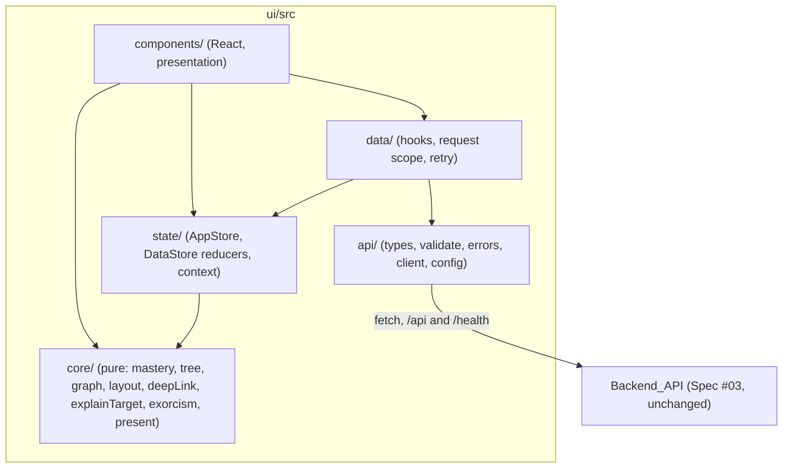
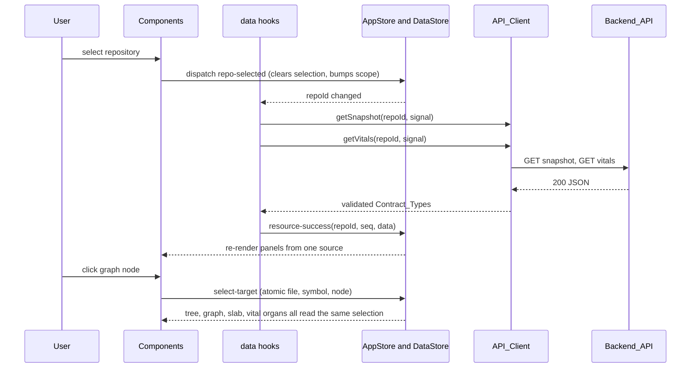
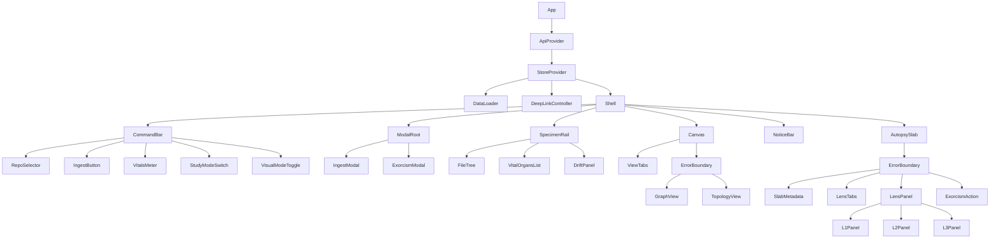
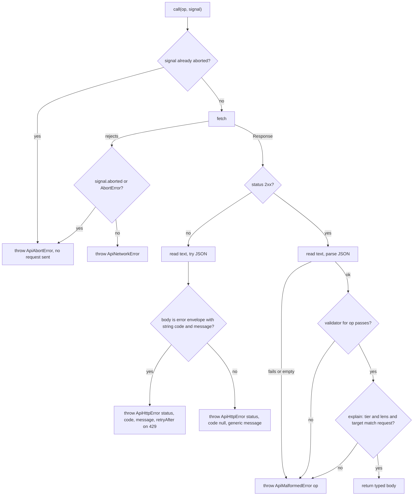
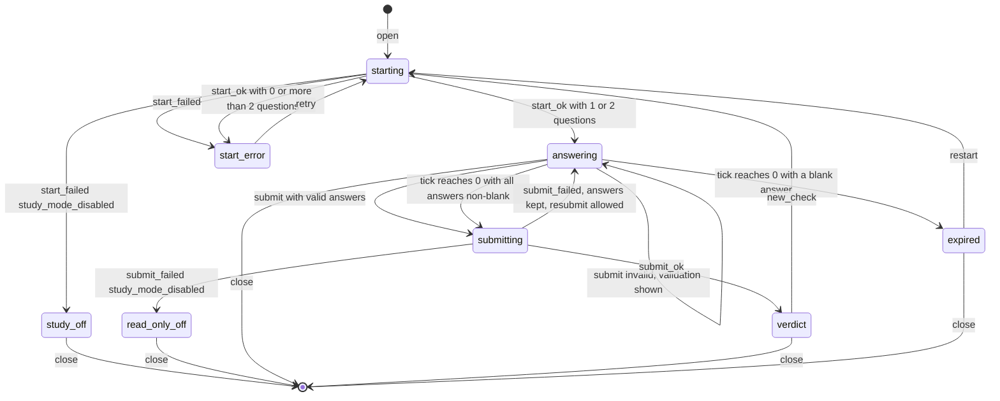
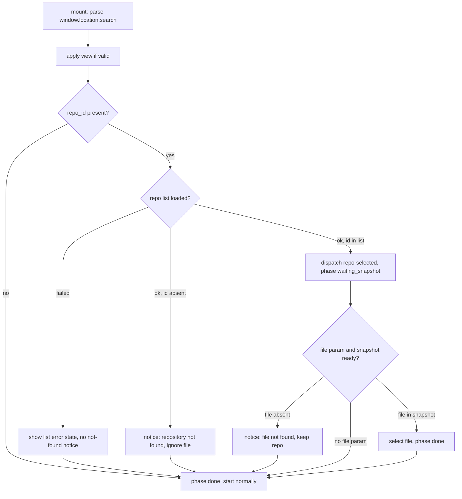

# Design Document

## Overview

Spec #04 delivers the Code Autopsy UI: a React and TypeScript single-page app in `ui/` that renders the data already served by the Spec #03 REST API. The UI is the Hosted Web App surface. It owns presentation and interaction only. Mastery state, grading, explanations, blast radius, topology, drift and provenance are never computed in the UI; they are read from backend responses, and where the backend has no data the UI says so (Graceful_Degradation).

This design was checked against the live backend contract in `requirements.md` (Verified Backend Contract and Recorded Contract Mismatches) and against `.kiro/steering/*`: `architecture.md` (static analysis only, structured outputs, no duplicated logic), `design-system.md` (clinical X-ray identity, color is system state), `product.md` (Autopsy vs Study Mode, three lenses), and `testing-rules.md` (offline, deterministic, mock providers).

### Research Findings That Shape the Design

Findings come from library documentation (no separate research file is kept):

- **@xyflow/react v12** accepts explicit `width` and `height` on node objects, so first render does not depend on DOM measurement. It has an `onlyRenderVisibleElements` prop for virtualization and `nodesFocusable` for keyboard focus. ([React Flow API reference](https://reactflow.dev/api-reference/react-flow))
- **dagre** lays out a directed graph from node sizes and edges. Its output depends on node and edge insertion order, so determinism requires the caller to sort inputs before insertion. It breaks cycles internally, so cyclic input does not fail. ([React Flow dagre example](https://reactflow.dev/examples/layout/dagre))
- **Vite `server.proxy`** forwards matching paths to a target. With no `rewrite`, the request path is forwarded unchanged. ([Vite server options](https://vite.dev/config/server-options.html#server-proxy))
- **Tailwind CSS 3.4** supports overriding `theme.colors` completely (not `extend`), which removes the default palette so only named tokens exist, and `addVariant` for the `autopsy:` and `lab:` mode variants. ([Tailwind theme docs](https://v3.tailwindcss.com/docs/theme))
- **jsdom** does not implement `ResizeObserver`, `DOMMatrixReadOnly`, `matchMedia`, or `scrollIntoView`. Tests install stubs in one setup file.
- **fast-check** is the property-based library for TypeScript and runs under Vitest with a fixed `seed`, which gives the repeatable results Requirement 28.4 needs. ([fast-check docs](https://fast-check.dev/))

### Key Design Decisions

| Decision | Rationale | Alternative rejected |
|---|---|---|
| Two stores: `AppStore` (exactly the eight values of Requirement 4.1) and `DataStore` (remote resources keyed by one `repo_id`) | Keeps Requirement 4.1 literal. Selection is tiny and synchronous; remote data has loading, error and staleness concerns. | One store with everything: breaks the "exactly eight values" rule. |
| Pure reducers and pure `core/` modules; React only wires them | Every invariant in the Correctness Properties is testable without DOM. | Logic inside components: only testable through render. |
| Stale-response protection is in the reducer (`repo_id` match plus per-resource sequence number), and `AbortController` is a second layer that cancels network work | A response that slips past an abort still cannot change state. The guard is a pure function, so it is property-testable. | Abort only: relies on every code path wiring a signal. |
| Hand-written runtime validators in `api/validate.ts` | Requirement 2.11 requires "required field missing" detection at runtime. No extra dependency; unknown enum strings stay tolerant (Requirement 27.5). | `zod`: extra dependency, stricter enums that would reject unknown values. |
| Directory selection for L3 is stored in `selectedGraphNode` | The eight-value rule leaves no ninth slot. A directory key can never equal a file path or `file::qualname` symbol id, so the value classifies unambiguously against the snapshot. | A ninth store value: violates Requirement 4.1. |
| No external fonts, no SVG data URIs with `http://` namespaces | Requirement 1.9 and 1.10 forbid absolute URLs in `ui/src` and external hosts in the build. System font stacks and CSS gradients cover the need. | Web fonts from a CDN. |

### Resolved Requirement Tensions

These points are ambiguous or in tension inside `requirements.md`. The design takes the position below and each is called out so the project owner can overrule it.

1. **Vitals refresh failure (Requirements 8.11, 19.15, 25.7).** 8.11 says a failed refresh replaces earlier values with the error state. 19.15 and 25.7 say the previous vitals stay. The design uses a refresh mode: `replace` for load, retry, and Study Mode change (8.11, 9.7); `keep` for explain-triggered and verdict-triggered refresh (19.15, 25.7). In `keep` mode a failed refresh sets `refreshFailed` and the previous values stay.
2. **Distinct color token per state (Requirements 11.1, 11.7).** `NO TRACKED SYMBOLS` and `STATE UNKNOWN` are both neutral zinc. They differ by label and icon. The four `MasteryState` values differ by label, icon, and color token. `DISSECTED` uses the bone-white token.
3. **Study Mode source (Requirements 4.4, 4.11, 9.1).** After a repository change Study Mode is `unknown`. It is set only from the vitals response (`study_mode_enabled`) and the study-mode POST response. The list entry `study_mode_enabled` is patched on a successful toggle, never used to seed the switch.
4. **Crimson text contrast.** `#DC2626` on `#09090B` is about 3.7:1, below the 4.5:1 text minimum of Requirement 10.15. Crimson `#DC2626` is used for borders, fills, icons and markers (3:1 needed). Red text uses the secondary red `#EF4444` (about 5.3:1 on `#09090B`). Both stay within Requirement 10.8 (crimson and red only for diagnostic states).
5. **Derived neighbor highlight vs blast radius (Requirements 16.2 to 16.6).** One-hop neighbors from snapshot edges get a neutral bone-white outline and an `UPSTREAM` or `DOWNSTREAM` text marker. Crimson with a `BLAST` marker is used only for ids from an explain response `blast_radius`.

## Architecture

### Layered Structure



Dependencies point inward: `components` call `data` and read `state`; only `api/client.ts` touches `fetch`; `core/` imports nothing from React or the DOM. This mirrors the backend's hexagonal rule on the frontend side.

### Runtime Data Flow



### Project Layout under `ui/`

```text
ui/
  index.html                 entry; loads /src/main.tsx
  package.json               scripts: dev, build, test, typecheck
  package-lock.json          committed (Requirement 1.11)
  tsconfig.json              strict; includes src and tests
  vite.config.ts             react plugin, dev proxy, Vitest config
  tailwind.config.ts         theme.colors replaced by named tokens, mode variants
  postcss.config.js
  src/
    main.tsx                 restores visual mode, mounts <App/>
    App.tsx                  providers and shell
    api/
      config.ts              normalizeBaseUrl, buildUrl
      types.ts               Contract_Types
      errors.ts              ApiHttpError, ApiNetworkError, ApiMalformedError, ApiAbortError
      validate.ts            runtime validators per response type
      client.ts              createApiClient with the nine operations
      context.tsx            ApiProvider and useApi
    core/                    pure modules, no React
      mastery.ts             presentMastery, fileMasteryView
      snapshotIndex.ts       lookup maps and node classification
      fileTree.ts            buildFileTree, flattenVisible
      graph.ts               buildGraphModel, cycle edge set, highlight sets
      layout.ts              layoutGraph (dagre wrapper)
      explainTarget.ts       resolveExplainTarget
      deepLink.ts            parseDeepLink, resolveDeepLink, buildSearch
      exorcism.ts            exorcism transition function
      present.ts             presentError (error to user text)
      counters.ts            recompute counters read by tests
    state/
      appReducer.ts          AppState and actions
      dataReducer.ts         DataState, Remote<T>, sequence guards
      store.tsx              providers, hooks, selectors
    data/
      requestScope.ts        per-repository AbortController scope
      useRepos.ts  useSnapshot.ts  useVitals.ts  useExplain.ts
      useStudyMode.ts  useIngest.ts  useSocratic.ts  useRetry.ts
    components/
      shared/   StateBlock, Modal, PlainText, MasteryBadge, LiveRegion, ErrorBoundary, Tabs
      shell/    CommandBar, RepoSelector, VitalsMeter, StudyModeSwitch, VisualModeToggle, IngestModal, NoticeBar
      rail/     SpecimenRail, FileTree, VitalOrgansList, DriftPanel
      canvas/   Canvas, ViewTabs, GraphView, FileNode, SymbolNode, CircularEdge, TopologyView
      slab/     AutopsySlab, SlabMetadata, LensTabs, LensPanel, L1Panel, L2Panel, L3Panel, ExorcismAction
      exorcism/ ExorcismModal
    styles/
      tokens.css             CSS variables for the color tokens (single source)
      index.css              Tailwind layers, grid, shroud, pulse, reduced-motion rules
  tests/
    setup.ts                 jsdom stubs, fast-check config, storage and URL reset
    helpers/                 mockFetch.ts, renderApp.tsx, deferred.ts
    fixtures/                typed builders: repos, snapshot, vitals, explain, socratic
    unit/                    property tests (11)
    ui/                      component and flow tests (7)
```

Fixtures live only under `ui/tests/`. Production code never imports from `tests/`, and the Vite build starts at `index.html`, so fixtures cannot reach `dist/` (Requirement 27.3).

### Toolchain Configuration

- **Scripts** (Requirement 1.2, 1.3, 1.5): `dev` is `vite`; `build` is `tsc --noEmit && vite build`; `typecheck` is `tsc --noEmit`; `test` is `vitest run`. `vitest run` executes once and exits. A type error makes `tsc` exit non-zero, which fails both `typecheck` and `build`.
- **TypeScript** (Requirement 1.4): `strict: true`, plus `noUncheckedIndexedAccess` and `noImplicitOverride`. `tests/` is part of `tsc` so typed fixtures break the typecheck when a Contract_Type drifts.
- **Dependencies** (Requirement 1.1): runtime `react`, `react-dom`, `@xyflow/react`, `dagre`, `lucide-react`. Dev: `typescript`, `vite`, `@vitejs/plugin-react`, `tailwindcss` (3.4), `postcss`, `autoprefixer`, `vitest`, `jsdom`, `@testing-library/react`, `@testing-library/user-event`, `@testing-library/jest-dom`, `@types/react`, `@types/react-dom`, `@types/dagre`, `fast-check`. `fast-check` is the one dev dependency beyond the list in Requirement 1.1; it supplies the property tests that `testing-rules.md` asks for.
- **Fonts** (Requirement 1.10, 10.10): system font stacks only. Sans: `ui-sans-serif, system-ui, sans-serif`. Mono: `ui-monospace, SFMono-Regular, Menlo, Consolas, monospace`.

### Vite Proxy and Base URL Handling

`vite.config.ts` (outside `ui/src`, so the target literal does not violate Requirement 1.9):

```ts
server: {
  proxy: {
    '/api':    { target: 'http://127.0.0.1:8000' },
    '/health': { target: 'http://127.0.0.1:8000' },
  },
}
```

No `rewrite` and no `changeOrigin` rewrite of the path, so the path is forwarded unchanged (Requirement 1.6). The dev server is same-origin to the browser, so CORS does not apply in development.

`api/config.ts`:

```ts
export function normalizeBaseUrl(raw: string | undefined): string {
  if (raw === undefined || raw === '') return '';
  return raw.replace(/\/+$/, '');   // remove one or more trailing slashes
}
export function buildUrl(base: string, path: string): string {
  return base + path;               // path always starts with "/"
}
```

`createApiClient` reads `import.meta.env.VITE_API_BASE_URL` once at construction through `normalizeBaseUrl`, and accepts an explicit `baseUrl` in tests. When the base is empty, URLs are relative (`/api/repos`), which the proxy handles. A value that is only slashes normalizes to `''`, which is relative; this is the safest reading of "non-empty value, remove trailing slashes".

With a cross-origin base, `Retry-After` is unreadable by the browser (the backend exposes no headers). The client then returns `retryAfterSeconds: undefined`, and the UI states the rate limit without a number (Requirements 2.13, 7.11).

### Visual Mode CSS Strategy

One attribute drives presentation: `document.documentElement.dataset.visualMode = 'autopsy' | 'lab'`.

- `main.tsx` reads `localStorage['stupid-code.visual-mode']` inside `try/catch`, validates it against `'Autopsy' | 'Lab'`, falls back to `Autopsy`, and writes the attribute **before** `createRoot(...).render(...)`. That satisfies "restore before the first Canvas render" (Requirement 10.3, 10.4).
- Toggling dispatches `visual-mode-set`; a layout effect updates the attribute synchronously and writes storage in `try/catch`. No network call, no state beyond the one store value (Requirement 10.1, 10.5).
- Tailwind variants `autopsy:` and `lab:` are `[data-visual-mode="autopsy"] &` and `[data-visual-mode="lab"] &`.
- Autopsy-only decoration is defined only under the Autopsy selector:
  - **Coordinate grid**: a CSS `background-image` of two `linear-gradient` hairlines in the hairline token on the Canvas container. `pointer-events: none` overlay.
  - **Shroud**: an absolutely positioned `::after` on `UNAUDITED` nodes with a static `repeating-linear-gradient` scanline texture at low opacity, `pointer-events: none`. Static, no blur, no halo. The node also carries the text `UNAUDITED`, so the state never depends on the overlay.
  - **Fracture pulse**: `@keyframes fracture-pulse` toggling stroke opacity (no blur) on circular edges.
- Lab mode defines none of those rules. Mastery badges, the `CIRCULAR` text marker, the dashed crimson stroke, icons and colors are mode-independent (Requirement 10.13, 11.11).
- `@media (prefers-reduced-motion: reduce)` sets `animation: none !important; transition: none !important` for all elements in both modes, which also covers the Shroud clearing transition (Requirements 10.14, 29.11). JS-driven animation (`setCenter` on viewport) reads a `useReducedMotion()` hook and passes `duration: 0`.
- **Color tokens** live once in `styles/tokens.css` as CSS variables: `--color-obsidian #09090B`, `--color-surface #111113`, `--color-bone #F4F4F5`, `--color-muted #A1A1AA`, `--color-hairline #27272A`, `--color-crimson #DC2626`, `--color-signal #EF4444`, `--color-verified #10B981`, `--color-stale #F59E0B`. `tailwind.config.ts` sets `theme.colors` (not `extend`) to those variables plus `transparent` and `currentColor`, so no default palette color exists. React Flow edge and node styles use `var(--color-*)` strings, never hex literals (Requirement 10.6). Amber (`stale`) is used by exactly one consumer, `presentMastery('STALE')` (Requirement 10.7).

## Components and Interfaces

### Component Tree



`DataLoader` is a render-less component that owns the loading effects (repos on mount; snapshot and vitals when `selectedRepoId` changes). Panels read `Remote<T>` values from the `DataStore` and never start those loads themselves, so no panel duplicates a request.

### Component Responsibilities

| Component | Responsibility | Reads | Writes |
|---|---|---|---|
| `CommandBar` (landmark `banner`) | Hosts the five controls in tab order | none | none |
| `RepoSelector` | Lists `RepoSummary[]`, selection, loading, empty, error states. `repo_id` is plain monospace text, truncated by CSS, full value in `title` and `aria-label` (6.12) | repos | `repo-selected` |
| `IngestModal` | Source choice, validation, in-flight state, summary, follow-up retry | none | via `useIngest` |
| `VitalsMeter` | Shows counts and percentage verbatim, `aria-live="polite"` | vitals | none |
| `StudyModeSwitch` | `role="switch"`, pending state, error with retry | studyMode, repo | via `useStudyMode` |
| `VisualModeToggle` | `aria-pressed`, visible text of current mode | visualMode | `visual-mode-set` |
| `SpecimenRail` | Collapse button (`aria-expanded`), unmounts content while collapsed so controls leave the tab order (5.3). The `snapshot` and `vitals` stay in the store, so no request is sent | selection | local `collapsed` flag |
| `FileTree` | `tree` role, roving tabindex, windowing above 1,000 rows | snapshot, selection, vitals | `select-target` |
| `VitalOrgansList` | Classifies each id as `FILE`, `SYMBOL`, `UNRESOLVED`; keeps backend order | snapshot, selection | `select-target` |
| `DriftPanel` | Filter, entries, spec links for the selected file | provenance, snapshot, selection | `select-target` |
| `Canvas` | `tablist` view switch, error boundary, one active view | activeView | `view-set` |
| `GraphView` | Layer switch, React Flow, text alternative, highlight styling | snapshot, vitals, selection, explain cache | `select-target`, `select-clear-node` |
| `TopologyView` | Pattern, confidence, metrics, directory rows, evidence | topology | `select-directory` |
| `AutopsySlab` (landmark `complementary`) | Metadata, lens tabs, lens content, Exorcism action | snapshot, provenance, vitals, selection | `lens-set` |
| `LensPanel` | Chooses `L1Panel`, `L2Panel`, `L3Panel`; owns loading, error, retry for explain | explain cache | via `useExplain` |
| `ExorcismModal` | Drives the Exorcism state machine and renders each phase | studyMode, selection | via `useSocratic` |
| `NoticeBar` | Dismissible deep-link notices | local list | none |

Shared building blocks (Requirement 3.15, 29.9):

- `StateBlock` has three variants. `loading` shows a text label with `role="status"`. `empty` names what is absent with `role="status"`, no error styling and no retry. `error` shows the presented message, a retry button, an optional health note, and optional `retryAfterSeconds` gating. It uses `role="alert"` (Requirement 3.16).
- `PlainText` renders a string as a text node with `white-space: pre-wrap`. No component uses `dangerouslySetInnerHTML` (Requirement 29.10).
- `MasteryBadge` renders icon, label text and token color from `presentMastery`. The label is real text, so it is exposed to assistive technology (Requirement 11.9).
- `Modal` renders into `#modal-root` through a portal, moves focus to the first focusable element, traps Tab and Shift+Tab, sets the `inert` attribute on `#app-root` while open (set by effect, so it works across React versions), returns focus to the opener or to the Command_Bar heading when the opener is gone, and calls `onRequestClose` on Escape unless `blockClose` is true (Requirement 29.4 to 29.6).
- `ErrorBoundary` is a class component with a fixed message and a reset action that bumps a `resetKey` and re-renders its children from the stores, with no page reload (Requirement 3.14).

### API_Client Interface

```ts
export interface ApiClient {
  getHealth(opts?: CallOpts): Promise<HealthResponse>;
  listRepos(opts?: CallOpts): Promise<RepoSummary[]>;
  ingestRepo(body: IngestRequest, opts?: CallOpts): Promise<IngestResponse>;
  getSnapshot(repoId: string, opts?: CallOpts): Promise<SnapshotResponse>;
  explain(repoId: string, body: ExplainRequest, opts?: CallOpts): Promise<ExplainResponse>;
  getVitals(repoId: string, opts?: CallOpts): Promise<ComprehensionVitals>;
  setStudyMode(repoId: string, enabled: boolean, opts?: CallOpts): Promise<StudyModeResponse>;
  startSocratic(repoId: string, targetId: string, opts?: CallOpts): Promise<SocraticCheck>;
  submitSocratic(repoId: string, body: SocraticSubmitRequest, opts?: CallOpts): Promise<SocraticVerdict>;
}
export interface CallOpts { signal?: AbortSignal }
```

Exactly nine operations (Requirement 2.3). `createApiClient({ baseUrl? })` returns an `ApiClient`. It looks up `globalThis.fetch` at call time, so a test that replaces `globalThis.fetch` is honored. This module is the only place in `ui/src` that mentions `fetch` or `XMLHttpRequest` (Requirement 2.4).

**Request construction** (Requirements 2.5 to 2.7):

- `repoId` is placed as `encodeURIComponent(repoId)`, one path segment. A `/`, `?`, `#`, `%` or space in `repo_id` cannot change the route.
- A request with a body sets `Content-Type: application/json` and a `JSON.stringify` of exactly the keys of that endpoint: `{target_id, lens}`; `{path}` or `{url}` for ingest; `{enabled}`; `{target_id}`; `{target_id, answers: [{question_id, answer}]}`. `GET` calls pass no `body` and set no `Content-Type`.
- `ingestRepo` forwards the body unchanged. The UI builds it with exactly one of `url` or `path` (Requirement 7.4); the client defensively throws a programmer error (not an `ApiError`) if both or neither are present.

**Response mapping** (Requirements 2.8 to 2.14). The order of checks is fixed:



- Reading the body can itself reject (for example when aborted mid-read). The same abort-versus-network rule applies there.
- `retryAfterSeconds` is parsed only for status 429 from `response.headers.get('Retry-After')` with `/^\s*\d+\s*$/`; any other state (absent, negative, date string, `NaN`) leaves it `undefined` (Requirement 2.13).
- `ApiHttpError.message` for an unusable body is the fixed constant `GENERIC_HTTP_MESSAGE`. No raw body, stack or exception text is ever copied into an error (Requirement 2.10). Unknown `code` strings pass through unchanged (Requirement 2.9).
- The explain check (Requirements 2.11, 19.14, 20.7) lives in the client because it knows the request: the tier named by the lens must be non-null, the other two must be null, `envelope.lens` and `envelope.target_id` must equal the request, and the tier's own `target_id` must equal the request.
- The client adds no retry, cache, or envelope of its own (Requirement 2.15).

### Error Classes

```ts
export class ApiHttpError extends Error {
  constructor(readonly status: number, readonly code: string | null,
              message: string, readonly retryAfterSeconds?: number) { super(message); }
}
export class ApiNetworkError extends Error {}
export class ApiMalformedError extends Error { constructor(readonly operation: string) { super('malformed response'); } }
export class ApiAbortError extends Error {}
```

All four are distinct classes (Requirement 2.14). `Error.message` of `ApiNetworkError` and `ApiMalformedError` is a fixed string; the original cause is not attached, so nothing from the network layer can leak into the UI.

`core/present.ts` maps an error plus a context (`'generic' | 'explain' | 'socratic' | 'ingest'`) to `{ message: string; retryable: boolean; retryAfterSeconds?: number } | null`:

| Error | Result |
|---|---|
| `ApiAbortError` | `null` (show nothing, Requirement 3.13) |
| `ApiHttpError`, context `explain`, code `llm_unavailable` or `invalid_llm_output` | fixed "explanation service is unavailable" text |
| `ApiHttpError`, context `socratic`, code `llm_unavailable`, `invalid_llm_output`, `grading_unavailable` | fixed "grading service is unavailable" text |
| `ApiHttpError`, code `rate_limited`, context `ingest` | fixed "GitHub ingestion is rate limited" text, plus the seconds only when `retryAfterSeconds` is defined |
| `ApiHttpError`, code `local_ingest_disabled`, context `ingest` | fixed "local path ingestion is disabled on this server" text |
| other `ApiHttpError` | the error `message` verbatim (already the envelope message or the generic constant) |
| `ApiNetworkError` | fixed connectivity message |
| `ApiMalformedError` | fixed generic message |

### App_Store

`state/appReducer.ts` holds exactly eight values:

```ts
export interface AppState {
  repoId: string | null;
  file: string | null;
  symbol: string | null;
  node: string | null;                 // graph node id; also holds a directory key (see decision table)
  view: 'graph' | 'topology';
  lens: Lens;
  studyMode: boolean | 'unknown';
  visualMode: 'Autopsy' | 'Lab';
}
export const initialAppState = (visualMode: VisualMode): AppState => ({
  repoId: null, file: null, symbol: null, node: null,
  view: 'graph', lens: 'L1_SYNTAX', studyMode: 'unknown', visualMode,
});
```

Actions (each is one `dispatch`, so one render commit; React batches the reducer result, so no render shows a partial selection, Requirement 4.6):

| Action | Effect |
|---|---|
| `repo-selected {repoId \| null}` | If equal to current: return the same state object (4.10). Else: `repoId` set; `file`, `symbol`, `node` null; `studyMode` `'unknown'`; `view`, `lens`, `visualMode` kept (4.4) |
| `select-target {target: ResolvedTarget}` | `{kind:'file', path}`: `file=path`, `node=path`, `symbol=null` (4.7). `{kind:'symbol', id, filePath}`: `symbol=id`, `node=id`, `file=filePath` (4.8). If the result equals the current tuple, return the same state (4.10) |
| `select-directory {dir}` | `node=dir`, `lens='L3_ARCHITECTURE'`; `file` and `symbol` kept (17.5, 17.9) |
| `node-cleared` | `node=null` (canvas background click, Escape) |
| `layer-changed {keepNode}` | `node = keepNode ? node : null`; `file` unchanged (15.20) |
| `view-set`, `lens-set` | set only that field; selection kept (17.9, 19.2) |
| `study-mode-set {value}` | set `studyMode` |
| `visual-mode-set {value}` | set `visualMode` only (9.14, 10.5) |

`ResolvedTarget` is produced outside the reducer by the pure `resolveTarget(index, rawTarget)` in `core/snapshotIndex.ts`. It returns `null` for an id absent from the snapshot, and the caller then dispatches nothing, so the selection stays unchanged (Requirement 4.9). Because the reducer receives only resolved targets and the file path of a symbol comes from the same index lookup, the three selection fields can never disagree.

Only `visualMode` is persisted, by a single effect in `store.tsx`. `studyMode` is never written to storage (Requirement 4.11, 4.12).

**Selection-to-node classification.** `classifyNode(index, directoryRoles, id)` returns `'file' | 'symbol' | 'directory' | null`. Files are checked first, then symbols, then directory keys. A directory key never has the `::` separator and never equals a file path, so classification is unambiguous in a real snapshot.

### DataStore, Remote State and Request Guards

```ts
export type Remote<T> =
  | { status: 'idle' }
  | { status: 'loading' }
  | { status: 'ready'; data: T; refreshFailed?: boolean }
  | { status: 'error'; error: ApiError };

export interface DataState {
  repoId: string | null;                         // the one repository the data belongs to
  repos: Remote<RepoSummary[]>;
  snapshot: Remote<SnapshotResponse>;            // snapshot, provenance, topology arrive together
  vitals: Remote<ComprehensionVitals>;
  explain: Record<string, Remote<ExplainResponse>>;   // key = repoId \0 targetId \0 lens
  seq: { repos: number; snapshot: number; vitals: number; explain: Record<string, number> };
}
```

Data caches are keyed by the single selected `repo_id`. A repository change clears `snapshot`, `vitals`, `explain` and their sequence numbers in one reducer step, which is the discard rule of Requirement 4.4. `repos` is not repository-scoped and survives.

**Guard rule.** Every async result is dispatched as `{type: 'resource-success' | 'resource-failure', resource, repoId, seq, ...}`. The reducer applies it only if `action.repoId === state.repoId` **and** `action.seq === state.seq[resource]`. Otherwise it returns the same state. A `resource-start` action increments `seq[resource]` and records `loading`. The guard gives:

- A response for a repository no longer selected is discarded (Requirements 4.14, 8.9, 25.9).
- When requests for one resource overlap, only the latest start wins (Requirements 8.10, 25.10).
- A late response that was not aborted in time still cannot change state.

**Abort layer.** `data/requestScope.ts` holds one `AbortController` for the current repository. Hooks pass `scope.signal` to client calls. On `repo-selected` the scope aborts and a new one is created (Requirement 4.5). Aborted calls raise `ApiAbortError`, which hooks swallow (no error shown, Requirement 3.13). Ingest deliberately uses no scope signal so closing its modal does not cancel the request (Requirement 7.16).

**Vitals refresh modes** (Resolved Tension 1):

```ts
refreshVitals(repoId, mode: 'replace' | 'keep')
// replace: failure -> { status: 'error' }.   keep: failure -> ready data kept, refreshFailed: true
```

A `keep` refresh does not set `loading`, so the meter keeps showing the previous numbers during the request. A successful refresh in either mode clears `refreshFailed`.

**Explain cache.** Key `repoId + '\u0000' + targetId + '\u0000' + lens`. Only `ready` entries act as cache. A `ready` entry is served with no request (Requirement 19.11, 19.16). `error` entries are shown but never served as cache and never cause an automatic re-request. When the effect for a key is cleaned up (selection or lens changed, unmount), its non-`ready` entry is removed, so returning to the key later starts fresh. A `Map<key, AbortController>` held in the hook enforces at most one in-flight request per key (Requirement 19.8). Retry deletes the entry, then sends exactly one request (Requirement 19.12).

### Data-Loading Hooks

| Hook | Trigger | Calls | Notes |
|---|---|---|---|
| `useRepos()` | mount, `reload()`, after ingest | `listRepos` | On a refreshed list that lacks the selected repo, dispatches `repo-selected null` (6.10). Never adds ids the backend did not return (6.8) |
| `useSnapshot()` (in `DataLoader`) | `repoId` changes | `getSnapshot` | No request while `repoId` is null (5.5). `reload()` for retry |
| `useVitals()` | `repoId` changes; `refreshVitals(mode)` | `getVitals` | On success also dispatches `study-mode-set` from `study_mode_enabled` (Resolved Tension 3) |
| `useExplain(target, lens)` | resolved target changes | `explain` | Cache, in-flight dedupe, abort on change, study-mode vitals refresh on non-cached L1 or L2 success |
| `useStudyMode()` | toggle | `setStudyMode` | Pending state, single flight, rollback by never changing the displayed value until success |
| `useIngest()` | submit | `ingestRepo`, then list, snapshot, vitals | Follow-up retry repeats only failed follow-ups |
| `useSocratic()` | modal actions | `startSocratic`, `submitSocratic` | Wraps the Exorcism transition function |
| `useRetry(reload)` | retry button | `getHealth` then `reload` | Health pre-check only after a network error |

`useRetry` implements Requirements 3.7 to 3.9. If the last error was `ApiNetworkError`, it calls `getHealth` once; the check passes only when the result equals `{status:'ok', service:'stupid-code'}`. On pass it shows "Backend answered" and re-sends the failed request once. On failure or any other result it shows "Backend did not answer", keeps the error state, and keeps the retry action. For other errors it re-sends the request directly, once per activation. A `rate_limited` error with a defined `retryAfterSeconds` disables the retry button until a visible countdown elapses (Requirement 3.12); the countdown is driven by a timer tick, not a clock read.

**Cross-feature refresh triggers** (Requirements 8.8, 19.15, 25.1):

- `useStudyMode` success: patch the list entry, store `studyMode`, `refreshVitals(repoId, 'replace')`.
- `useExplain` non-cached success while `studyMode === true` and lens is `L1_SYNTAX` or `L2_FLOW`: `refreshVitals(repoId, 'keep')`. L3 and cache hits trigger none.
- `useSocratic` verdict displayed: `refreshVitals(repoId, 'keep')` for the checked symbol's repository; failure shows an out-of-date notice with a retry that calls the same refresh.
- `study_mode_disabled` error from start or submit: dispatch `study-mode-set false` and `refreshVitals(repoId, 'replace')` (Requirement 9.12).

### Pure Mastery Mapping (`core/mastery.ts`)

```ts
export type MasteryCategory =
  'UNAUDITED' | 'DISSECTED' | 'MASTERED' | 'STALE' | 'NO TRACKED SYMBOLS' | 'STATE UNKNOWN';
export interface MasteryPresentation {
  category: MasteryCategory; label: string; icon: IconName; token: ColorToken;
}
export function presentMastery(input: unknown): MasteryPresentation;       // total
export type FileMastery = MasteryPresentation;
export function fileMasteryView(vitals: Remote<ComprehensionVitals>, filePath: string): FileMastery;
```

| Category | Icon (lucide) | Token | Note |
|---|---|---|---|
| `UNAUDITED` | `ShieldAlert` | `crimson` | Shroud eligible |
| `DISSECTED` | `ScanSearch` | `bone` | |
| `MASTERED` | `ShieldCheck` | `verified` | |
| `STALE` | `Clock` | `stale` | |
| `NO TRACKED SYMBOLS` | `CircleSlash` | `muted` | |
| `STATE UNKNOWN` | `CircleHelp` | `muted` | |

- `presentMastery` returns the category with `label === input` for the four known strings, and `STATE UNKNOWN` for anything else (unknown string, `undefined`, number, object) with no throw (Requirements 11.2, 11.8).
- `fileMasteryView` returns `STATE UNKNOWN` unless `vitals.status === 'ready'`. When ready (including `refreshFailed`), a path with no key in `file_states` gives `NO TRACKED SYMBOLS`; a key gives `presentMastery(value)`. It reads nothing else: not counts, not `due_for_review`, not an explain response (Requirement 11.5).
- A discarded or previous-repository response cannot reach this function, because the `Remote` it receives is the guarded DataStore value.
- The Shroud predicate is `category === 'UNAUDITED' && visualMode === 'Autopsy'`; no other category ever returns true (Requirement 15.11).
- A single memoized `masteryLookup` per vitals value produces a `Map<filePath, FileMastery>` so every region updates from one response at once (Requirements 11.10, 29.7).

### Snapshot Index (`core/snapshotIndex.ts`)

`buildSnapshotIndex(snapshot, topology)` memoized per snapshot object (WeakMap) returns `filesByPath`, `symbolsById`, `symbolsByFile` (sorted by `start_line` then `id`), `directoryRoles`, and `classifyNode`/`resolveTarget`. All lookups are exact, case-sensitive string equality.

### Graph Building and Layout

`core/graph.ts`:

```ts
export type Layer = 'files' | 'symbols';
export interface GraphNodeModel { id: string; layer: Layer; label: string; filePath: string; kind?: string }
export interface GraphEdgeModel { id: string; source: string; target: string; edgeType: string; circular: boolean }
export interface GraphModel {
  nodes: GraphNodeModel[];        // sorted by id, code-unit order
  edges: GraphEdgeModel[];        // sorted by (source, target, edgeType), deduplicated
  circularEdgeIds: ReadonlySet<string>;
  outgoing: ReadonlyMap<string, readonly string[]>;   // node id -> target ids
  incoming: ReadonlyMap<string, readonly string[]>;   // node id -> source ids
}
export function buildGraphModel(snapshot: RepoGraphSnapshot, layer: Layer): GraphModel;
```

Rules (Requirements 15.3 to 15.5, 15.9, 15.17):

- `files` layer: one node per `snapshot.files[].file_path`; only edges with `edge_type === 'imports'`. `symbols` layer: one node per `files[].symbols[].id`; only `edge_type === 'calls'`. Edges of any other `edge_type` are not drawn.
- An edge whose `source` or `target` is not a node of the layer is omitted and creates no node.
- **Cycle edge set.** Build `Map<nodeId, number[]>` of cycle-entry indices from `snapshot.cycles`. An edge is circular iff its endpoints share at least one cycle index. The set is computed once per `(snapshot, layer)` and stored as `circularEdgeIds`; selection changes never recompute it. This applies in both layers because it is defined by node ids, not by layer.
- Nothing is hardcoded: every node and edge derives from the snapshot arguments.

**Highlight model** (`highlightFor(model, selectedId, blast?)`), computed from `model.incoming`/`outgoing` (O(degree)), not from a full scan:

```ts
export interface Highlight {
  selected: string | null;
  upstream: ReadonlySet<string>;     // one-hop sources of edges into selected
  downstream: ReadonlySet<string>;   // one-hop targets of edges out of selected
  blast: ReadonlySet<string>;        // ids from explain blast_radius that are layer nodes
  source: 'blast_radius' | 'derived' | 'none';
  impactScore: number | null;        // only when source is 'blast_radius'
}
```

A selected id that is not a node of the layer (a directory key, or a node of the other layer) yields `selected: null`, no dimming. Blast ids that are not layer nodes are skipped (Requirement 16.8). Node style precedence: `selected` > `blast` (crimson plus `BLAST` marker) > `upstream` or `downstream` (bone-white outline plus text marker) > `dim` (reduced opacity) when a node is selected. Edges touching the selected node stay normal; the rest are dimmed.

`core/layout.ts`:

```ts
export interface LayoutResult {
  positions: ReadonlyMap<string, { x: number; y: number }>;
  width: number; height: number;
}
export function layoutGraph(model: GraphModel): LayoutResult;
```

- Node size is a fixed constant (180 by 44). Layout never reads the DOM.
- Input is sorted before insertion into `dagre.graphlib.Graph`: nodes by id, edges by `(source, target)`. Fixed options: `rankdir: 'LR'`, `nodesep: 24`, `ranksep: 72`, `marginx/marginy: 16`. Same model gives the same output; a permutation of the snapshot arrays gives the same sorted model and therefore the same output (Requirement 15.6).
- Coordinates are rounded to integers (top-left from dagre's center). Isolated nodes get a dagre rank-0 slot, and the reported `width`/`height` come from `graph.graph()`, so every node box lies within `[0,width] x [0,height]` (Requirement 15.8).
- Memoization: a `WeakMap<RepoGraphSnapshot, Partial<Record<Layer, {model, layout}>>>` caches model and layout per snapshot and layer (Requirement 15.7, 29.7). Selection, vitals, explain responses and visual mode are not inputs, so none can invalidate it. `core/counters.ts` exposes `computeCounters = { fileTree, graph, layout, cycleSet, masteryLookup }`, incremented inside each builder; tests read them (Requirement 29.12).

**Rendering.** `GraphView` builds React Flow nodes from `(model, layout)` once per layer, then applies selection styling in a separate step that reuses the previous `data` object of any node whose derived fields (`highlight`, `mastery`, `shroud`) are unchanged. Node components are wrapped in `React.memo`, so a selection change re-renders only nodes whose highlight changed (Requirement 29.8). `onlyRenderVisibleElements` is set when `model.nodes.length > 300` (Requirement 15.19). Nodes carry explicit `width`/`height`. File nodes use `FileNode`; symbol nodes use `SymbolNode`, which shows the mastery of its file with the text `file-level` (Requirement 15.13).

Edges use the custom `CircularEdge` for circular ids: dashed crimson stroke, a `CIRCULAR` text label on the edge, and the `fracture-pulse` class only under Autopsy mode. Non-circular edges use the default edge in the hairline token.

Interaction: clicking a node dispatches the resolved `select-target`; clicking the pane dispatches `node-cleared`; nodes are focusable, Enter or Space selects, Escape on the canvas clears (Requirements 16.1, 16.7, 16.9). A visually hidden paragraph (`aria-live="polite"`) states the selected node id with incoming and outgoing edge counts from the layer edges, `No upstream or downstream nodes` when both are zero, or that nothing is selected (Requirements 15.18, 16.10).

Viewport centering on a vital-organ or tree selection uses `setCenter` only when the node exists in the current layer's positions; otherwise nothing happens and the selection remains (Requirements 13.8 to 13.10). When the Topology_View is active the effect does not run, and `GraphView` performs the centering on mount if `node` is set (13.10).

A layer switch computes `keepNode = node !== null && newModel.nodes.some(n => n.id === node)` and dispatches `layer-changed {keepNode}` (Requirement 15.20, 16.11).

**Blast radius source.** `selectBlastRadius(dataState, appState)` returns the `blast_radius` of the first `ready` explain entry for the selected symbol, checking `L2_FLOW` before `L1_SYNTAX`. It returns `undefined` if no symbol is selected or none exists. It is derived from the selected symbol each render, so changing the selected symbol discards it (Requirement 16.12). `GraphView` never calls the API (Requirement 16.13). `impact_score` text reads `from blast-radius result`; derived highlighting is labelled `derived from snapshot` and shows no score. For a selected file the Slab shows `File-level blast radius is not provided by the backend` (Requirement 27.7).

### File Tree (`core/fileTree.ts`)

```ts
export type TreeRow =
  | { kind: 'folder'; path: string; name: string; depth: number; expanded: boolean }
  | { kind: 'file'; path: string; name: string; depth: number; language: string; parseErrors: boolean; expanded: boolean; hasSymbols: boolean }
  | { kind: 'symbol'; id: string; qualname: string; symbolKind: string; depth: number; filePath: string };
export function buildFileTree(files: FileAnalysis[]): TreeNode;                 // memoized per snapshot
export function flattenVisible(root: TreeNode, expanded: ReadonlySet<string>): TreeRow[];
export function ancestorsOf(path: string): string[];
```

- Folders come from `/`-separated segments only; no row exists for a segment no `file_path` contains (Requirement 12.1).
- Children sort: folders before files, each group ascending by code-unit comparison (`a < b`, not `localeCompare`), independent of input order (Requirement 12.2). Symbols under a file sort by `start_line`, then `id` (12.8).
- `expanded` is a `Set<string>` local to `FileTree`. Initially it holds only the ancestors of the selected file (12.4). When the selection changes from any source, an effect adds the ancestors of the selected file (and the file itself when a symbol is selected, so the symbol row is visible), then scrolls the row into view and marks it `aria-selected` (12.14).
- Roles: container `tree` with an accessible name; folder rows `treeitem` with `aria-expanded`; children inside `group`. Roving `tabindex`: one row has `tabindex=0`. ArrowUp/Down move in the flat visible list; ArrowRight expands or moves into the first child; ArrowLeft collapses or moves to the parent; Home and End jump to the ends (12.15, 12.16).
- **Virtualization above 1,000 rows** (12.17): when `flattenVisible` returns more than 1,000 rows, `FileTree` renders only the rows in the scroll window (fixed 28 px row height, a spacer for total height, `aria-setsize` and `aria-posinset` on each rendered row). Key handling works on the flat array, scrolls the target index into the window, and focuses the row in the same commit. Only the window is in the DOM, so moving focus is O(window).
- Mastery badge on file rows only, from `fileMasteryView` (12.7). Symbol rows show no badge (12.10). A file with non-empty `parse_errors` shows a `PARSE ERRORS` label and stays selectable (12.11). Language shows verbatim in a badge; an unknown language string renders as plain text with a neutral style (27.5).

### Topology View

`TopologyView` renders `TopologyProfile` sections, each with its own empty state (Requirement 17.7):

- Header: `detected_pattern` as plain text and `Math.round(confidence * 100)` followed by `%`.
- Metrics list with the backend key names as labels: `domain_isolation_score` and `cross_folder_import_ratio` via `toFixed(2)`, `max_depth` and `entry_point_count` as integers.
- Directory table: keys of `directory_roles` sorted by code point (default string sort), path and role in monospace. Unknown role strings render as plain text with a neutral style.
- Evidence: ordered list of plain text in backend order.
- A directory row is a button. Activating it dispatches `select-directory {dir}`, which sets `node`, switches the lens to `L3_ARCHITECTURE`, and keeps file and symbol selection. The row sets `aria-current`. Rows offer no L1 or L2 affordance (Requirement 17.6).

### Autopsy_Slab

The slab chooses its subject from the store (`resolveSlabSubject`): if `lens === 'L3_ARCHITECTURE'` and `classifyNode(node) === 'directory'`, the subject is that directory (path and role, no file-only field, Requirement 18.8). Otherwise a selected symbol, then a selected file. A selection that no longer resolves in the snapshot shows the empty state (18.9, 5.9).

- File metadata: path, `language`, `loc`, `ast_hash`, file-level mastery badge (18.1).
- Symbol metadata: `qualname`, `kind`, `signature`, `start_line` to `end_line`, `ast_hash`, file path, the file's mastery badge with the text `File-level state`, and no per-symbol state (18.2, 11.6).
- `ast_hash` is shown verbatim in monospace with a copy button. A rejected or missing `navigator.clipboard.writeText` shows `Copy failed`, the text stays selectable (18.3).
- When a ready explain entry exists for the current target and lens, show `envelope.ast_hash` and `cached` or `fresh`; otherwise omit both with no placeholder (18.4).
- Recent commits: `provenance.recent_commits[file]`, at most 20 entries, as received (newest first). Each string is split at the first `|` into hash and subject; a string without `|` is shown as a single text. No entries gives `No commit history available for this file` (18.5, 18.6, 27.6).
- Spec links of the selected file as plain text in backend order (18.7).
- No source code is rendered anywhere (18.10); the slab has `role="region"` with `aria-label`.

### Lens Navigation and Explain Target Resolution

`LensTabs` is a `tablist` with roving focus: Left/Right with wrap, Home, End. Each `tab` has `aria-selected` and `aria-controls` pointing at the single `tabpanel`.

```ts
export type ExplainTarget =
  | { kind: 'ok'; targetId: string }
  | { kind: 'pick-symbol'; filePath: string }   // L1 or L2 with a file only
  | { kind: 'none' };
export function resolveExplainTarget(input: {
  repoId: string | null; lens: Lens; file: string | null; symbol: string | null;
  node: string | null; index: SnapshotIndex | null;
}): ExplainTarget;
```

| Lens | Condition | Result |
|---|---|---|
| L1 or L2 | `symbol` set and in index | `ok` with the symbol id |
| L1 or L2 | no symbol, `file` set and in index | `pick-symbol` (lists the file's symbols, or states the file has no explainable symbols); no request |
| L3 | `node` classifies as `directory` | `ok` with that directory key |
| L3 | otherwise and (`file` or `symbol` set) and `repoId` set | `ok` with `repoId` |
| any | otherwise | `none` (empty state, no request) |

A file path is never returned as `targetId` (Requirement 19.3 to 19.7, 28.10). The `useExplain` hook calls `explain(repoId, {target_id, lens})` only for `kind: 'ok'`.

### Lens Panels

All backend text goes through `PlainText` (Requirements 20.8, 21.10, 22.9).

- **L1Panel**: labelled `summary`, `language`, `key_takeaway`. Annotations render as an ordered list in backend order. Line range text is `n` when `line_start === line_end`, otherwise `a-b`, with out-of-range or reversed numbers shown exactly as returned. `what_if_removed` renders in a callout headed `What breaks if removed?` only when it has non-whitespace content. Empty `annotations` shows the summary and takeaway plus `No annotations were returned`.
- **L2Panel**: `execution_steps` ordered by a stable sort on `step_number` (ties keep backend order). `upstream_callers`, `downstream_callees`, `side_effects` as labelled sections, each omitted when empty. Blast-radius chips are labelled by direction and show `impact_score.toFixed(2)`; a chip whose id is a snapshot symbol id is a `button` that dispatches `select-target`, otherwise it is plain text. A `DSA-in-the-Wild` section with one `DSACard` per `dsa_cards` entry (chapter, pattern, lines, `why_used_here`, both complexities), omitted entirely when empty. It never reads `snapshot.dsa_signals` (21.7). `llm_content_available === false` adds a notice that generated flow content is unavailable while every deterministic field still renders. If every list and the blast radius are empty it shows one empty state (plus the notice when degraded).
- **L3Panel**: `topology_pattern`, `why_this_folder_structure`, `structural_evidence` in order, `Spec rationale` section only when non-null. `CounterfactualMatrix` is a semantic `<table>` with columns `Pattern`, `Why not selected`, `When to switch`. It has one first row for `topology_pattern` marked `Selected` as text whose other cells say `not applicable` (no borrowed text), followed by one row per `alternatives` entry in backend order, including an alternative equal to `topology_pattern` (22.5). Empty `alternatives` omits the table and states that none were returned. At narrow widths the table sits in an `overflow-x: auto` wrapper with `scope` attributes, readable at 320 px. L3 shows no blast chip, no `impact_score`, no mastery indication (22.9), and an empty blast radius with score 0 is never described as low impact (27.8).

### Exorcism Modal State Machine

`core/exorcism.ts` is a pure transition function. The hook runs the returned `command` and feeds API results back as events.



```ts
export interface ExorcismState {
  phase: 'starting' | 'start_error' | 'study_off' | 'answering' | 'submitting'
       | 'verdict' | 'expired' | 'read_only_off';
  questions: SocraticQuestion[];
  answers: Record<string, string>;      // raw text per question_id
  remaining: number;                    // whole seconds, 60 down to 0
  validation: string[];                 // question ids that failed validation
  verdict: SocraticVerdict | null;
  error: PresentedError | null;
}
export type ExorcismEvent =
  | { type: 'start_ok'; questions: SocraticQuestion[] } | { type: 'start_failed'; error: ApiError }
  | { type: 'type'; questionId: string; text: string } | { type: 'tick' }
  | { type: 'submit' } | { type: 'submit_ok'; verdict: SocraticVerdict }
  | { type: 'submit_failed'; error: ApiError } | { type: 'new_check' } | { type: 'restart' } | { type: 'retry' };
export type ExorcismCommand =
  | { type: 'call_start' } | { type: 'call_submit'; answers: { question_id: string; answer: string }[] }
  | { type: 'stop_timer' };
export function transition(s: ExorcismState, e: ExorcismEvent): { state: ExorcismState; command?: ExorcismCommand };
```

- `call_submit` is emitted only when every question has an answer that is non-blank and at most 2000 characters after trimming, and the payload holds exactly one trimmed answer per question with each `question_id` used once (Requirements 24.1, 24.2). Otherwise `validation` lists the offending ids and no command is emitted.
- A countdown tick is a counter decrement, driven by `setInterval(…, 1000)` in the hook, started at `start_ok` and stopped at `stop_timer`. The design uses no clock reads, so fake timers advance it deterministically (Requirement 28.4). The 60 seconds are never sent to the backend (23.10). Browsers may throttle timers in background tabs, which only gives the learner more time; the backend enforces no time limit.
- At `remaining === 0` with all answers valid, the transition emits `call_submit` as if the user had clicked submit. With a blank answer it enters `expired` (inputs locked, `time expired` text, restart offered) and emits no submit (23.13, 23.14). No answer is ever fabricated (23.15).
- Submit failure after the countdown has reached 0 returns to `answering` with `remaining` 0 and no running timer; the user may resubmit manually.
- `verdict` stores the response object verbatim. The view derives `PASSED` or `FAILED` from `verdict.passed` only, the score as `Math.round(score * 100)%`, the `new_state` through `presentMastery`, and shows `next_review_at` only when non-null. Pass is emerald; fail is crimson even when `new_state` is `MASTERED` (24.5 to 24.8). The modal computes no grade (24.9).
- `expected_concepts` is never rendered (23.9). The character count is `answer.trim().length + ' / 2000'` per input (24.3).
- Close: `Escape` and the close control close the modal when phase is not `submitting`. In `submitting`, `Modal` is given `blockClose` so Escape is ignored and values stay (29.6). Closing stops the timer, aborts a pending start, sends nothing, and changes no mastery display (23.16).
- The modal closes and discards a pending start response when `repoId` or `symbol` changes, or when `studyMode` is no longer `true` (9.11, 23.17). It disposes via the request scope abort and a `closed` ref checked before dispatching events.

`ExorcismAction` appears only when `studyMode === true`; it is enabled with a symbol selected and disabled with explanatory text when only a file is selected, and not rendered when Study Mode is off or `unknown` (Requirements 9.9, 9.10, 23.1 to 23.3).

### Post-Verification Refresh

On `submit_ok`, `useSocratic` dispatches the event, then calls `refreshVitals(repoId, 'keep')` with the repository id captured when the modal opened. The guard rule makes the response apply only if that repo is still selected and the call is the latest vitals request (25.9, 25.10). `file_states` replaces the whole mastery lookup in one DataStore update, so `FileTree`, `GraphView`, `VitalsMeter` and the slab re-render from the same value; the Shroud disappears because the pure predicate no longer returns true, and `new_state` is never written into any store (25.2 to 25.5). A failed refresh keeps the verdict and the previous display, sets `refreshFailed`, and shows an out-of-date notice with a retry that calls the same function (25.7, 25.8). Selection, view, lens, Study Mode and visual mode are untouched because the refresh dispatches only `resource-*` actions (25.6).

### Deep Links and URL Sync (`core/deepLink.ts`)

```ts
export interface ParsedDeepLink {
  repoId: ParamValue; file: ParamValue; view: 'graph' | 'topology' | null;
}
export type ParamValue = { present: false } | { present: true; value: string; matchable: boolean };
export function parseDeepLink(search: string): ParsedDeepLink;
export function resolveDeepLink(p: ParsedDeepLink, repoIds: readonly string[]): { repoId: string | null; notFound: boolean; ignoreFile: boolean };
export function resolveFile(p: ParsedDeepLink, filePaths: ReadonlySet<string>): { file: string | null; notFound: boolean };
export function buildSearch(current: string, s: { repoId: string | null; file: string | null; view: 'graph' | 'topology' }): string;
```

- `parseDeepLink` uses `URLSearchParams.get`, which returns the **first** occurrence (26.12). A value longer than 4096 characters has `matchable: false` and matches nothing (26.13). `view` equals `graph` or `topology` exactly, otherwise `null` meaning default `graph` with no notice (26.7).
- Matching is exact and case-sensitive against ids returned by `GET /api/repos` and file paths of the snapshot. Values are never interpreted, only compared and rendered as plain text (26.11).
- `file` without `repo_id` is ignored silently (26.6).
- `buildSearch` preserves unrelated query parameters, sets `repo_id` only when a repository is selected, `file` only when a file is selected, `view` always, and `URLSearchParams` handles encoding. It calls no code that adds history; `history.replaceState` is the only writer (26.8).

`DeepLinkController` is a small local state machine with phases `waiting_repos` → `waiting_snapshot` → `done`:



URL sync starts only in phase `done`, so the initial URL is not overwritten before it has been read. Deep-link handling issues no explain, Socratic, study-mode or ingest request (26.10).

### Accessibility Design

- Landmarks: `header` (Command_Bar), `aside` with label (Specimen_Rail), `main` (Canvas), `aside`/region with label (Autopsy_Slab). DOM order equals the required tab order (Requirement 5.10). A global focus-visible rule uses a 2 px outline in the bone token (at least 3:1 on obsidian and surface).
- Every icon-only button, tab, switch, toggle, tree, graph region and dialog has an accessible name; the rail collapse button's label states the action (`Collapse specimen rail` or `Expand specimen rail`) and sets `aria-expanded`.
- One global polite live region plus `role="status"` or `role="alert"` on `StateBlock` announce loading, empty and error states. Mastery and drift states always pair color with text and a named icon (Requirements 3.16, 29.3).
- Modals: focus moves in, Tab is trapped, `#app-root` is `inert`, focus returns to the opener on close or to the Command_Bar heading if the opener unmounted. The Study_Mode_Switch is a `role="switch"` button with `aria-checked`, operated by Space and Enter.
- Contrast: body text on obsidian uses bone (above 15:1) or muted (about 7.5:1). Red text uses the secondary red token. Node labels use bone on surface.

## Data Models

### Contract_Types (`api/types.ts`)

The types mirror the Verified Backend Contract field for field. Enum-like fields that the UI must tolerate when unknown use `Tolerant<T>`:

```ts
export type Tolerant<T extends string> = T | (string & {});
export type Lens = 'L1_SYNTAX' | 'L2_FLOW' | 'L3_ARCHITECTURE';
export type MasteryState = Tolerant<'UNAUDITED' | 'DISSECTED' | 'MASTERED' | 'STALE'>;

export interface HealthResponse { status: string; service: string }
export interface RepoSummary { repo_id: string; file_count: number; symbol_count: number; study_mode_enabled: boolean }

export interface SymbolNode {
  id: string; name: string; qualname: string;
  kind: Tolerant<'function' | 'method' | 'class' | 'interface' | 'component'>;
  file_path: string; start_line: number; end_line: number; signature: string;
  ast_hash: string; decorators: string[]; is_async: boolean; raw_calls: string[];
}
export interface FileAnalysis {
  file_path: string; language: Tolerant<'python' | 'typescript' | 'javascript' | 'tsx' | 'java'>;
  loc: number; ast_hash: string; imports: string[]; exports: string[];
  symbols: SymbolNode[]; parse_errors: string[];
}
export interface GraphEdge { source: string; target: string; edge_type: Tolerant<'imports' | 'calls'> }
export interface DSASignal {
  symbol_id: string; file_path: string; start_line: number; end_line: number;
  chapter: string; pattern_name: string; confidence: number; evidence: string[];
}
export interface RepoGraphSnapshot {
  repo_id: string; root_path: string; files: FileAnalysis[]; edges: GraphEdge[];
  vital_organs: string[]; cycles: string[][]; dsa_signals: DSASignal[];
}

export interface SpecLink { spec_name: string; source_file: string; section_title: string; excerpt: string; confidence: number }
export interface DriftItem { drift_type: Tolerant<'UNSPECIFIED_CODE' | 'UNIMPLEMENTED_SPEC'>; target: string; details: string }
export interface ProvenanceReport {
  repo_id: string; has_kiro_specs: boolean;
  spec_links: Record<string, SpecLink[]>; drift_items: DriftItem[];
  recent_commits: Record<string, string[]>;
}
export interface TopologyProfile {
  repo_id: string; detected_pattern: Tolerant<string>; confidence: number;
  directory_roles: Record<string, Tolerant<string>>;
  boundary_metrics: { max_depth: number; cross_folder_import_ratio: number; domain_isolation_score: number; entry_point_count: number };
  evidence: string[];
}
export interface SnapshotResponse { snapshot: RepoGraphSnapshot; provenance: ProvenanceReport; topology: TopologyProfile }

export interface IngestWarning { kind: string; path: string; detail: string }
export interface IngestResponse {
  repo_id: string;
  summary: { file_count: number; symbol_count: number; edge_count: number; dsa_signal_count: number };
  provenance: ProvenanceReport; topology: TopologyProfile;
  truncated: boolean; warnings: IngestWarning[];
}
export type IngestRequest = { path: string } | { url: string };

export interface ExplainRequest { target_id: string; lens: Lens }
export interface L1Annotation { line_start: number; line_end: number; construct: string; explanation: string; what_if_removed: string }
export interface L1Explanation { target_id: string; language: string; summary: string; annotations: L1Annotation[]; key_takeaway: string }
export interface ExecutionStep { step_number: number; location: string; action: string; data_transformation: string }
export interface DSACard { chapter: string; pattern_name: string; start_line: number; end_line: number; why_used_here: string; time_complexity: string; space_complexity: string }
export interface L2Explanation {
  target_id: string; execution_steps: ExecutionStep[]; upstream_callers: string[]; downstream_callees: string[];
  side_effects: string[]; dsa_cards: DSACard[]; llm_content_available: boolean;
}
export interface L3Alternative { pattern_name: string; why_not_chosen: string; when_to_switch: string }
export interface L3Explanation {
  target_id: string; topology_pattern: string; why_this_folder_structure: string;
  structural_evidence: string[]; alternatives: L3Alternative[]; spec_rationale: string | null;
}
export interface ExplanationEnvelope {
  repo_id: string; target_id: string; ast_hash: string; lens: Lens; cached: boolean;
  l1: L1Explanation | null; l2: L2Explanation | null; l3: L3Explanation | null;
}
export interface BlastRadius { target_id: string; upstream_callers: string[]; downstream_callees: string[]; impact_score: number }
export interface ExplainResponse { envelope: ExplanationEnvelope; blast_radius: BlastRadius }

export interface ComprehensionVitals {
  repo_id: string; study_mode_enabled: boolean; total_modules: number;
  unaudited_count: number; dissected_count: number; mastered_count: number; stale_count: number;
  mastery_percentage: number; due_for_review: string[]; file_states: Record<string, MasteryState>;
}
export interface StudyModeResponse { repo_id: string; study_mode_enabled: boolean }
export interface SocraticQuestion { question_id: string; target_id: string; prompt: string; line_reference: string; expected_concepts: string[] }
export interface SocraticCheck { repo_id: string; target_id: string; questions: SocraticQuestion[] }
export interface SocraticSubmitRequest { target_id: string; answers: { question_id: string; answer: string }[] }
export interface SocraticVerdict {
  target_id: string; passed: boolean; score: number; feedback: string;
  new_state: MasteryState; next_review_at: string | null;
}
export interface ApiErrorEnvelope { error: { code: string; message: string } }
```

A few types were reasoned from the requirements text where the exact Python field type was not restated there (`SpecLink.confidence` and `line_reference` as number and string respectively). The validators check only the presence and primitive type of the fields the UI reads, so a harmless extra field never fails a response. The `SocraticQuestion.expected_concepts` field is typed but never read.

### UI-Only Models

```ts
export type ApiError = ApiHttpError | ApiNetworkError | ApiMalformedError | ApiAbortError;
export interface PresentedError { message: string; retryable: boolean; retryAfterSeconds?: number }
export interface Notice { id: string; text: string }                 // deep-link notices, dismissible
export type DriftFilter = 'All' | 'UNSPECIFIED_CODE' | 'UNIMPLEMENTED_SPEC';
export type ResolvedTarget =
  | { kind: 'file'; path: string }
  | { kind: 'symbol'; id: string; filePath: string };
```

### Test Fixture Shape

`tests/fixtures/*.ts` export typed builders, for example `makeSnapshotResponse(overrides?: DeepPartial<SnapshotResponse>)`, `makeVitals`, `makeExplain(lens, overrides)`, `makeCheck`, `makeVerdict`, `makeRepos`. They return `Contract_Types` values, so a contract change breaks the typecheck. Builders contain no randomness and no clock reads. `fast-check` arbitraries for snapshots live in `tests/fixtures/arbitraries.ts`.

## Correctness Properties

Background: *a characteristic or behavior that should hold true across all valid executions of a system is called a correctness property, a formal statement about what the system should do. Such statements serve as the bridge between human-readable specifications and machine-verifiable correctness guarantees.*

Reflection on the prework: it produced about twenty testable criteria. Redundant ones were merged: base-URL handling and request construction became one property (Property 3); mastery totality, distinctness and the file-level derivation became one property (Property 1); layer filtering, cycle edges and one-hop highlighting share one generated snapshot, so they are one property (Property 5); stale-response, repository-scope and overlapping-request rules are one guard (Property 9). All other criteria are UI flows covered by example tests (see Testing Strategy).

### Property 1: Mastery presentation is total, distinct, and derived only from loaded file states

*For any* input value (a known `MasteryState`, an unknown string, `undefined`, a number, or an object), `presentMastery` returns a presentation without throwing; for the four known states `label` equals the input; for any other input the result is `STATE UNKNOWN` with the neutral token; the six categories have pairwise distinct label and icon, and the four known states have pairwise distinct tokens. *For any* `Remote<ComprehensionVitals>` and file path, `fileMasteryView` returns `STATE UNKNOWN` unless the status is `ready`; when `ready`, a path without a `file_states` key returns `NO TRACKED SYMBOLS`, and a path with a key returns `presentMastery(value)`, independent of every count, `due_for_review`, and any other field. The Shroud predicate is true only for category `UNAUDITED` in `Autopsy` visual mode.

**Validates: Requirements 11.1, 11.2, 11.3, 11.4, 11.5, 11.7, 11.8, 15.11, 27.5, 27.9**

### Property 2: API_Client error and response mapping

*For any* HTTP status, body (valid error envelope with any code and message, JSON without the envelope shape, empty text, non-JSON text), `Retry-After` header value (absent, non-negative integer string, any other string), and abort state, the `API_Client` raises exactly one of the four distinct error classes by these rules: already-aborted signal raises the abort error and sends no request; a rejected fetch with an aborted signal raises the abort error, otherwise the network error; a non-2xx response with a valid envelope raises an HTTP error carrying the status, the unchanged `code` and `message`; any other non-2xx raises an HTTP error with `code` null and the fixed generic message; a 2xx response with empty, non-JSON, or shape-invalid body raises the malformed error naming the operation. `retryAfterSeconds` is defined only for status 429 with a non-negative integer header. No error message or property contains any substring of the raw body, a stack trace, or an exception class name.

**Validates: Requirements 2.9, 2.10, 2.11, 2.12, 2.13, 2.14, 28.13**

### Property 3: Request construction

*For any* `VITE_API_BASE_URL` value (undefined, empty, or any string with zero or more trailing slashes), any `repo_id` string (including `/`, `?`, `#`, `%`, spaces and Unicode), and any of the nine operations, the request URL equals the normalized base (trailing slashes removed, empty means relative) followed by the endpoint path, the `repo_id` occupies exactly one path segment whose decoded value equals the original, the JSON body (when the operation has one) has exactly the endpoint's keys with `Content-Type: application/json`, and `GET` operations carry no body.

**Validates: Requirements 1.7, 1.8, 2.5, 2.6, 2.7**

### Property 4: Layout is deterministic and independent of input order

*For any* snapshot and layer, `layoutGraph(buildGraphModel(snapshot, layer))` returns identical positions, width, and height when the snapshot's `files`, `symbols`, and `edges` arrays are permuted, and when called twice on the same input; every position is an integer pair; every node box (positions plus the fixed node size) lies within `[0, width] x [0, height]`, including nodes with no edge.

**Validates: Requirements 15.6, 15.8**

### Property 5: Graph model respects layers, cycles, and one-hop neighborhoods

*For any* snapshot and layer, every model node is a `file_path` (files layer) or symbol `id` (symbols layer) of that snapshot with no duplicates; every model edge has the layer's `edge_type` and both endpoints among the model nodes; no edge is dropped when both endpoints are nodes and the type matches (after de-duplication); an edge is marked circular if and only if its endpoints appear together in at least one entry of `snapshot.cycles`; and for any node id, `highlightFor` returns `upstream` equal to the set of sources of edges into it and `downstream` equal to the set of targets of edges out of it, never including ids that are not layer nodes, and returns no selection for an id that is not a layer node.

**Validates: Requirements 15.3, 15.4, 15.5, 15.9, 16.2, 16.8**

### Property 6: Selection updates are atomic, validated, and idempotent

*For any* `AppState` and any finite sequence of store actions, after each action the tuple `(file, symbol, node)` equals either its previous value or exactly the value the action specifies (file target: file and node equal the path and symbol is null; symbol target: symbol and node equal the id and file equals the symbol's own `file_path` in the index); selecting a target absent from the snapshot dispatches nothing and leaves the state reference unchanged; selecting the current target returns the same state reference; `repo-selected` with a different id clears `(file, symbol, node)`, sets `studyMode` to `unknown`, and keeps `view`, `lens`, and `visualMode`; actions other than `visual-mode-set` never change `visualMode`, and `visual-mode-set` changes nothing else.

**Validates: Requirements 4.4, 4.6, 4.7, 4.8, 4.9, 4.10, 9.14, 10.5, 17.9, 19.2**

### Property 7: File tree structure and ordering

*For any* list of files with distinct `/`-separated paths in any input order, `buildFileTree` produces folder rows only for path segments that some `file_path` contains, one file row per file, folders before files within each directory, each group in ascending code-unit order, symbols under a file sorted by `start_line` then `id`; the result is identical for any permutation of the input; and `flattenVisible` with an expanded set shows a row only if all of its ancestors are in the set.

**Validates: Requirements 12.1, 12.2, 12.8, 12.4**

### Property 8: Deep-link parsing, resolution, and URL building

*For any* query string, `parseDeepLink` returns the first occurrence of each of `repo_id` and `file`, marks values longer than 4096 characters as not matchable, and returns `graph` or `topology` for `view` only when it equals exactly that text, otherwise null; `resolveDeepLink` selects a repository only when it equals a listed id by exact case-sensitive comparison, and ignores `file` when no repository is selected; for any repository, file, and view state, `buildSearch` includes `repo_id` only when a repository is selected, `file` only when a file is selected, always includes `view`, preserves unrelated parameters, and `parseDeepLink(buildSearch(...))` returns the same repository, file, and view.

**Validates: Requirements 26.1, 26.2, 26.4, 26.5, 26.6, 26.7, 26.8, 26.11, 26.12, 26.13**

### Property 9: Stale responses never change data state

*For any* sequence of `resource-start`, `resource-success`, `resource-failure`, and `repo-selected` actions on the `DataStore`, a success or failure whose `repoId` differs from the current repository, or whose `seq` is not the latest started sequence of that resource, leaves the state reference unchanged; after a repository change, `snapshot`, `vitals`, and `explain` hold no data of the previous repository; and for overlapping requests of one resource the final data equals the response of the most recently started request, independent of arrival order.

**Validates: Requirements 4.4, 4.14, 8.9, 8.10, 25.9, 25.10**

### Property 10: Explain targets are never file paths

*For any* snapshot index and selection `(repoId, lens, file, symbol, node)`, `resolveExplainTarget` returns `ok` for `L1_SYNTAX` or `L2_FLOW` only with the selected symbol's id; returns `pick-symbol` and no target for those lenses when only a file is selected; returns `ok` for `L3_ARCHITECTURE` only with the selected directory key (when `node` is a key of `directory_roles`) or otherwise with `repoId` when a file or symbol is selected; returns `none` when nothing valid is selected; and the returned `targetId` never equals a snapshot `file_path`.

**Validates: Requirements 19.3, 19.4, 19.5, 19.6, 19.7, 28.10**

### Property 11: Exorcism state machine invariants

*For any* sequence of Exorcism events starting from a valid start response, the transition function emits `call_submit` only when every question has an answer that is non-blank and at most 2000 characters after trimming, with exactly one trimmed answer per `question_id` and each id used once; never emits `call_submit` in the phases `verdict`, `expired`, `study_off`, `read_only_off`, or `submitting`; keeps `remaining` between 0 and 60 and non-increasing between starts; moves to `expired` (and emits no submit) when `remaining` reaches 0 with any blank answer; stores the verdict exactly as returned and derives pass or fail only from its `passed` field; and a submit failure with code `study_mode_disabled` leaves the answers unchanged and allows no further `call_submit`.

**Validates: Requirements 23.8, 23.10, 23.13, 23.14, 23.15, 24.1, 24.2, 24.4, 24.5, 24.7, 24.11, 24.12, 24.15**

## Error Handling

| Situation | Detection | UI result | Requirements |
|---|---|---|---|
| Backend returns error envelope | `ApiHttpError` with code | Envelope `message`, retry action | 3.3 |
| Non-envelope, empty, or non-JSON error body | `ApiHttpError`, `code` null | Fixed generic message | 2.10, 3.5 |
| Fetch rejects with no abort | `ApiNetworkError` | Fixed connectivity message, retry runs `GET /health` first | 3.4, 3.8, 3.9 |
| 2xx body missing a required field, or explain tier, lens or target mismatch | `ApiMalformedError` | Fixed generic message; earlier valid data stays | 2.11, 19.14, 27.4 |
| Abort or discarded response | `ApiAbortError` or reducer guard | Nothing shown | 3.13, 4.14 |
| `rate_limited` | `ApiHttpError`, code | Rate-limit text; seconds only when readable; retry delayed by countdown | 3.12, 7.11 |
| `local_ingest_disabled` | `ApiHttpError`, code | Local ingest disabled text | 7.12 |
| `llm_unavailable`, `invalid_llm_output` on explain | `presentError` context | Explanation service unavailable, no explanation | 3.10 |
| `llm_unavailable`, `invalid_llm_output`, `grading_unavailable` on Socratic | `presentError` context | Grading unavailable; modal inputs, selection, mastery unchanged | 3.11, 24.12 |
| `study_mode_disabled` | code | Study Mode treated as off, Exorcism action hidden, vitals refreshed | 9.12, 23.11, 24.11 |
| `unknown_target` on L3 | code | Message with retry; other lenses usable | 22.10 |
| `invalid_answers` | code | Message, answers kept, submit re-enabled | 24.10 |
| Vitals refresh fails in `keep` mode | `refreshFailed` flag | Previous values, out-of-date notice with retry | 19.15, 25.7 |
| Render exception inside Canvas or Slab | `ErrorBoundary` | Fixed message and reset without reload | 3.14 |
| `localStorage` throws or holds an invalid value | `try/catch` plus validation | `Autopsy` or in-memory value, no message | 4.13, 10.4 |
| Clipboard write rejected | rejected promise | `Copy failed`, text stays selectable | 18.3 |
| Unknown enum value (state, kind, language, role, pattern, edge or drift type) | tolerant validators | Plain text with neutral style | 27.5 |
| Backend lacks data (source code, file blast radius, per-symbol mastery, progress) | n/a | Text naming the missing item, or element omitted, no substitute value | 27.1, 27.7 |
| Real CORS or contract defect | observed in manual check | Report with file, issue and minimal fix; no backend change without approval; UI degrades | 30.5 |

All user-visible error text comes from `presentError` or the envelope `message`. Components never format an `Error` object, a status code, or a response body directly.

## Testing Strategy

PBT is applicable: the core modules are pure functions (validators, mapping, reducers, layout, parsers, state machine). PBT is not used for visual styling, accessibility semantics, or the dev-server proxy; those use example tests and smoke checks.

### Tools and Configuration

- **Vitest** (`vitest run`, jsdom environment) with **@testing-library/react**, `user-event` and `jest-dom`.
- **fast-check** for properties. `tests/setup.ts` calls `fc.configureGlobal({ numRuns: 100, seed: 20250101 })`. A fixed seed gives identical results on three consecutive runs (Requirement 28.4); a developer can override the seed locally for exploration. Each property test is tagged with a comment such as `// Feature: 04-autopsy-ui, Property 6: Selection updates are atomic, validated, and idempotent`, and each Correctness Property is implemented by exactly one property test with at least 100 runs.
- **Offline.** No test sends a request to the Backend_API or any host. `LLM_PROVIDER=mock` is exported for the combined verification run, and no test reads a `.env` file (`testing-rules.md`).
- **Fake timers** (`vi.useFakeTimers`) drive the 60-second countdown and rate-limit retry countdown. No test reads wall-clock time.

### Test Setup and Helpers

`tests/setup.ts` installs jsdom stubs: `ResizeObserver`, `DOMMatrixReadOnly`, `matchMedia` (default `prefers-reduced-motion: no-preference`, switchable), `Element.prototype.scrollIntoView`, `navigator.clipboard`; it clears `localStorage` and resets the URL with `history.replaceState({}, '', '/')` before each test.

`tests/helpers/mockFetch.ts` is the fetch mock that fails on unmatched requests:

```ts
export interface Route {
  method: 'GET' | 'POST';
  path: string | RegExp;                          // matched on pathname plus search
  body?: (parsed: unknown) => boolean;            // optional body matcher
  respond: () => MockReply | Promise<MockReply>;  // status/json/headers, or { network: true }, or a deferred
}
export function installFetchMock(routes: Route[]): {
  calls: { method: string; path: string; body: unknown }[];
  unmatched: string[];
  restore(): void;
};
```

- When a request matches no route the mock records `"<METHOD> <path>"` in `unmatched` and rejects. Because the `API_Client` converts a rejected fetch into `ApiNetworkError`, a bare rejection could be hidden by the UI, so a global `afterEach` asserts `unmatched.length === 0` and fails the test with the message `Unmatched request: GET /api/...` (Requirement 28.2).
- The mock honors `init.signal`: an aborted signal rejects with an `AbortError` `DOMException`, so abort paths run.
- `deferred()` returns a promise with external `resolve`, used to hold a request in flight (pending states, overlapping requests, double-submit guards).
- `renderApp()` wraps `<App/>` with the real `createApiClient` (relative URLs) so tests exercise the real client against the mocked `fetch`.

Fixtures are typed builders under `tests/fixtures/` (see Data Models). Backend text containing `<b>`, `<script>`, and Markdown markers is included in a fixture to prove plain-text rendering (Requirement 28.14).

### Test Plan (18 cases, within the 12 to 18 limit)

| # | Type | File | Covers | Requirements |
|---|---|---|---|---|
| 1 | Property | `unit/mastery.property.test.ts` | Property 1, six mapping categories | 11, 15.11, 28.9 |
| 2 | Property | `unit/apiErrors.property.test.ts` | Property 2, no leaks | 2.9 to 2.14, 28.13 |
| 3 | Property | `unit/apiRequests.property.test.ts` | Property 3 | 1.7, 1.8, 2.5 to 2.7 |
| 4 | Property | `unit/layout.property.test.ts` | Property 4 | 15.6, 15.8 |
| 5 | Property | `unit/graph.property.test.ts` | Property 5 | 15.3 to 15.5, 15.9, 16.2, 16.8 |
| 6 | Property | `unit/appReducer.property.test.ts` | Property 6 | 4, 9.14, 10.5 |
| 7 | Property | `unit/fileTree.property.test.ts` | Property 7 | 12 |
| 8 | Property | `unit/deepLink.property.test.ts` | Property 8 | 26, 28.12 |
| 9 | Property | `unit/dataGuards.property.test.ts` | Property 9 | 4.14, 8.9, 8.10, 25.9, 25.10 |
| 10 | Property | `unit/explainTarget.property.test.ts` | Property 10 | 19.3 to 19.7, 28.10 |
| 11 | Property | `unit/exorcism.property.test.ts` | Property 11 | 23, 24 |
| 12 | Example | `ui/repos.test.tsx` | Repo list loading, empty, error, selection; deep link for unknown repo, unknown file, unsupported view; plain-text rendering of an HTML-tag `repo_id` | 6, 26.2, 26.5, 26.7, 28.5, 28.12, 28.14 |
| 13 | Example | `ui/ingest.test.tsx` | Blank input, wrong GitHub prefix (no request), success with list refresh and selection, `rate_limited` with `Retry-After`, `local_ingest_disabled`, in-flight double submit | 7, 28.6 |
| 14 | Example | `ui/vitalsStudy.test.tsx` | Vitals values and empty state; Study Mode pending state (`aria-busy`, previous value shown), failure restores the value and shows the error; Exorcism action hidden when off | 8, 9, 28.7 |
| 15 | Example | `ui/graphCanvas.test.tsx` | Graph renders from snapshot, node click updates tree, slab and vital organs together, symbol blast radius from an L2 response, `derived from snapshot` for a file, Topology switch keeps selection, vital organ `UNRESOLVED` and order, topology rows sorted | 13, 15, 16, 17, 28.8 |
| 16 | Example | `ui/lenses.test.tsx` | Lens tabs and keyboard, L1 callouts (empty `what_if_removed` hidden), L2 flow, DSA cards present and section hidden when empty, degraded notice, L3 matrix with `Selected` row, error with retry and no cache of failures, file path never sent as `target_id`, HTML in backend text shown as text | 19 to 22, 28.10, 28.14 |
| 17 | Example | `ui/exorcism.test.tsx` | Start sends only `target_id`, no answer key shown, 60 s countdown under fake timers, blank-at-zero expiry, submit, pass and fail verdict, vitals refresh turns the shroud and tree badge to `MASTERED`, `New check` returning `study_mode_disabled` shows the Study Mode off state | 23, 24, 25, 28.11 |
| 18 | Example | `ui/memoization.test.tsx` | Snapshot with 300 or more nodes: read `computeCounters`, change selection several times, assert `graph`, `layout`, `cycleSet`, `fileTree`, `masteryLookup` counters are unchanged, and that `onlyRenderVisibleElements` is enabled above 300 | 15.7, 15.19, 29.8, 29.12 |

Cases 12 to 18 may each cover several criteria of one flow, as Requirement 28.1 allows. Requirement 28.15 is met by the single `npm test` command.

### Coverage of Requirements Without a Dedicated Case

Smoke checks run by the Implementer as commands, not as Vitest cases (and recorded in the implementation report): `npm run typecheck`, `npm run build`, a search of `ui/src` for absolute `http://` or `https://` URLs other than `https://github.com/`, a search for `dangerouslySetInnerHTML`, a search for `fetch(` outside `api/client.ts`, a check that the committed lockfile exists and `ui/node_modules/` and `ui/dist/` are ignored, and the unchanged Backend_Suite run (Requirements 1.9 to 1.11, 2.4, 29.10, 30, 31). Visual conformance (colors, grid, shroud, pulse, contrast, reduced motion) is verified by example assertions on class names and attributes in cases 15 and 17 plus a manual review in both visual modes, because pixel rendering is not a computable property.

### Risks and Mitigations

- **React Flow in jsdom** needs size information. Explicit node `width` and `height` plus the `ResizeObserver` stub keep nodes rendering; if a node still does not mount in a test, the test asserts through the pure model and the text alternative, and the layout and highlight logic stay covered by Properties 4 and 5.
- **dagre determinism** depends on insertion order. The design sorts nodes and edges before insertion; Property 4 would fail if that sorting were removed.
- **Fixed property seed** reduces exploration. It trades breadth for the reproducibility Requirement 28.4 asks for. Developers may run with another seed locally.
- **Open Decision** (Autopsy and Lab versus Study Mode) stays isolated: `VisualModeToggle` and `StudyModeSwitch` dispatch different actions, and Property 6 checks they never change each other. A later decision to bind them changes only the control wiring.
